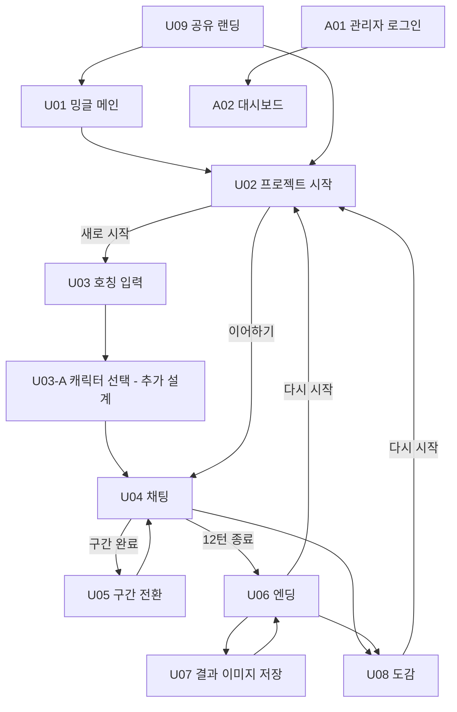
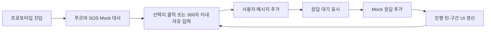
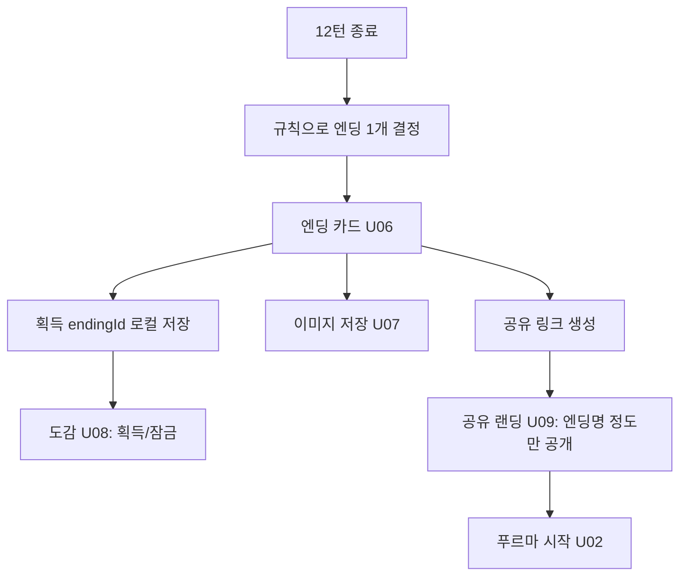
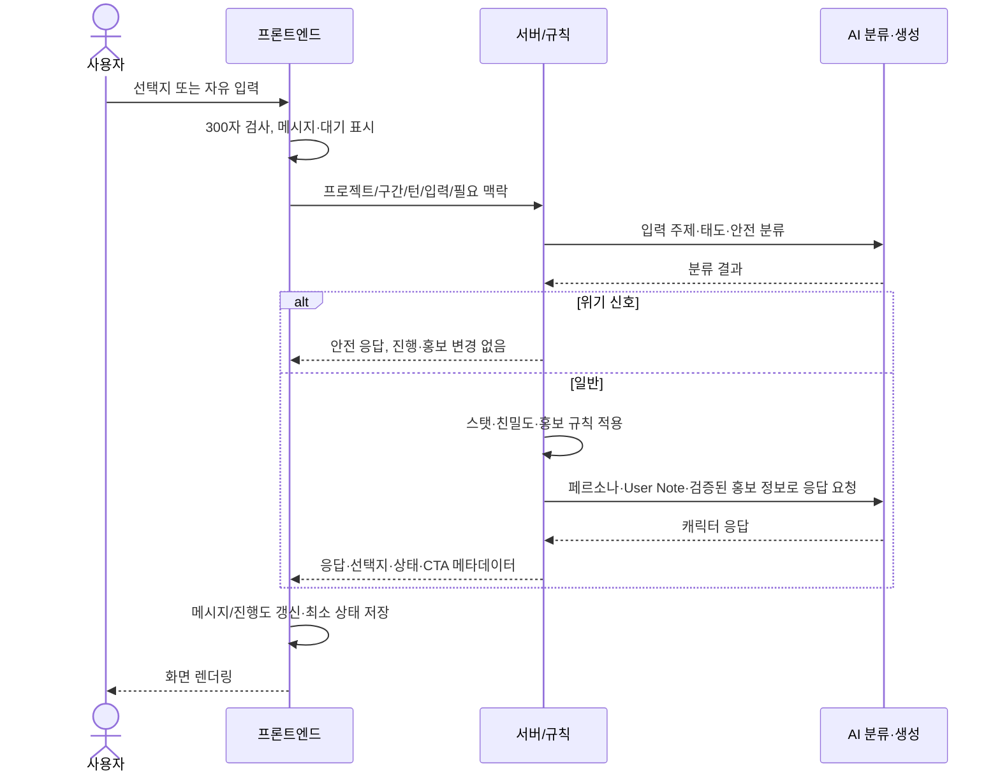

# Mingle 프론트엔드 설계서

> **대상:** 밍글(Mingle) 플랫폼 및 「푸르마와 학교 다니기」 사용자·관리자 화면  
> **상태:** 설계 문서 (구현 완료 보고 아님)  
> **최종 수정:** 2026-10-15  
> **저장 위치:** 저장소 루트 `FRONTEND_DESIGN.md`  
> **기준 문서:** `AGENTS.md`, `mingle-srs.md`, 「푸르마와 학교 다니기: 프로젝트 기획서」 (2026-10-14 v0.2)

## 개정 이력 (Revision History)

| 버전 | 날짜 | 작성/수정 | 변경 내용 |
|---|---|---|---|
| 0.1 | 2026-10-15 | 프론트엔드 박경진 | 밍글 메인·푸르마·관리자 화면, 캠퍼스 다이어리 UI, 컴포넌트·상태·Mock/API 흐름 초안 정리 |
| 0.2 | 2026-10-15 | 프론트엔드 박경진 | PM의 SRS·푸르마 기획서 v0.2와 정합성 반영: 6구간/12턴, 성장·엔딩·홍보 규칙, 화면 ID, 데이터·통계 명세 보완. 푸르마 이미지 협의 완료 및 캐릭터 선택 화면 유지. 중간발표 범위를 **코드로 동작하는 채팅 흐름 프로토타입**으로 변경 |

## 목차

1. [목적·기준·범위](#1-목적기준범위)
2. [요구사항 대응표](#2-요구사항-대응표)
3. [정보 구조·사용자 흐름](#3-정보-구조사용자-흐름)
4. [화면별 설계](#4-화면별-설계)
5. [푸르마 스토리·대화·성장 규칙](#5-푸르마-스토리대화성장-규칙)
6. [홍보·엔딩·도감·공유](#6-홍보엔딩도감공유)
7. [디자인 시스템과 리소스](#7-디자인-시스템과-리소스)
8. [컴포넌트·상태·데이터](#8-컴포넌트상태데이터)
9. [Mock·서버·LLM 연동](#9-mock서버llm-연동)
10. [관리자·통계](#10-관리자통계)
11. [개발 단계·검증](#11-개발-단계검증)
12. [미결정 사항](#12-미결정-사항)

---

## 1. 목적·기준·범위

본 문서는 **PM 요구사항 → 화면/컴포넌트 → Mock 동작 → API 통합 → 검증** 순서로 프론트엔드 구현 기준을 제시한다. 서비스 요구사항 자체는 PM의 `mingle-srs.md`, 푸르마 고유 시나리오·규칙은 「푸르마와 학교 다니기: 프로젝트 기획서」를 따른다. 충돌하는 사항은 팀에서 합의하여 상위 기획과 본 문서를 함께 수정한다.

**표기 구분**
- **기획 기준:** PM 문서에서 정의한 요구사항. 일부 수치와 엔딩은 잠정값이다.
- **확정 전달 사항(2026-10-15):** 푸르마 이미지 관리 부서 협의 완료; 캐릭터 선택 화면 유지; 중간발표는 코드로 작동하는 채팅 흐름 프로토타입만 시연하면 충분.
- **프론트엔드 디자인 제안:** 캠퍼스 다이어리, 네오 브루탈리즘, 시간표·게시판·앨범 표현 등. 필수 게임 기능과 구별한다.
- **미결정:** 스택, 실제 API 계약, 세부 엔딩, 공유 링크 방식 등.

**서비스 구성:** ① 밍글 통합 메인 ② 프로젝트별 사용자 서비스(첫 프로젝트: 푸르마) ③ 프로젝트별 관리자 로그인·대시보드. 공통 UI와 프로젝트별 캐릭터·시나리오·엔딩·홍보 설정·테마를 분리한다. 일반 사용자 로그인/회원가입, 관리자 회원가입, 캐릭터 외형 커스터마이징, 티저 영상 모달은 범위에서 제외한다. 웹·모바일 우선(최소 360px), 데스크톱 대응. 기술 스택(React/Vite 등)은 팀 결정 전 후보일 뿐이다.

**범위 우선순위:** 중간발표의 합의된 최소 산출물은 **동작하는 채팅 프로토타입**이다. SRS의 일반적인 '중간발표 우선순위'와 별개로 이번 시연의 구현 범위를 축소하며, 나머지 화면은 이후 구현 대상이다. 실제 LLM 연동, 완전한 12턴 구현, 관리자 인증·통계는 중간발표의 필수 조건이 아니다.

## 2. 요구사항 대응표

| 영역 | PM 요구사항 | 프론트엔드 설계 대응 | 중간발표 코드 필수 여부 |
|---|---|---|---|
| 메인 | FR-01~04 | 프로젝트 카드, Coming Soon 비활성, 이어하기 표시 | 아니오 |
| 시작 | FR-10~13 | 소개·소요시간·호칭·새로 시작/이어하기·공유 진입 | 아니오 |
| 캐릭터 선택 | **사용자 추가 유지 요청** | 시작 단계의 캐릭터 선택 카드 UI; 현재 푸르마 1종 기준, 외형 커스터마이징 아님 | 아니오 |
| 채팅 | FR-20~27 | **자유 입력 + 선택지 → Mock 응답 → 대화 로그/진행 표시** | **예** |
| 홍보 | FR-30~34 | 규칙에 따라 허용된 키워드 링크/포스터, 노출 제한 | 아니오 (Mock 예시 가능) |
| 엔딩·공유 | FR-40~45 | 엔딩 카드·이미지 저장·도감·공유 랜딩 | 아니오 |
| 페르소나·기억 | FR-50~54 | 푸르마 대사/감정 Mock, 이후 RAG·User Note 연동 | Mock만 |
| 안전 | FR-60~65 | 개인정보 안내, 안전 응답, 실패/재시도 UI | 기초 오류 UI 권장 |
| 관리자 | FR-70~74 | 관리자 로그인·권한별 통계·샘플 표시 | 아니오 |
| 비기능 | NFR-01~11 | 360px 대응, 접근성, 저장 최소화, API 키 서버 보관 | 프로토타입 해당 부분 |

화면 번호는 PM SRS의 `U01~U09`, `A01~A02`를 사용한다. **캐릭터 선택은 PM SRS에 없는 추가 화면 `U03-A`(임시 ID)** 로 표시하며, 팀 확정 전까지 PM의 기존 화면 번호를 변경하지 않는다.

## 3. 정보 구조·사용자 흐름

### 3.1 전체 흐름 (최종 목표)



- `U03-A`는 **사용자 요청으로 유지한 추가 단계**이다. 푸르마만 존재하는 현재 버전에서는 푸르마 카드 하나를 선택하고 진행한다. 다중 캐릭터·학과별 캐릭터나 캐릭터별 스토리 분기는 아직 확정되지 않았다.
- 이어하기는 저장된 선택 캐릭터/상태를 복원해 `U04`로 이동한다. 기록이 없으면 숨기거나 비활성화한다.
- 공유 페이지는 다른 기기에서 열릴 수 있으므로 로컬 저장소에 의존해 엔딩 내용을 조회하지 않는다.

### 3.2 중간발표 최소 실행 흐름



최소한 **버튼을 누르거나 텍스트를 전송했을 때 화면 상태가 실제로 바뀌어야** 한다. Figma 화면 전환만으로 완료했다고 보지 않는다. 전체 6구간을 구현하지 않더라도 **SOS 1개 + 입력/선택지 1회 이상 + 응답 표시 + 진행 변화**를 보여 줄 수 있으면 시연 목표에 부합한다. 6구간·12턴은 최종 설계 데이터 구조에 반영한다.

## 4. 화면별 설계

| 화면 | 주요 요소 | 동작/조건 | 개발 단계 |
|---|---|---|---|
| **U01 통합 메인** | 밍글 브랜딩, 세로 프로젝트 카드, Coming Soon, 이어하기 | Coming Soon 클릭 불가; 카드 → U02 | 이후 |
| **U02 프로젝트 시작** | 푸르마 소개, 1줄 설명, 약 5분(잠정), 새로 시작, 이어하기, 메인 | 새로 시작 → U03, 이어하기 → U04 | 이후 |
| **U03 호칭 입력** | 호칭 필드, 개인정보 입력 지양 안내, 시작 | 학번·실명·연락처 요구 금지; 공란은 기본 호칭 '선배' | 이후 |
| **U03-A 캐릭터 선택** | 캐릭터 카드 그리드, 푸르마 설명, 선택/계속 | 추가 유지 화면. 현재 푸르마 단일 선택; 외형 변경 기능 아님 | 이후 |
| **U04 채팅** | 구간명·진행도·턴 수, 캐릭터, 대화 목록, 선택지, 자유 입력(300자), 전송, User Note, CTA, 도감 | 선택/입력 → 응답; 로딩·오류·재시도. 360px에서도 가로 스크롤 없음 | **중간발표 핵심** |
| **U05 구간 전환** | 다음 구간명, 푸르마 한마디, 계속 | 구간 완료 후 U04 복귀 | 이후 |
| **U06 엔딩** | 엔딩명·설명·이미지, 저장, 공유, 도감, 다시 시작 | 스탯·선택 기반 판정 결과만 렌더링 | 이후 |
| **U07 이미지 저장** | 결과 카드 미리보기, 이미지 다운로드, 링크 복사 | 저장 실패 안내·재시도 | 이후 |
| **U08 엔딩 도감** | 획득 카드·잠금 카드, 재시작 | 재시작해도 획득 내역 유지 | 이후 |
| **U09 공유 랜딩** | 엔딩명 정도, 프로젝트 시작(주), 다른 프로젝트(보조) | 상세 스탯·대화 내용 비공개 | 이후 |
| **A01 관리자 로그인** | ID·비밀번호·오류·이동 | 계정 별도 발급, 회원가입 없음 | 이후 |
| **A02 대시보드** | 프로젝트·기간 선택, KPI 카드, 그래프, 샘플 데이터 표시 | 허용된 프로젝트만; 권한은 서버 검증 | 이후 |

### 4.1 채팅 화면 레이아웃·상태

- **상단:** 현재 구간 이름(예: `3. 중간고사`), 구간 진행도, 현재 턴(`5/12`), 도감·User Note 접근. 좌측 상단 타임라인은 디자인 제안으로 유지.
- **중앙:** 원본 푸르마 캐릭터, 감정 반응(하트·반짝임), 상황/SOS, 캐릭터·사용자 말풍선 구분, 스크롤 대화 목록.
- **하단:** 상황별 선택지 3~4개(장면에 따라 다름), 자유 입력창, 전송 버튼, 글자 수 `0/300`. 자유 입력은 선택지와 별개로 언제나 이용 가능하도록 설계.
- **로딩:** 전송 중 중복 입력 방지, 캐릭터가 입력 중임을 표시. 최종 버전에서 스트리밍 수신 지원.
- **오류:** 네트워크·AI 실패 시 대화 및 진행 상태를 잃지 않고 재시도/대체 응답 제공. 위기 신호에는 장난·홍보·진행 변경 중단.
- **모바일:** 키보드가 입력창을 가리지 않게 처리하고, 대화 영역만 스크롤. 대화문은 읽기 쉬운 2~3문장 단위로 분리.

### 4.2 장면형 UI — 시각 디자인 제안, 필수 게임 기능 아님

| 테마 | 기획에 맞춘 활용 | 제외할 해석 |
|---|---|---|
| 시간표·학사 다이어리 | 6개 스토리 구간을 표현하는 타임라인·챕터 카드 | 실제 수강신청·시간표 관리 |
| 캠퍼스 지도 | 개강 장면의 **정적 배경/소품** 정도 | 자유 이동·지도 선택 게임, 개강 구간의 캠퍼스맵 홍보 링크 |
| 학교 게시판 | 홍보 규칙을 통과한 공식 포스터 카드의 외형 | 모든 구간에서 자동 노출하는 상시 광고판 |
| 졸업 앨범 | 엔딩 도감의 카드 그리드·잠금 표현 | 별도 3D 앨범 엔진 |

푸르마 스토리는 **선배가 신입생 푸르마를 돕는 대화형 육성 게임**이다. 장소 탐험 중심으로 사용자 흐름을 바꾸지 않는다.

## 5. 푸르마 스토리·대화·성장 규칙

### 5.1 캐릭터와 플레이 구조 (PM 기획 v0.2)

- 푸르마: 하늘을 달리던 천마 출신의 영남대 신입생. 사용자는 선배 역할.
- 성격: 활발·호기심·덜렁거림; 기본 존댓말, 친밀도에 따라 장난/반말. 기분 좋을 때 `히히힝`.
- 한 판: **6구간, 12턴, 약 5분(시험 후 조정 가능)**. 실제 학사일정이 아니라 대화 턴으로 시간이 흐른다.
- 각 구간 첫 턴에는 **고정 SOS 대사**를 쓰고 이후 자유 대화와 선택지를 지원한다.

| 구간 | 턴 | SOS·상황 | 홍보 후보 |
|---|---|---|---|
| 1. 개강 | 1~2 | 강의실을 못 찾음, 지각 소동 | 없음 |
| 2. 적응 | 3~4 | 선배에게 학교의 좋은 것 추천 요청 | 추천 주제와 일치할 때 구내식당 메뉴·총동아리연합회 |
| 3. 중간고사 | 5~6 | 공부할 자리·도서관 고민 | 도서관 |
| 4. 축제 | 7~9 | 공연·푸드트럭, 히든 분기 가능 | 없음 |
| 5. 기말·종강 | 10 | 성적·장학금 걱정 | 없음 |
| 6. 방학 계획 | 11~12 | 취업·교환학생·비교과·창업 등 진로 | 선택에 따라 취업처·국제처·YuTopia·창업보육센터 |

### 5.2 한 턴의 처리 순서

1. 현재 구간의 SOS 또는 직전 맥락에 맞는 푸르마 메시지 표시.
2. 사용자가 선택지를 누르거나 자유 입력(최대 300자).
3. 입력을 **주제·태도·안전 여부**로 분류. 분류 실패 시 주제=일상, 태도=중립, **스탯 갱신 없음**.
4. 위기 신호면 안전 응답으로 전환하고 진행·홍보 노출을 멈춤.
5. 일반 입력이면 **AI가 아니라 규칙**으로 스탯·친밀도·선택 기록 갱신.
6. 구간·턴·선택·주제 기반 홍보 노출 규칙 적용.
7. 푸르마 페르소나·현재 상태·User Note를 반영해 응답 생성·검증.
8. 화면과 진행 상태를 갱신하고 브라우저에 필요한 최소 상태 저장.

### 5.3 성장 데이터

| 값 | 범위 | 초기값 | 설명 |
|---|---|---|---|
| 탐구·기술·예술·소통·글로벌 | 각 0~100 | 각 0 | 선택·자유 입력 주제에 따라 증가 |
| 친밀도 | 0~100 | 10 | 말투 및 일부 분기 영향 |
| 선택 기록 | 목록 | 비어 있음 | 구간별 선택 및 엔딩 판정 |

**PM 기획의 잠정 갱신 규칙:** 선택지 해당 스탯 +6·친밀도 +2, 자유 입력 주제 스탯 +3, 응원·도움 태도 친밀도 +3, 중립 +1, 부정 -1, SOS 응답 친밀도 +5. 단 **한 턴 최대 스탯 +6·친밀도 +5**, 동일 주제 3턴 연속이면 3번째부터 스탯 +1, 홍보 클릭 보상 없음. 합산·상한 적용 순서는 팀 규칙 구현 시 검증한다.

친밀도별 말투: 0~24 어색(존댓말), 25~49 편안(장난 섞인 존댓말), 50~100 절친(반말·농담). **스탯 수치창 표시 여부는 미정**이므로 내부 상태는 설계하되 화면의 수치 공개를 확정하지 않는다.

### 5.4 User Note와 안전

- **User Note는 스탯과 별개**의 대화 기억: 호칭, 관심사, 선택, 약속, 반복 주제 등 핵심 항목 **최대 10개**. 구간당 최대 한 번만 자연스럽게 언급.
- 학번·실명·연락처·주소, 민감정보, 타인의 실명·특징, 개인 고민 상세 내용은 저장하지 않는다. 채팅 원문을 통째로 영구 저장하지 않는다.
- 캐릭터 설정 변경·지침 공개 요구, 연애/성적 대화, 욕설·혐오, 실존 인물 묘사, 부정확한 학교 정보는 PM 안전 규칙을 따른다.
- 위기 신호에서는 장난과 홍보를 중단하고 공식 자료를 확인한 상담 안내를 제공한다. 정확한 문구는 PM·담당자 확정 후 사용한다.

## 6. 홍보·엔딩·도감·공유

### 6.1 마케팅 트리거·CTA

홍보는 푸르마의 대화 맥락에서 **공식 링크 키워드** 또는 **공식 포스터 카드**로 나타난다. 노출 판단은 규칙이 우선이며, AI 주제 분류는 보조로만 사용한다.

| 규칙 | 조건 | 표시 |
|---|---|---|
| R1 | 2구간에서 사용자 추천 주제가 후보와 일치 | 구내식당 메뉴·총동아리연합회 링크 |
| R2 | 3구간 학업·도서관·시험 관련 입력 | 도서관 링크 |
| R3 | 6구간 진로 선택 | 취업처·국제처·YuTopia·창업보육센터 중 해당 링크 |
| R4 | 엔딩 결정 | 엔딩과 관련된 공식 링크(있는 경우) |
| R5 | 위기 신호 | **노출 없음** |

- 1·4·5구간은 홍보 없음. **한 턴 최대 1개, 한 구간 최대 2개**. 닫은 콘텐츠는 같은 진행에서 재노출하지 않는다.
- 새 탭으로 열고 클릭 직전 익명 이벤트를 전송한다. 클릭을 강요하거나 보상을 주지 않는다.
- 포스터/링크는 **공개·승인된 실제 자료**만 사용하며 URL·출처·확인일을 관리한다. 공식 자료 확인 전 임의의 행사 정보를 만들지 않는다.
- 프론트는 검증된 콘텐츠 ID/URL을 렌더링한다. 임의 문자열을 HTML로 실행하거나 모든 단어를 자동 링크로 바꾸지 않는다.

### 6.2 엔딩 결정과 카드

- 엔딩은 **홍보 / 재미 / 히든**의 세 층. 한 판이 끝나면 **규칙이 하나를 판정**하고 프론트는 결과를 카드로 렌더링한다. 학과별 엔딩이라는 기존 표현은 폐기한다.
- 판정 순서(PM 안): ① 히든(총장님·CC·교수님) → ② 휴학 → ③ 홍보(6구간 선택 관련·도서관 지박령) → ④ 재미(교환학생·과탑·분야별 변신) → ⑤ 기본 종강 생존.
- 스탯 임계값 20/30/40/50 등은 **잠정**이며 12턴 플레이 테스트 후 조정한다. **첫 구현 엔딩은 1~2개**, 대상은 팀에서 확정. 나머지는 후보 데이터로 관리.
- UI: `EndingCard`에 `endingId`, 제목, 설명, 승인된 이미지, 연결 CTA(있을 때)를 주입한다. 미래 시점(4년·20년·40년 등)은 엔딩별 설정값이지 추가 스토리 챕터가 아니다.
- CC 엔딩은 사용자와 푸르마의 연애가 아니라 **푸르마가 다른 인물과 캠퍼스 커플이 되는 설정**이다.

### 6.3 도감(졸업 앨범형)·이미지 저장·공유



- 도감은 획득/미획득을 구분하고, 미획득 카드는 가린다. 힌트 제공은 미정. **다시 시작해도 획득 도감은 유지**.
- 엔딩 이미지는 기기에 저장할 수 있도록 한다. 공유 링크는 모바일 네이티브 공유 지원 시 활용하고, 미지원 환경은 링크 복사 제공.
- 공유 랜딩에는 **엔딩명 정도만** 표시하고, 프로젝트 시작/밍글 메인으로 이동. 상세 엔딩 내용·개인 대화·스탯은 노출하지 않는다.
- URL 자체에 최소 정보를 담을지 서버에서 식별할지는 미결정. **로컬 저장소만으로 타 기기의 공유 링크를 해석할 수 없다는 점**을 고려해야 한다.

## 7. 디자인 시스템과 리소스

### 7.1 비주얼 방향 — 프론트엔드 제안

**네오 브루탈리즘 70% + 스크랩북 30% / 캠퍼스 다이어리·학교 기록장**을 유지한다.

- 굵은 테두리, 명확한 카드, 오프셋 하드 섀도, 종이 질감·하프톤·테이프·스티커는 선택적으로 사용.
- 하트·반짝임 등 캐릭터 감정 이펙트는 입력/대화 가독성과 모바일 성능을 해치지 않는 범위에서 사용.
- 참고 미연시의 **상호작용 완성도만 참고**하고, 화면 배치·버튼 위치·대화창 비율을 직접 복제하지 않는다.
- 캠퍼스 지도는 장면 소품 수준이며 별도 지도 탐색 기능은 범위에 넣지 않는다. 게시판형 포스터는 홍보 노출 규칙을 따른다.

### 7.2 컬러 (제공된 가이드 기준)

| 명칭 | HEX | 제안 용도 |
|---|---|---|
| YU Blue | `#153974` | 헤더·프레임·주요 텍스트 |
| YU Sky Blue | `#00AACA` | 선택·진행 강조 |
| YU Gray | `#9D9D9C` | 보조 정보 |
| YU Beige | `#EAE3D2` | 종이 배경 |
| Special Green | `#0B612D` | 보조 포인트 |
| Yellow | `#F0EC8F` | 선택지·스티커 강조 |

Black/Gold/Silver는 공식 HEX가 확정되지 않았으므로 임의로 공식 코드라 표시하지 않는다.

### 7.3 푸르마 PNG 활용 — **관리 부서 협의 완료**

- **사용자 최신 전달 사항:** 관리 부서 협의가 완료되어 푸르마 이미지 활용을 전제로 디자인할 수 있다. PM 문서의 '협의 전 이미지 없는 버전' 조건은 이번 최신 확인 사항으로 갱신한다.
- 보유한 원본 PNG(손 흔드는 모습·실험복·졸업 관련 포즈 등)를 활용하고 캐릭터 자체를 임의로 재그리거나 과도하게 변형하지 않는다.
- **협의 완료 ≠ 모든 2차 가공·재배포 자동 허용**이므로, 허용 범위에 관한 세부 가이드가 있다면 그대로 따른다. GitHub 공개 저장소에 PNG를 올릴 수 있는지도 사용·배포 조건에 따라 확인한다.
- 배경·말풍선·스티커·이펙트는 캐릭터 PNG와 별도 레이어로 구성한다.

### 7.4 반응형·접근성

- 최소 **360px**에서 가로 스크롤 없는 레이아웃, 터치 가능한 버튼, 적절한 텍스트 대비·포커스 표시.
- 데스크톱에서는 세로형 플레이 영역을 중심 배치하되 폭과 여백은 Figma에서 결정한다.
- 모바일 키보드, 긴 대사, 스크롤, 모달/사이드바, 로딩·오류·빈 상태를 점검한다.

## 8. 컴포넌트·상태·데이터

### 8.1 컴포넌트 제안 (기술 스택/폴더 구조 확정 아님)

```text
Mingle 공통
├─ ProjectCard / Header / Navigation
├─ Button / Card / Modal / BottomSheet
└─ LoadingState / ErrorState / EmptyState / ProjectTheme

푸르마 사용자
├─ ProjectStart / NicknameInput / CharacterSelection (추가 유지)
├─ ChatScene
│  ├─ ChapterTimeline / TurnCounter / ChapterTransition
│  ├─ CharacterStage / EmotionEffect
│  ├─ MessageList / MessageBubble
│  ├─ ChoiceList / ChatInput / SendButton
│  ├─ UserNotePanel / PromoLink / PosterCard
│  └─ TypingIndicator / RetryNotice
├─ EndingCard / EndingCollection (졸업 앨범형)
└─ SaveImage / ShareLanding

관리자
├─ AdminLogin / ProjectSelector / DateFilter
└─ MetricCard / AnalyticsChart / AnalyticsTable
```

### 8.2 프론트 상태 분리

| 상태 | 주요 필드 예시 | 저장/책임 |
|---|---|---|
| 프로젝트 | `projectId`, `characterId` | 프로젝트 설정·선택 |
| 사용자 | `nickname` | 브라우저 로컬; 실명/학번 요구하지 않음 |
| 진행 | `chapterId`, `turn`, `choices`, `stats`, `affinity` | 브라우저 로컬 복원; **규칙 판정은 신뢰 가능한 로직** |
| 채팅 | `messages`, `isLoading`, `error`, `streamingText` | 화면 상태; 전체 원문 영구 저장 지양 |
| 기억 | `userNotes`(최대 10개) | 로컬 저장, 민감정보 필터링 |
| 홍보 | `contentId`, `shownIds`, `dismissedIds` | 중복·닫기·노출 제한 |
| 엔딩 | `lastEndingId`, `unlockedEndingIds` | 로컬 저장; 다시 시작 시 도감 유지 |
| 관리자 | `authStatus`, `allowedProjects`, `metrics` | 인증·인가 서버 책임 |

- 로컬 저장은 동일 기기·브라우저의 복원만 보장한다. 시크릿 모드/데이터 삭제 시 복원되지 않을 수 있다.
- 분석용 익명 이벤트는 서버로 보내되 **이름·학번·연락처·채팅 원문을 통계에 넣지 않는다**.
- 스탯·엔딩·홍보 규칙은 LLM이 임의로 결정하지 않으며, 프론트는 검증된 결과를 표시한다. Mock 단계에서는 동일 규칙을 임시 데이터로 재현할 수 있다.

## 9. Mock·서버·LLM 연동

### 9.1 단계별 구조



위 그림은 **논리적 역할 분리**다. 분류·규칙·저장의 구체적인 실행 위치 및 API 경계는 팀이 정한다. LLM API 키·관리자 비밀 정보는 클라이언트에 넣지 않는다. 최종적으로 스트리밍과 대체 응답을 지원한다.

### 9.2 중간발표 Mock 응답 예시 — API 계약 아님

```json
{
  "messageId": "mock-001",
  "chapterId": "opening",
  "chapterName": "개강",
  "turn": 1,
  "totalTurns": 12,
  "text": "선배, 강의실이 어딘지 모르겠어요!",
  "emotion": "confused",
  "choices": [
    { "id": "map", "label": "지도 같이 보자" },
    { "id": "ask", "label": "사람들한테 물어보자" },
    { "id": "guide", "label": "내가 데려다줄게" }
  ],
  "promoContent": null
}
```

Mock에서는 선택지 클릭과 자유 입력이 **하나의 메시지 처리 함수**를 거치고, 응답은 미리 준비된 분기별 대사/기본 응답을 표시한다. AI로 생성한 것처럼 설명하지 않는다. 응답 이후 진행 표시를 갱신하며, 오류·빈 입력·300자 초과·중복 클릭을 처리한다. 실제 API 계약 전에는 필드명이 바뀔 수 있다.

### 9.3 API 협의 체크포인트

- 요청: `projectId`, `characterId`, 구간·턴, 입력 타입(선택/자유), `choiceId` 또는 텍스트, 필요한 맥락.
- 응답: 대사, 감정 코드, 선택지, 구간/턴, 안전 상태, 규칙 계산 결과, 승인된 홍보 ID/URL, 엔딩 ID.
- 실패: 타임아웃, 재시도, 중복 요청 방지, 스트리밍 형식, 안전 응답 우선순위.
- 보안: 자유 텍스트를 HTML로 직접 삽입하지 않기, URL 검증, 서버 측 관리자 권한 검증, 요청 빈도·일일 AI 호출 상한.

## 10. 관리자·통계

### 10.1 화면·권한

관리자는 별도 발급받은 ID·비밀번호로 로그인하며 **관리자 회원가입 없음**. A02에서는 서버가 허용한 프로젝트의 데이터만 표시한다. 중간발표 범위 밖이며 Mock 화면을 만들 경우 반드시 **샘플 데이터**라고 표기한다.

### 10.2 SRS 7장 기준 지표

| 지표 | PM 정의 | UI 표현 제안 |
|---|---|---|
| 총 접속 수 | 프로젝트 시작 화면 진입 세션 수 | KPI 카드 |
| 사용자 체류 시간 | 시작부터 마지막 활동까지 | KPI·추이 |
| 구간 도달률 | 해당 구간 진입 세션 / 시작 세션 | 구간별 막대·퍼널 |
| 스토리 완료율 | 엔딩 도달 세션 / 시작 세션 | KPI |
| 홍보 링크 클릭 수 | 키워드 링크·포스터 클릭 횟수 | KPI·콘텐츠 표 |
| 콘텐츠별 관심도 | 콘텐츠별 노출 대비 클릭 | CTR 차트 |
| 엔딩 분포 | 엔딩별 도달 비율 | 막대·분포 |
| 재방문율 | 두 번째 이상 시작한 세션 / 완료 세션 | KPI(정의는 PM 기준) |
| 공유 기능 사용 | 링크 공유·이미지 저장 버튼 사용 횟수 | KPI; 실제 외부 게시 수 아님 |
| 공유 링크 방문 | 링크 오픈 및 시작 버튼 유입 세션 | KPI·추이 |

**이벤트 데이터 최소화:** 익명 세션 ID, 프로젝트 ID, 구간, 턴, 이벤트 타입, 콘텐츠 ID, 시각. 구체적인 이벤트명(`project_view`, `chapter_reached`, `promo_impression`, `promo_click`, `ending_unlocked`, `share_action`, `share_link_view` 등)은 **프론트 제안**이며 API 계약으로 확정하지 않는다. 관심 분야/부서별 분석은 실제 수집 근거와 집계 정의를 추가 협의한다.

## 11. 개발 단계·검증

### 11.1 우선순위와 산출물

| 단계 | 작업 | 완료 판단 |
|---|---|---|
| **1. 중간발표(10/20)** | 채팅 화면 코드 구현, 푸르마 SOS Mock, 선택지·자유 입력, 응답, 턴/진행 표시 | **실제 클릭·입력으로 대화 흐름 시연 가능** |
| 2. 화면 확대 | 메인·시작·호칭·캐릭터 선택·구간 전환, 반응형, 감정 효과 | PM U01~U05 + 추가 U03-A 동선 |
| 3. 규칙·스토리 | 6구간/12턴, 스탯·친밀도, User Note, 홍보 노출 규칙 | 선택·입력별 일관된 상태 갱신 |
| 4. AI 통합 | 서버 API·분류·페르소나·RAG·안전·스트리밍 | 자유 입력의 실제 응답과 실패 복구 |
| 5. 결과·저장·공유 | 엔딩 1~2개 우선, 도감·로컬 복원, 이미지 저장, 공유 랜딩 | 획득·재시작·공유 테스트 |
| 6. 관리자 | 관리자 인증·프로젝트별 권한, 익명 통계, 대시보드 | 서버 권한 검증 및 지표 검증 |
| 7. QA | 모바일·PC·접근성·보안·성능 | 테스트 결과 기록 |

위 단계는 의존성 중심 제안이며, 팀 작업은 병행 가능하다. **중간발표에 관리자/도감/공유/완전한 AI 구현을 요구하지 않는다.**

### 11.2 중간발표 채팅 프로토타입 체크리스트

- [ ] 실제 코드 실행으로 채팅 화면이 열린다.
- [ ] 푸르마 SOS Mock 메시지가 표시된다.
- [ ] 선택지 버튼 클릭 시 사용자 메시지와 다음 푸르마 대사가 표시된다.
- [ ] 자유 입력 후 전송 시 동일한 대화 흐름으로 응답이 표시된다.
- [ ] 빈 입력·300자 초과를 처리한다.
- [ ] 전송 중 상태와 중복 전송 방지가 동작한다.
- [ ] 현재 구간·턴 또는 진행도가 입력 후 갱신된다.
- [ ] 좁은 모바일 폭에서도 말풍선·입력창이 정상 표시된다.
- [ ] Mock 데이터임을 발표에서 명확히 밝힌다.

### 11.3 최종 QA 체크리스트

- [ ] 6구간/12턴 진행, 전환, 이어하기가 일관되게 동작한다.
- [ ] 분류 실패·위기 신호 시 스탯/홍보 노출 규칙이 지켜진다.
- [ ] 한 턴·구간 홍보 상한 및 닫은 카드 재노출 방지가 동작한다.
- [ ] 선택 기록·스탯으로 엔딩을 판정하고 도감은 재시작해도 유지된다.
- [ ] 로컬 저장 삭제/재방문/공유 링크의 다른 기기 접속을 검증한다.
- [ ] User Note에서 민감정보를 저장하지 않는다.
- [ ] 관리자 권한은 서버에서 검증하고 통계에 채팅 원문을 수집하지 않는다.
- [ ] API 실패·스트리밍·모바일 키보드·긴 대사·접근성을 점검한다.
- [ ] 승인된 캐릭터·홍보 리소스의 이용 조건을 지킨다.
- [ ] 구현하지 않은 기능·실행하지 않은 테스트를 완료로 표시하지 않는다.

## 12. 미결정 사항

| 항목 | 현재 상태/확인 필요 |
|---|---|
| 프로젝트 이름 | `푸르마와 학교 다니기`와 `푸르마 키우기` 중 공식 명칭 팀 결정 필요 |
| 캐릭터 선택 | **화면 유지 확정(사용자 요청)**. 현재 푸르마 단일 카드; 추가 캐릭터·스토리 영향은 미정 |
| 푸르마 이미지 | **관리 부서 협의 완료(사용자 확인)**. 허용된 가공·배포 범위는 제공된 가이드 준수 |
| 중간발표 | **동작하는 채팅 흐름 코드 프로토타입으로 범위 확정(사용자 확인)** |
| 프론트·서버·DB·AI | 수행계획서의 React/FastAPI/PostgreSQL/Gemini는 제안; 팀 확정 전 |
| 엔딩 | 첫 구현 1~2개 종류, 엔딩명·시점, 스탯 임계값 조정 필요 |
| 상태창 | 스탯 수치 표시 여부 미정; 구간명·진행도·턴 수는 표시 |
| 도감 | 미획득 엔딩 힌트 제공 여부 미정 |
| 공유 | URL 최소 정보 vs 서버 식별 방식, 이미지 저장 구현 방식 미정 |
| 관리자 | 계정 발급·프로젝트별 권한, 이벤트 수집/보관 정책 미정 |
| 안전 | 위기 시 공식 상담 안내 문구·링크 확인 필요 |
| 학교 홍보 자료 | 후보 프로그램의 공식 URL·출처·확인일 검증 필요 |
| 시각 디자인 | 네오 브루탈리즘/스크랩북과 장면형 표현은 프론트 제안, 최종 디자인 검토 필요 |
| 협업 | 실제 저장소 구조·브랜치/PR·테스트 명령은 팀 지침 확인 |

---

## 유지 관리 원칙

- PM 요구사항이 바뀌면 **개정 이력 → 요구사항 대응표 → 사용자 흐름 → 화면·상태·API → 검증 항목** 순으로 함께 수정한다.
- 기획 기준과 디자인 제안, 구현 완료 상태를 혼동하지 않는다. 구현·테스트 결과는 PR/이슈 등으로 별도 기록한다.
- `AGENTS.md` 및 팀 합의된 협업 규칙을 따른다. 명시적인 요청 없이 자동으로 Commit·Push·Merge하지 않는다.
