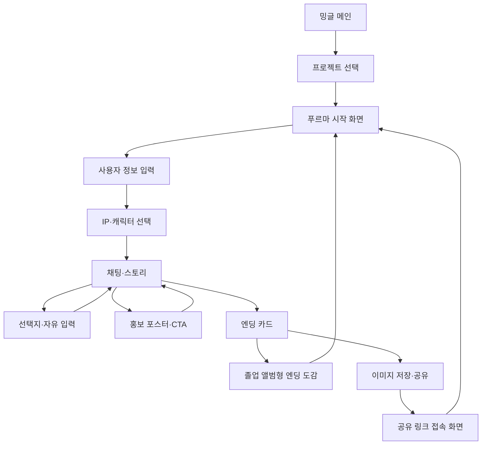
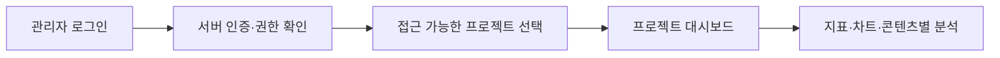
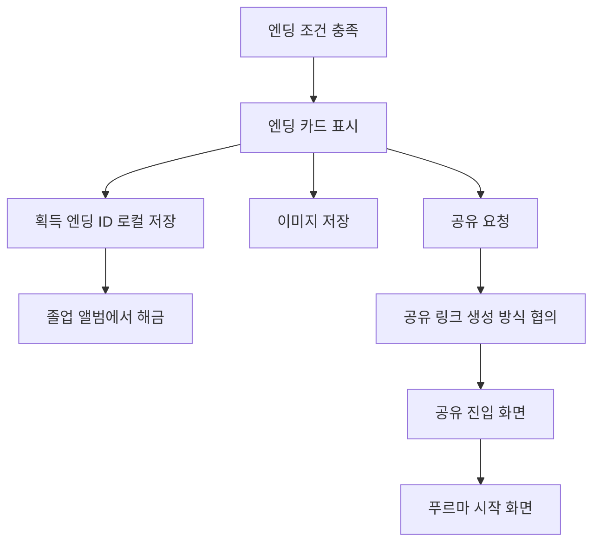
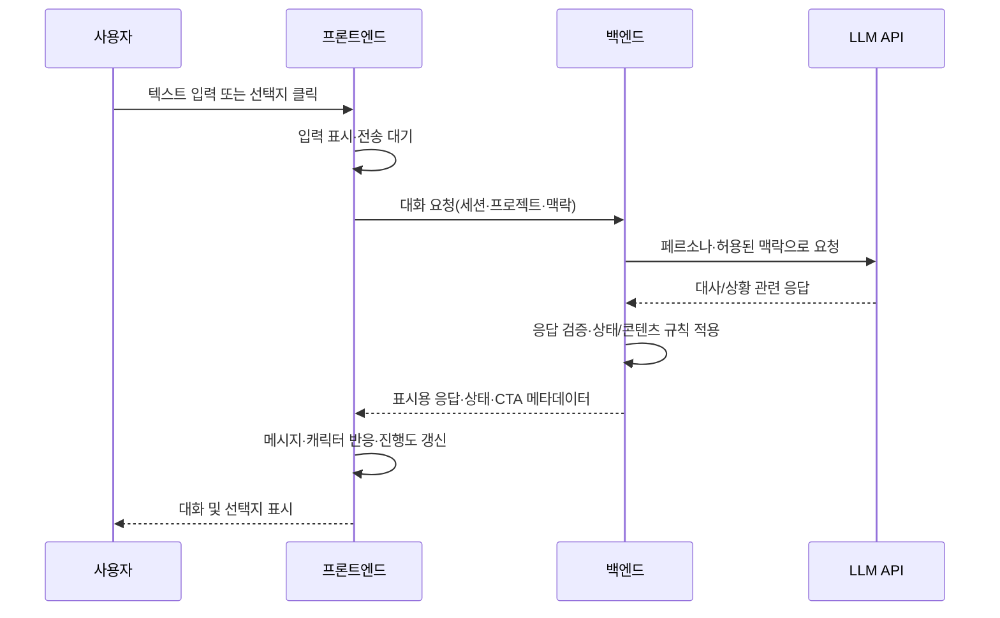

# Mingle 프론트엔드 설계서

> **대상:** 밍글(Mingle) 통합 서비스 및 첫 번째 프로젝트 「푸르마와 학교 다니기」  
> **문서 상태:** 설계안 · 팀 검토용 (구현 완료 문서 아님)  
> **최종 정리:** 2026-10-15  
> **권장 경로:** `docs/Mingle_Pruma_Frontend_Design.md`

## 목차

1. [문서 목적과 설계 기준](#1-문서-목적과-설계-기준)
2. [서비스 구조 및 요구사항](#2-서비스-구조-및-요구사항)
3. [정보 구조와 사용자 흐름](#3-정보-구조와-사용자-흐름)
4. [화면별 설계](#4-화면별-설계)
5. [푸르마 UI·디자인 시스템](#5-푸르마-ui디자인-시스템)
6. [컴포넌트와 상태 설계](#6-컴포넌트와-상태-설계)
7. [프론트엔드–백엔드·LLM 연동 흐름](#7-프론트엔드백엔드llm-연동-흐름)
8. [로컬 저장·공유·통계 설계](#8-로컬-저장공유통계-설계)
9. [개발 단계와 검증](#9-개발-단계와-검증)
10. [미확정 사항과 협의 항목](#10-미확정-사항과-협의-항목)

---

## 1. 문서 목적과 설계 기준

이 문서는 **기획 요구사항 → 화면 설계 → 컴포넌트 분리 → Mock 검증 → API 연동 → 최종 기능 통합**으로 이어지는 프론트엔드 설계 흐름을 팀에 공유하기 위한 것이다.

- **공통 개발 지침 우선:** 팀의 `AGENTS.md` 또는 이에 준하는 공통 지침과 충돌하면 공통 지침을 우선한다.
- **요구사항과 구현 구분:** 본 문서의 화면·기능은 설계 대상이지 구현 완료 항목이 아니다.
- **미확정 기술 보류:** React, Vite, CSS Modules 등의 사용은 **후보**이며 팀 확정 전까지 강제하지 않는다.
- **Mobile First:** 사용자 서비스는 모바일 세로 화면을 우선 설계하고 데스크톱에서는 반응형으로 제공한다.
- **공통/프로젝트 분리:** 밍글 공통 기능과 푸르마 전용 테마·장면·캐릭터·콘텐츠를 구분한다.
- **프론트/서버 분리:** AI 제공자 키, 관리자 권한 검증, 신뢰할 수 있는 이벤트 판정은 클라이언트에 두지 않는다.

### 표기 기준

| 구분 | 의미 |
| --- | --- |
| **요구사항** | 팀이 공유한 서비스 개발 범위. 구현 완료를 의미하지 않음 |
| **디자인 제안** | 본 문서에서 권장하는 UI/UX 방식. 최종 디자인은 팀 검토 필요 |
| **협의 필요** | 사양·담당·기술 선택이 확정되지 않아 구현 전 결정이 필요한 항목 |

## 2. 서비스 구조 및 요구사항

### 2.1 서비스 구성

| 영역 | 목적 | 주요 기능 |
| --- | --- | --- |
| **밍글 통합 메인** | 홍보 프로젝트 탐색 | 프로젝트별 카드, 프로젝트 진입, Coming Soon |
| **푸르마 사용자 서비스** | 캐릭터 대화와 스토리·홍보 경험 | 시작, 정보 입력, 캐릭터 선택, 채팅, 선택지, 진행도, CTA, 엔딩, 공유, 엔딩 도감 |
| **B2B 관리자 영역** | 프로젝트 성과 확인 | 관리자 로그인, 프로젝트별 권한, 주요 지표·차트·필터 |

현재 프로젝트 예시는 **「푸르마와 학교 다니기」** 및 **Coming Soon** 카드이다. 향후 프로젝트 추가를 고려하되 불필요한 범용화는 피한다.

### 2.2 프론트엔드 요구사항 추적표

| ID | 영역 | 구현 대상 | 단계 제안 |
| --- | --- | --- | --- |
| FE-01 | 메인 | 밍글 브랜드·세로 스크롤 프로젝트 카드·진입 | 중간발표 |
| FE-02 | 공통 | 프로젝트별 테마·컬러·캐릭터 리소스 적용 | 중간발표 기초 |
| FE-03 | 사용자 | IP/캐릭터 카드 그리드 및 선택 화면 | 중간발표 UI |
| FE-04 | 사용자 | 자유 입력 채팅·대화 분기 선택지 | 중간발표 Mock → 최종 API |
| FE-05 | 사용자 | 감정 이펙트·유저노트(사이드바/모달) | 중간발표 기초 → 최종 보완 |
| FE-06 | 사용자 | 좌측 상단 타임라인·스토리 진행 상태 | 중간발표 |
| FE-07 | 사용자 | 키워드 링크·포스터 카드·CTA | 중간발표 Mock → 최종 이벤트 연결 |
| FE-08 | 사용자 | 학과별/엔딩별 결과 카드·이미지 저장 | 중간발표 UI → 최종 기능 |
| FE-09 | 사용자 | 공유 링크 접속·참여 유도·시작 이동 | 중간발표 UI → 최종 공유 구현 |
| FE-10 | 사용자 | 획득/미획득 엔딩 도감 | 중간발표 UI → 최종 로컬 저장 |
| FE-11 | 관리자 | 로그인 및 프로젝트별 접근 화면 | 중간발표 UI → 최종 서버 인증 |
| FE-12 | 관리자 | 체류 시간·마케팅 트리거 도달률·관심분야 분포 | 중간발표 Mock → 최종 통계 |
| FE-13 | 관리자 | 구간 도달률·시작/완주율·링크 클릭·부서별 통계 | 중간발표 Mock → 최종 통계 |
| FE-14 | 관리자 | 공유 수·공유 링크 방문 수 | 중간발표 Mock → 최종 통계 |
| FE-15 | 공통 | 버튼·카드·모달·반응형·로딩/오류/빈 상태 | 단계별 적용 |

**제외/제약:** 일반 사용자 로그인·회원가입 없음, 관리자 회원가입 없음, 캐릭터 외형 커스터마이징 제외. 티저 영상 모달은 현 범위에서 제외한다.

## 3. 정보 구조와 사용자 흐름

### 3.1 사용자 서비스 정보 구조



- **공통 동선:** 대화가 진행되는 동안 유저노트와 진행 타임라인에 접근할 수 있도록 설계한다.
- **선택지 + 자유 입력:** 같은 대화 처리 흐름으로 연결한다. 선택지가 없어도 자유 입력 가능하도록 고려한다.
- **홍보 노출:** 반드시 별도 화면으로 전환할 필요는 없다. 대화 안의 카드 또는 장면형 게시판으로 제공할 수 있다.
- **엔딩과 도감:** 엔딩 카드는 단일 결과물이며, 졸업 앨범은 엔딩 카드들의 수집·열람 화면이다.

### 3.2 관리자 흐름



관리자 계정은 별도 발급하며 회원가입 화면을 두지 않는다. 실제 인증 및 프로젝트 접근 권한은 **서버에서 검증**한다.

### 3.3 화면 설계 흐름

1. **정보 구조 확정:** 어떤 화면이 필요한지, 각 화면이 어떻게 연결되는지 정리한다.
2. **핵심 채팅 화면 우선:** 모바일에서 대화 로그·입력창·선택지·캐릭터 표현이 충돌하지 않는지 검토한다.
3. **공통 요소 추출:** 버튼·카드·채팅 말풍선·포스터 카드·모달·타임라인 등을 공통화한다.
4. **장면형 테마 적용:** 시간표·지도·게시판·졸업 앨범을 공통 동작 위의 화면 템플릿으로 적용한다.
5. **Mock 프로토타입:** 입력/응답/장면 전환/엔딩/통계의 사용자 흐름을 실제 API 없이 검증한다.
6. **API 계약 협의·연동:** 팀에서 정한 데이터 형식과 오류 처리 규칙에 따라 서버 연결을 교체한다.
7. **모바일·접근성·성능 검증:** 키보드, 긴 대화, 네트워크 오류, 이미지 로딩, 공유 등 예외 상황을 확인한다.

## 4. 화면별 설계

### 4.1 밍글 통합 메인

- **구성:** 브랜드 헤더 → 세로 스크롤 프로젝트 카드 → 프로젝트 진입.
- **카드:** 이미지, 프로젝트명, 한 줄 설명, 이용 가능/Coming Soon 상태.
- **원칙:** 공통 브랜드 중심의 간결한 디자인. 프로젝트별 카드는 각 테마를 썸네일로 드러낼 수 있음.

### 4.2 푸르마 시작·정보 입력·캐릭터 선택

| 화면 | 주요 UI | 비고 |
| --- | --- | --- |
| 시작 | 타이틀, 대표 푸르마, 시작, 이어하기·도감 진입(해당 기능 구현 시) | 게임 분위기 전달 |
| 정보 입력 | 닉네임 등 진행에 필요한 최소 정보 | 일반 사용자 로그인 없음 |
| 캐릭터 선택 | 작품·캐릭터 카드 그리드, 설명, 선택 버튼 | 학과별 캐릭터 구성·선택 조건은 협의 필요 |

캐릭터 선택 화면은 초기 요구사항에 포함되어 있으나, 실제 선택 가능한 캐릭터 수와 스토리 분기 방식은 팀 협의 후 확정한다.

### 4.3 채팅·스토리: 최우선 화면

**필수 구성**

- 진행 구간/타임라인(좌측 상단 배치 요구사항 반영)
- 캐릭터 표시 및 감정 반응(하트·반짝임 등)
- 사용자 메시지와 캐릭터 메시지의 명확한 구분
- 스크롤 가능한 대화 영역
- 자유 텍스트 입력창과 전송 버튼
- 상황별 선택지 버튼
- 유저노트 진입 버튼과 사이드바 또는 모달
- 홍보 포스터 카드와 CTA가 삽입될 수 있는 공간
- 응답 대기, API 오류, 재시도, 빈 상태 안내

**레이아웃 원칙:** 세로형 모바일 게임 화면을 기본으로 하되, **캐릭터 영역·대화 로그·선택지·입력창의 공간 배분은 Figma 검증 후 확정**한다. 대화가 길어질 때 화면 전체가 늘어나지 않도록 스크롤 영역을 분리한다. 모바일 키보드가 열려도 입력창이 가려지지 않도록 검증한다.

**중요:** 기존 비주얼 노벨의 하단 고정형 대화창을 그대로 복제하지 않는다. 캠퍼스 기록장/메모지 표현을 사용하되 입력과 대화 읽기가 우선이다.

### 4.4 장면형 UI 템플릿 — 디자인 제안

장면의 독창성을 위한 변형 UI이며, **각각 별도 게임 엔진이나 복잡한 시스템을 만드는 것으로 해석하지 않는다.**

| 템플릿 | 사용 시점 | 화면 구성 | 구현 범위 제안 |
| --- | --- | --- | --- |
| **시간표형** | 첫 등교·챕터 시작 | 오늘의 일정, 방문 예정 장소, 현재 진행 구간 | 데이터 기반 일정 카드·챕터 표시 |
| **캠퍼스 지도형** | 장소 선택·탐방 | 간략한 지도/장소 이미지와 선택 지점 | 정해진 장소 선택 → 해당 대화 장면 이동 |
| **학교 게시판형** | 홍보 이벤트·콘텐츠 노출 | 실제 홍보 포스터 이미지, 공지 카드, CTA | 제공된 홍보 이미지 그대로 사용, 링크/상세 보기 |
| **졸업 앨범형** | 엔딩 이후·수집 화면 | 획득한 엔딩 카드와 잠금 카드 | 카드 그리드·상세 보기·재열람 |

- **시간표:** 실제 강의 시간표 관리 기능이 아니라 스토리의 챕터/일정 연출이다.
- **지도:** 자유 이동·실시간 지도 기능이 아니라 정해진 장소 선택 UI이다.
- **게시판:** AI가 새 홍보 포스터를 생성하는 기능이 아니다. 승인된 학교 홍보 이미지 및 링크를 사용한다.
- **앨범:** 3D 페이지 넘김은 필수 요구사항이 아니다. 가벼운 카드 그리드부터 구현한다.

### 4.5 마케팅 트리거·CTA

- 대화 맥락에 맞는 **특정 키워드 링크**, **포스터 카드**, **이벤트·장소 CTA**를 제공한다.
- 링크 클릭을 강제하거나 홍보를 위해 대화를 막지 않는다.
- 키워드 링크는 무조건적인 문자열 치환보다 **검증된 링크 메타데이터**를 응답과 분리해 렌더링하는 방식을 권장한다.
- 실제 포스터·링크는 승인된 자료를 사용한다. 허위 학교 정보가 노출되지 않도록 한다.
- 도달·노출·클릭의 의미와 집계 이벤트는 백엔드·관리자 담당자와 합의한다.

### 4.6 엔딩 카드·졸업 앨범·공유



- **엔딩 카드:** 학과별·엔딩별 이미지/타이틀/간단한 결과를 표시하는 개별 결과물. 저장·공유의 기본 단위.
- **졸업 앨범:** 엔딩 카드 컬렉션. 획득 카드는 열람 가능, 미획득 카드는 `?`/잠금 표시.
- **동일 데이터 재사용:** `endingId` 등을 기준으로 카드와 앨범을 연결하여 중복 구현을 피한다.
- **공유 진입:** 전체 엔딩 내용을 공개하지 않고 프로젝트 소개·참여 유도·시작 버튼 중심으로 구성한다.
- **공유 링크 주의:** 로컬 저장소만으로는 다른 기기에서 결과를 식별할 수 없다. 공개용 식별자 생성·서버 저장 여부 또는 URL에 담을 최소 정보의 범위는 **협의 필요**이다.

### 4.7 B2B 관리자 대시보드

| 분류 | 주요 지표 | UI 제안 |
| --- | --- | --- |
| 이용 현황 | 총 접속 수, 체류 시간, 시작/완주율 | 요약 카드·추이 차트 |
| 스토리 | 구간 도달률, 마케팅 트리거 도달률 | 구간별 막대/퍼널형 시각화 |
| 홍보 | 링크 클릭 수, 콘텐츠별 관심도, 부서별 통계 | 막대 차트·표 |
| 참여/공유 | 공유 기능 사용 수, 공유 링크 방문 수 | 요약 카드·추이 차트 |
| 관심 분야 | 관심분야 분포 | 분포 차트 |

- 관리자 로그인을 요구하며 프로젝트별 접근 권한을 서버에서 검증한다.
- **지표 정의(예: 방문·시작·완주·체류 시간의 분모/집계 단위)는 미확정**이며 개발 전에 합의한다.
- 대시보드 Mock 데이터를 실제 통계로 오인하지 않도록 표시한다.
- 개인정보 및 채팅 원문을 불필요하게 수집하지 않는다.

## 5. 푸르마 UI·디자인 시스템

### 5.1 스타일 방향 — 디자인 제안

**네오 브루탈리즘 70% + 스크랩북 30%**, 테마는 **캠퍼스 다이어리·학교 기록장**.

- 굵은 테두리, 대비가 분명한 카드, 선명한 버튼, 오프셋 그림자.
- 종이 텍스처, 도트 인쇄, 메모지·테이프·스티커는 부분적으로 적용.
- 캐릭터는 **기존 푸르마 PNG 원본 그대로** 활용. 전면 픽셀화·과도한 질감 처리 지양.
- 브라키오 미연시는 **플레이 경험의 완성도**만 참고. 화면 구획·선택지 위치·대화창 비율·전환 연출의 직접적인 복제는 지양.
- 시각적으로 장식적이어도 자유 입력 채팅의 사용성을 해치지 않도록 한다.

### 5.2 제공된 컬러

| 이름 | HEX | 활용 예시 |
| --- | --- | --- |
| YU Blue | `#153974` | 주요 프레임, 헤더, 텍스트·강조 |
| YU Sky Blue | `#00AACA` | 인터랙션 강조, 일부 배경 |
| YU Gray | `#9D9D9C` | 보조 정보 |
| YU Beige | `#EAE3D2` | 종이/배경 톤 |
| Special Green | `#0B612D` | 보조 포인트 |
| Yellow | `#F0EC8F` | 선택지·스티커 강조 |

> Black·Gold·Silver의 HEX 값은 현재 확정되지 않았으므로 임의의 학교 공식색 코드로 표기하지 않는다. 실제 텍스트/테두리 색은 대비 검증 후 별도 정의한다.

### 5.3 반응형·접근성 원칙

- 모바일 기본 프레임은 **설계 예시로 390×844px**를 사용 가능하나, 고정 해상도에만 의존하지 않는다.
- 데스크톱에서는 중앙 정렬된 제한 너비의 게임 화면을 고려한다. **최대 너비 수치는 Figma 검토 후 확정**.
- 터치 영역, 폰트 크기, 대비, 키보드 포커스, 스크린리더 레이블 등 기본 접근성을 확인한다.
- 애니메이션은 과도하지 않게 설계하며 동작 감소 환경을 고려한다.
- 텍스처는 낮은 강도로 사용하고 문자 영역의 가독성을 우선한다.

## 6. 컴포넌트와 상태 설계

### 6.1 컴포넌트 분리 제안

```text
공통 UI (밍글)
├─ Header / Navigation
├─ Button / Card / Modal / BottomSheet
├─ LoadingState / ErrorState / EmptyState
└─ ProjectCard / ThemeProvider(또는 테마 설정)

푸르마 사용자 UI
├─ Start / UserInfo / CharacterSelection
├─ ChatScene
│  ├─ Timeline / ProgressIndicator
│  ├─ CharacterStage / ReactionEffect
│  ├─ MessageList / MessageBubble
│  ├─ ChoiceList / ChatInput
│  ├─ PosterCard / CTA
│  └─ UserNote
├─ SceneTemplate (시간표·지도·게시판)
├─ EndingCard / GraduationAlbum
└─ ShareLanding

관리자 UI
├─ AdminLogin / ProjectSelector
├─ SummaryMetrics / AnalyticsChart
└─ AnalyticsTable / Filter
```

이는 **논리적 구성 예시**이며 실제 폴더명·프레임워크 구조를 강제하지 않는다.

### 6.2 화면 상태 분리

| 상태 | 예시 데이터 | 관리 원칙 |
| --- | --- | --- |
| 세션/사용자 | 임시 닉네임, 프로젝트 ID | 로그인 없는 흐름 |
| 스토리 | 장면 ID, 진행 구간, 선택 내역 | 서버·클라이언트 책임 분담 협의 |
| 채팅 | 화면 표시 메시지, 전송 상태 | 저장 범위 최소화, 장문 대화 성능 고려 |
| 반응 | 감정 코드, 이펙트 상태 | 사전에 정의한 화면 표현으로 매핑 |
| 홍보 | 포스터 ID, URL, CTA 타입 | 승인된 콘텐츠만 렌더링 |
| 엔딩 | 획득한 엔딩 ID, 마지막 결과 | 로컬 저장·복원 고려 |
| 관리자 | 로그인 여부, 허용 프로젝트, 지표 | 서버 인증·인가 필수 |

## 7. 프론트엔드–백엔드·LLM 연동 흐름

### 7.1 권장 흐름



- AI API 키는 **백엔드에만** 보관한다.
- 클라이언트는 LLM의 자유 형식 텍스트를 HTML로 직접 실행하지 않는다.
- 캐릭터 감정·장면·CTA 등은 **정해진 enum/ID/검증된 데이터**로 표현하는 것이 안전하다.
- 엔딩 결정과 광고 링크 노출 등 신뢰성이 필요한 규칙은 프론트 단독 판단 또는 무검증 LLM 결과에 의존하지 않는다.

### 7.2 Mock 응답 형식 예시 — **API 계약 아님**

```json
{
  "messageId": "msg_demo_01",
  "text": "오늘은 어디부터 가볼까?",
  "emotion": "happy",
  "sceneId": "campus_intro",
  "progress": { "chapterId": "day_01", "step": 2 },
  "choices": [
    { "id": "library", "label": "도서관으로 가자" },
    { "id": "student_center", "label": "학생회관에 가자" }
  ],
  "contentCards": []
}
```

**계약 전 협의 항목:** 요청·응답 스키마, 세션 식별자, 선택지 처리, 오류 코드, 재시도/중복 전송, 스트리밍 여부, 타임아웃, 대화 기억 방식, 상태 저장 주체, CTA 이벤트 형식.

### 7.3 UI 상태 처리

- **전송 중:** 중복 전송 방지, 대기 표시.
- **응답 실패:** 이전 대화 보존, 오류 안내 및 재시도.
- **선택지 없음:** 자유 입력 동작 유지.
- **잘못된 감정/장면 코드:** 기본 이미지·기본 장면으로 안전하게 표시.
- **긴 응답/긴 대화:** 스크롤과 카드 높이 안정성 검증.
- **홍보 콘텐츠 누락:** 빈 카드 대신 안전한 기본 대화 흐름 유지.

## 8. 로컬 저장·공유·통계 설계

### 8.1 사용자 데이터

- 닉네임, 최소한의 설정, 진행 상태, 획득 엔딩 등은 **브라우저 로컬 저장 중심**으로 검토한다.
- 로컬 저장소는 같은 기기·브라우저에서의 복원에 유효하며 **기기 간 동기화는 보장하지 않는다**.
- 채팅 원문 전체를 무조건 영구 보관하지 않는다. LLM에 필요한 대화 맥락 유지 방식은 별도 설계한다.
- 브라우저 데이터 삭제·시크릿 모드 등의 경우 진행 내용이 사라질 수 있음을 사용자에게 안내할 수 있다.

### 8.2 공유 기능

- **이미지 저장:** 엔딩 카드 화면을 이미지 파일로 내려받는 방식 검토.
- **네이티브 공유:** 지원 브라우저에서 공유 기능 활용 검토. 미지원 환경에서는 URL 복사 등 대안 제공.
- **공유 링크:** 서버 저장형 공개 토큰 또는 제한된 URL 정보 등 구현 방식과 공개 범위 협의 필요.
- **스포일러 제한:** 공유 진입 페이지는 전체 엔딩을 바로 공개하기보다 프로젝트 소개·시작 유도 중심.

### 8.3 통계 이벤트 — 초안

| 이벤트 후보 | 목적 | 주의 사항 |
| --- | --- | --- |
| `project_view` | 프로젝트 접속 수 | 재방문·중복 집계 정의 필요 |
| `play_start` | 플레이 시작률 | 분모 기준 협의 |
| `chapter_reached` | 구간 도달률 | 구간 ID 표준화 |
| `trigger_shown` | 트리거 도달률 | 노출 기준 합의 |
| `cta_clicked` | 홍보 링크 클릭 수 | 콘텐츠·부서 ID 정합성 |
| `ending_unlocked` | 완주·엔딩 분포 | 엔딩 ID 표준화 |
| `share_clicked` | 공유 시도/사용 수 | 실제 완료 여부와 구분 |
| `share_link_visited` | 공유 유입 수 | 링크 식별 기준·개인정보 최소화 |

이름과 형식은 **제안이며 확정 이벤트 규격이 아니다**. 체류 시간·관심분야 분포·부서별 통계는 정의와 수집 방법을 팀과 먼저 합의한다. 불필요한 개인정보·채팅 원문은 통계에 포함하지 않는다.

## 9. 개발 단계와 검증

### 9.1 단계별 설계·구현 계획

| 단계 | 주요 작업 | 산출물/검증 기준 |
| --- | --- | --- |
| **0. 현황 확인** | 저장소·공통 지침·역할·기술 후보 확인 | 실제 구조와 미확정 사항 목록 |
| **1. 정보 설계** | 화면 목록, 동선, 장면 구분, 데이터 흐름 | 화면 흐름도·와이어프레임 |
| **2. Figma 핵심 화면** | 채팅 화면 먼저, 시작·선택·엔딩 템플릿 | 모바일 가독성·레이아웃 검토 |
| **3. 공통 UI + Mock** | 카드·버튼·모달·대화·선택지·CTA·도감 | 클릭 가능한 중간발표 프로토타입 |
| **4. 프로젝트 UI 확대** | 시간표·지도·게시판·졸업 앨범 시각 연출 | 공통 컴포넌트 재사용 확인 |
| **5. 서버·LLM 연결** | API 계약·전송/응답·오류·상태 관리 | 자유 입력/선택지 실연동 검증 |
| **6. 최종 기능** | 진행 복원·엔딩 저장·공유·통계·관리자 인증 | 사용자·관리자 E2E 동선 검증 |
| **7. 품질 점검** | 모바일/PC, 접근성, 오류, 성능, 개인정보 | 테스트 결과 및 미해결 항목 |

각 단계 일정과 담당자는 팀에서 결정한다. 3~4단계의 일부는 병행 가능하다.

### 9.2 중간발표 범위

- 밍글 메인, 푸르마 시작·정보 입력·캐릭터 선택, 채팅·선택지, 홍보 카드·CTA, 엔딩 카드·도감, 공유 진입, 관리자 로그인·대시보드의 **화면과 사용자 흐름** 우선.
- 시간표·지도·게시판은 필요한 장면만 **정적/Mock 형태**로 시연 가능.
- 실제 LLM 연동·관리자 인증·통계 수집이 아직 없다면 발표에서 **미구현/Mock**임을 명시.

### 9.3 최종 구현 시 우선순위

1. **LLM 자유 입력 채팅 및 선택지 처리의 안정성**
2. **캐릭터 페르소나와 스토리 상태 관리**
3. **진행 저장·복원, 엔딩 조건 및 획득 처리**
4. **홍보 콘텐츠·CTA 및 통계 이벤트 연결**
5. **엔딩 이미지 저장·공유와 졸업 앨범 완성**
6. **관리자 인증·권한·대시보드 실데이터 연결**
7. **장면 연출·애니메이션·질감 완성도 개선**

실제 병렬 작업과 순서는 팀 역할·의존관계에 따라 조정 가능하다.

### 9.4 검증 체크리스트

- [ ] 모바일 화면에서 텍스트 입력 시 키보드가 전송 버튼을 가리지 않는가?
- [ ] 자유 입력과 선택지가 동일한 스토리 상태를 안전하게 갱신하는가?
- [ ] 긴 대화·긴 메시지·느린 네트워크에서도 레이아웃이 유지되는가?
- [ ] 로딩·오류·재시도·빈 데이터 화면이 준비되어 있는가?
- [ ] 승인되지 않은 링크·이미지·HTML을 그대로 렌더링하지 않는가?
- [ ] 엔딩 카드와 졸업 앨범이 동일한 엔딩 데이터를 사용하는가?
- [ ] 로컬 저장·재접속 복원 및 데이터 삭제 상황을 확인했는가?
- [ ] 공유 링크 방문 시 불필요한 사용자 정보가 공개되지 않는가?
- [ ] 관리자 권한은 서버에서 검증되는가?
- [ ] Mock 데이터와 실제 통계가 명확히 구분되는가?
- [ ] 브라키오 미연시의 배치·버튼 구성을 직접 복제하지 않았는가?
- [ ] 실제 수행하지 않은 테스트를 성공한 것처럼 기록하지 않았는가?

## 10. 미확정 사항과 협의 항목

| 항목 | 현재 상태 | 협의 대상/결정 내용 |
| --- | --- | --- |
| 프론트엔드 기술 스택 | 미확정 | React/Vite 등 후보 검토, 실제 도입 결정 |
| 백엔드·DB·배포 | 미확정 | 프레임워크, 저장 책임, 배포 환경 |
| 프로젝트별 테마 구현 | 설계 제안 | 스타일 토큰/리소스 관리 방식 |
| 실제 캐릭터 선택 범위 | 미확정 | 학과별 캐릭터 수, 분기 영향 |
| 스토리·엔딩 판정 | 미확정 | 장면 ID, 선택지, 엔딩 조건, 검증 주체 |
| LLM 모델·API 계약 | 미확정 | 응답 형식, 맥락·메모리, 오류·스트리밍 |
| 감정 이펙트 규칙 | 디자인 제안 | 감정 코드, 캐릭터 이미지 매핑 |
| 장면형 템플릿 | 디자인 제안 | 시간표·지도·게시판 적용 위치 및 개수 |
| 졸업 앨범 스타일 | 디자인 제안 | 엔딩 카드 아트워크·잠금 상태·레이아웃 |
| 공유 링크 구현 | 미확정 | 공개 정보·식별자·서버 사용 여부 |
| 통계 스키마 | 미확정 | 이벤트·집계 기준·관심분야 정의 |
| 관리자 인증·권한 | 원칙만 확정 | 계정 발급/인증 수단/프로젝트 접근 |
| 디자인 최종 승인 | 미확정 | 모바일 프레임·컴포넌트·질감·아이콘 검토 |
| 협업 규칙 | 미확정 | 브랜치, PR, 리뷰, 테스트/빌드 명령 |

---

## 유지 관리 원칙

- 새로운 기능이 확정되면 **요구사항 추적표 → 사용자 흐름 → 해당 화면 → 상태·API → 검증 항목** 순서로 업데이트한다.
- 구현 완료 여부는 별도 작업 이력/PR/테스트 결과로 관리하며, 이 문서의 기획 항목을 구현 완료로 해석하지 않는다.
- 프로젝트 공통 지침이 바뀌면 본 문서의 충돌 항목을 재검토한다.
- AI 코딩 에이전트는 명시적인 요청 없이 Commit·Push·Merge를 수행하지 않는다.
