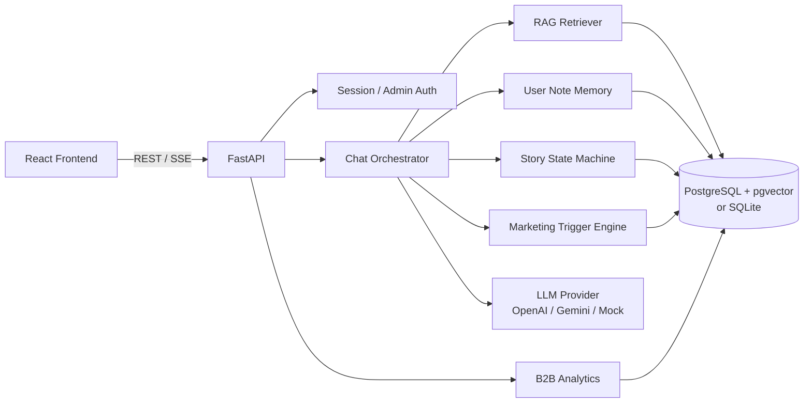

# Persona Companion AI — Backend

「캐릭터 IP를 이용한 LLM 기반 페르소나 컴패니언 AI」의 백엔드입니다.
FastAPI + SQLAlchemy(async) + PostgreSQL/pgvector(SQLite 폴백) + OpenAI/Gemini(또는 오프라인 Mock)로
기획서의 핵심 기능을 모두 API로 제공합니다.

- **Persona + RAG** 기반 캐릭터 대화
- **User Note**(장기 기억) 추출·저장·압축 및 다음 턴 반영
- **상태 기반** 관계·스토리 분기, 멀티엔딩
- **Marketing Trigger / CTA** 판정·노출·클릭 추적
- 비회원 **개인 코드** 발급/복구 (회원가입 없이 대화 이어하기)
- **B2B Dashboard** 집계 API
- **SSE 스트리밍** 응답
- **가드레일**(부적절 응답 차단)

---

## 1. 빠른 시작

### 1-1. 로컬 실행 (SQLite, API 키 없이 바로 가능)

```powershell
cd backend
python -m venv .venv
.\.venv\Scripts\Activate.ps1
pip install -r requirements.txt

copy .env.example .env      # 선택: 값을 바꾸려면 편집
uvicorn app.main:app --reload
```

- Swagger UI: <http://localhost:8000/docs>
- ReDoc: <http://localhost:8000/redoc>
- 헬스체크: <http://localhost:8000/api/health>

API 키가 없으면 자동으로 **Mock LLM**으로 동작합니다. 대화·RAG·기억·트리거·대시보드
전체 흐름을 오프라인에서 시연할 수 있습니다.

> 서버는 시작 시 LLM 공급자의 임베딩/생성 API를 1회 확인합니다.
> 키가 잘못되었거나 모델이 폐기된 경우 **자동으로 Mock 모드로 대체**되어 서버는 계속 기동되며,
> `/api/health`의 `llm.degraded` 값으로 확인할 수 있습니다.

### 1-2. 실제 LLM 사용

`.env`에 키를 넣으면 `LLM_PROVIDER=auto`가 자동으로 해당 공급자를 선택합니다.

```dotenv
OPENAI_API_KEY=sk-...
# 또는
GEMINI_API_KEY=...
```

### 1-3. PostgreSQL + pgvector (Docker)

```powershell
docker compose up --build
```

- API: <http://localhost:8000>
- DB: `localhost:5432` (`companion` / `companion`)
- `DATABASE_URL=postgresql+asyncpg://companion:companion@db:5432/companion`로 자동 설정됩니다.
- 기동 시 `CREATE EXTENSION IF NOT EXISTS vector` 후 테이블을 생성합니다.

### 1-4. 테스트

```powershell
.\.venv\Scripts\python -m pytest -q
```

23개 테스트가 SQLite + Mock LLM으로 실행됩니다(외부 API 불필요).

### 1-5. 라이브 스모크 테스트

서버를 띄운 뒤, 실제 LLM으로 전체 흐름(세션 발급 → 3턴 SSE 대화 → 트리거/CTA 노출 → 클릭 추적 → 코드 복구 → 관리자 대시보드)을 한 번에 확인합니다.

```powershell
.\.venv\Scripts\python scripts\smoke_live.py
# 다른 서버/페르소나:
.\.venv\Scripts\python scripts\smoke_live.py --base-url http://127.0.0.1:8000 --persona kai-orbital7
```

- 실제 API를 호출하므로 과금이 발생할 수 있습니다.
- 관리자 계정은 `.env`의 `ADMIN_EMAIL` / `ADMIN_PASSWORD`를 사용합니다.
- Gemini가 간헐적으로 500을 반환하면 공급자 계층에서 최대 3회까지 자동 재시도합니다.

---

## 2. 아키텍처



### 한 턴의 처리 순서 (`app/services/chat_service.py`)

1. 세션 소유권 확인 → 페르소나/관계 상태/User Note/최근 메시지 로드
2. RAG 검색 (질문 + 직전 사용자 발화 기반, 코사인 유사도 상위 K)
3. 관계 상태 갱신 + 스토리 이벤트/엔딩 판정 → 이번 턴 연출 지침 생성
4. Persona Prompt + RAG + User Note + 관계 단계 + 연출 지침으로 시스템 프롬프트 구성
5. LLM 호출(일반/스트리밍)
6. 가드레일 검사(금지 주제 차단)
7. 메시지 저장
8. User Note 추출·저장(규칙 기반 + 선택적 LLM)
9. Marketing Trigger 판정 → CTA 노출 기록

---

## 3. 기획서 기능 → 구현 매핑

| 기획 기능 | 구현 위치 | API |
|---|---|---|
| AI Persona 선택 및 대화 | `Persona`, `Conversation` | `GET /api/personas`, `POST /api/conversations` |
| RAG 기반 Persona 대화 | `services/rag.py`, `persona_prompt.py` | `POST /api/chat` |
| User Note 기반 맥락 저장 | `services/memory.py` | `GET /api/notes` |
| 개인 코드 기반 저장/이어하기 | `usersessions`, `sessions.py` | `POST /api/sessions`, `/api/sessions/resume` |
| 관계·분기·멀티엔딩 | `services/story.py`, `StoryEventDef`, `EndingDef` | `GET /api/conversations/{id}/timeline` |
| Marketing Trigger / CTA | `services/marketing.py` | 응답의 `triggers[]`, `POST /api/marketing/events` |
| 결과/엔딩 공유 | `ShareCard` | `POST /api/conversations/{id}/share`, `GET /api/share/{slug}` |
| 관리자 로그인 / Dashboard | `admin.py`, `services/analytics.py` | `POST /api/admin/login`, `GET /api/admin/overview` |
| 실시간 대화 | SSE | `POST /api/chat/stream` |
| Persona Guardrail | `chat_service.apply_guardrail` | 응답 필드 `guardrail_triggered` |

---

## 4. API 요약

> 인증
> - **사용자(비회원)**: `X-Personal-Code: COMP-XXXX-XXXX`
> - **관리자**: `Authorization: Bearer <JWT>`

### 시스템 / 페르소나

| Method | Path | 설명 |
|---|---|---|
| GET | `/api/health` | 상태·LLM 공급자·DB 종류 확인 |
| GET | `/api/personas` | 페르소나 목록 |
| GET | `/api/personas/{slug}` | 페르소나 상세(세계관/말투/지식 수) |

### 세션 / 개인 코드

| Method | Path | 설명 |
|---|---|---|
| POST | `/api/sessions` | 세션 생성 + **개인 코드 1회 반환** (선택: `persona_slug`로 대화 즉시 생성) |
| POST | `/api/sessions/resume` | 개인 코드로 세션·대화 복구 |
| GET | `/api/sessions/me` | 현재 세션 |
| GET | `/api/sessions/me/conversations` | 내 대화 목록 |

### 대화 / 채팅

| Method | Path | 설명 |
|---|---|---|
| POST | `/api/conversations` | 새 대화 시작(인사 메시지 자동 생성) |
| GET | `/api/conversations` | 대화 목록 |
| GET | `/api/conversations/{id}` | 대화 상세(상태·엔딩 포함) |
| PATCH | `/api/conversations/{id}` | 제목 변경 |
| GET | `/api/conversations/{id}/messages` | 메시지 목록 |
| GET | `/api/conversations/{id}/state` | 관계 단계/호감도/챕터 |
| GET | `/api/conversations/{id}/timeline` | 스토리 이벤트·엔딩 이력 |
| POST | `/api/chat` | 메시지 전송 → 응답 + 상태 + CTA |
| POST | `/api/chat/stream` | SSE 스트리밍 (`token` → `final`) |

### 기억 / 마케팅 / 공유

| Method | Path | 설명 |
|---|---|---|
| GET | `/api/notes` | User Note 목록 (`persona_id` 필터) |
| POST | `/api/notes` | 수동 추가/갱신 |
| PATCH | `/api/notes/{id}` | 수정 |
| DELETE | `/api/notes/{id}` | 삭제 |
| POST | `/api/marketing/events` | CTA 클릭 기록 |
| GET | `/api/conversations/{id}/marketing-events` | 노출/클릭 이력 |
| POST | `/api/conversations/{id}/share` | 공유 카드 생성(재사용) |
| GET | `/api/share/{slug}` | 공유 카드 공개 조회(조회수 증가) |

### 관리자

| Method | Path | 설명 |
|---|---|---|
| POST | `/api/admin/login` | JWT 발급 |
| GET | `/api/admin/me` | 관리자 정보 |
| GET | `/api/admin/overview?days=14` | KPI·페르소나별·트리거별·일별·단계 분포 |
| GET | `/api/admin/conversations` | 최근 대화 목록 |
| GET | `/api/admin/conversations/{id}` | 전체 메시지/기억/마케팅 이벤트 |
| GET | `/api/admin/triggers` | 트리거 성과 |
| GET | `/api/admin/triggers/{id}/config` | 트리거 조건/CTA 설정 |

---

## 5. 사용 예시

### 5-1. 세션 생성 → 대화
```bash
curl -X POST http://localhost:8000/api/sessions \
  -H "Content-Type: application/json" \
  -d '{"persona_slug":"seo-harin"}'
# → {"personal_code":"COMP-AB12-CD34", "conversation": {...}}
```

```bash
curl -X POST http://localhost:8000/api/chat \
  -H "Content-Type: application/json" \
  -H "X-Personal-Code: COMP-AB12-CD34" \
  -d '{"conversation_id":"<id>","message":"내 이름은 지우야. 달빛 정원에 데려가줘."}'
```

응답에는 다음이 포함됩니다.
```json
{
  "reply": "...",
  "state": {"turn_count": 3, "affinity": 21, "stage": "호기심", "chapter": 2},
  "sources": [{"title": "장소 · 달빛 정원과 별의 회랑", "score": 0.42}],
  "triggers": [{"name": "달빛 굿즈 관심", "cta": {"label": "...", "cta_type": "coupon"}}],
  "story_events": [{"code": "moonlight_garden", "title": "달빛 정원으로의 초대"}],
  "ending": null,
  "notes_updated": [{"key": "이름", "value": "지우"}]
}
```

### 5-2. SSE 스트리밍 (프론트엔드)

`EventSource`는 POST를 지원하지 않으므로 `fetch` 스트림을 사용합니다.

```ts
const res = await fetch(`${API}/api/chat/stream`, {
  method: "POST",
  headers: {
    "Content-Type": "application/json",
    "X-Personal-Code": personalCode,
  },
  body: JSON.stringify({ conversation_id, message }),
});

const reader = res.body!.getReader();
const decoder = new TextDecoder();
let buffer = "";

while (true) {
  const { value, done } = await reader.read();
  if (done) break;
  buffer += decoder.decode(value, { stream: true });
  const events = buffer.split("\n\n");
  buffer = events.pop() ?? "";
  for (const block of events) {
    const event = /event: (.+)/.exec(block)?.[1];
    const data = JSON.parse(/data: (.+)/.exec(block)?.[1] ?? "{}");
    if (event === "token") appendToken(data.token);
    if (event === "final") applyChatMeta(data); // state, triggers, ending ...
    if (event === "error") showError(data.detail);
  }
}
```

---

## 6. 데이터 / 시드

`app/db/seed.py`에 데모용 페르소나 3종이 포함되어 있습니다.

| slug | 이름 | 유형 | 컨셉 |
|---|---|---|---|
| `seo-harin` | 서하린 | IP(판타지 소설) | 궁정 마법사, 봉인된 서, 멀티엔딩 |
| `kai-orbital7` | 카이 | IP(SF 드라마) | 파일럿, 미확인 신호, 기억 상실 |
| `momo-dalkom` | 모모 | 브랜드 | 디저트 브랜드 마스코트, B2B 마케팅 데모 |

각 페르소나에 RAG 지식(6~7문서), 스토리 이벤트(3~5개), 엔딩(2~3개),
Marketing Trigger(3개)와 CTA가 포함됩니다.

시드를 다시 만들려면 `backend/data/app.db`를 삭제하고 재시작하세요.
(Postgres는 `docker compose down -v`)

### 지식 문서 추가

```powershell
# docs.json: [{"title": "...", "content": "...", "category": "world"}]
.\.venv\Scripts\python -m scripts.ingest --persona seo-harin --file ..\docs.json
```

`title` 기준으로 upsert(재임베딩)됩니다.

---

## 7. 설정

`backend/.env` (전체 예시는 `.env.example`)

| 변수 | 기본값 | 설명 |
|---|---|---|
| `DATABASE_URL` | SQLite `data/app.db` | `postgresql+asyncpg://...`로 변경 시 pgvector 사용 |
| `SECRET_KEY` | dev 값 | **운영 시 반드시 32바이트 이상으로 변경** |
| `ADMIN_EMAIL` / `ADMIN_PASSWORD` | `admin@companion.ai` / `admin1234!` | 시드 시 관리자 계정 생성 |
| `LLM_PROVIDER` | `auto` | `auto/openai/gemini/mock` |
| `OPENAI_API_KEY` | – | 있으면 OpenAI 사용 |
| `GEMINI_API_KEY` | – | OpenAI 키가 없을 때 Gemini 사용 |
| `GEMINI_CHAT_MODEL` | `gemini-3.8-flash` | Gemini 채팅 모델 |
| `GEMINI_EMBEDDING_MODEL` | `gemini-embedding-001` | Gemini 임베딩 모델 |
| `EMBEDDING_DIM` | `1536` | DB 스키마와 일치해야 함(변경 시 재시드 필요) |
| `RAG_TOP_K` | `4` | 검색 문서 수 |
| `MEMORY_LLM_ENABLED` | `false` | LLM 기반 기억 추출 추가 |
| `TRIGGER_LLM_JUDGE_ENABLED` | `false` | Trigger LLM 판정 추가 |
| `SEED_ON_STARTUP` | `true` | 시작 시 시드 |

---

## 8. 설계 메모

- **RAG 이중 경로**: PostgreSQL이면 pgvector `cosine_distance`, SQLite면 파이썬 코사인 계산.
  Mock 임베딩은 한국어 문자 bigram feature hashing으로 어휘 기반 검색이 가능합니다.
- **임베딩 차원 고정**: 공급자별 차원 차이는 `fit_embedding()`이 pad/truncate + L2 정규화로 흡수합니다.
- **개인 코드 보안**: 코드 원문은 저장하지 않고 `SHA-256(SECRET_KEY + code)` 해시만 저장합니다.
  분실 시 재발급만 가능하며, API 응답에서는 최초 1회만 노출됩니다.
- **조건 DSL**: `all/any/none` + `turn_gte`, `affinity_gte`, `stage_in`, `keyword_any`, `flag` 등.
  스토리 이벤트·엔딩·트리거가 동일한 평가기를 공유합니다(`services/conditions.py`).
- **트리거 중복 방지**: `cooldown_turns`, `max_fires`로 대화 중 반복 노출을 제한합니다.
- **관계 단계**: 호감도 0/15/40/70 기준 `낯섦 → 호기심 → 친밀 → 각별`.
- **User Note 압축**: 노트가 임계치를 넘으면 중요도가 낮은 항목을 `기타_기억`으로 병합합니다.
- **임베딩 공급자 변경 주의**: LLM 공급자(OpenAI ↔ Gemini ↔ Mock)를 바꾸면 임베딩 공간이 달라집니다.
  기존 DB에는 이전 공급자의 벡터가 남아 있으므로, 공급자를 바꾼 뒤에는 DB를 재시드하세요.
  (`backend/data/app.db` 삭제 후 재시작, Postgres는 `docker compose down -v`)

---

## 9. 폴더 구조

```
backend/
├── app/
│   ├── main.py                 # FastAPI 엔트리포인트
│   ├── core/                   # 설정·보안·로깅
│   ├── db/
│   │   ├── base.py             # 엔진/세션/초기화
│   │   ├── models.py           # ORM 모델 14종
│   │   └── seed.py             # 데모 페르소나/지식/이벤트/트리거
│   ├── schemas/                # Pydantic 스키마
│   ├── api/
│   │   ├── deps.py             # 세션/관리자 인증
│   │   └── routes/             # 도메인별 라우터
│   └── services/
│       ├── llm/                # 공급자 추상화 (openai/gemini/mock)
│       ├── rag.py              # 임베딩·색인·검색
│       ├── memory.py           # User Note 추출/압축
│       ├── story.py            # 상태 머신·이벤트·엔딩
│       ├── marketing.py        # Trigger/CTA
│       ├── chat_service.py     # 턴 오케스트레이션
│       └── analytics.py        # Dashboard 집계
├── scripts/ingest.py           # 지식 문서 추가 CLI
├── scripts/reindex.py          # 임베딩 재생성 CLI
├── scripts/smoke_live.py       # 라이브 E2E 스모크 테스트
├── tests/                      # pytest 23개
├── docker-compose.yml
├── Dockerfile
└── requirements.txt
```

---

## 10. 운영 체크리스트

- [ ] `SECRET_KEY`, `ADMIN_PASSWORD` 변경
- [ ] `CORS_ORIGINS`에 실제 프론트 도메인만 허용
- [ ] PostgreSQL + pgvector 사용 (`DATABASE_URL`)
- [ ] LLM API 키를 서버 환경변수/시크릿으로 주입
- [ ] 리버스 프록시에서 SSE 버퍼링 비활성화 (`X-Accel-Buffering: no` 이미 설정)
- [ ] 요청 로그/에러 모니터링, LLM 비용·지연 추적 (`/api/admin/overview`의 `avg_latency_ms`)
