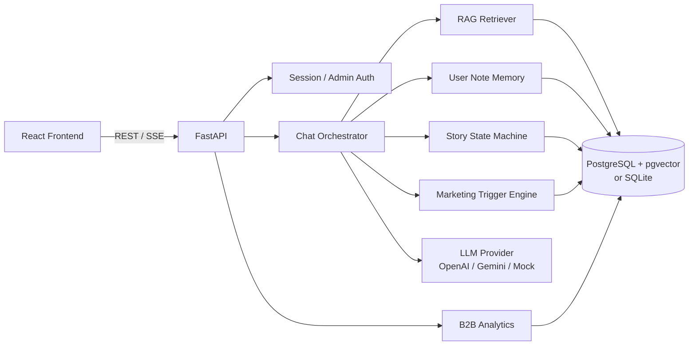

# Persona Companion AI — Backend

「캐릭터 IP를 이용한 LLM 기반 페르소나 컴패니언 AI」의 백엔드입니다.
FastAPI + SQLAlchemy(async) + PostgreSQL/pgvector(SQLite 폴백) + OpenAI/Gemini(또는 오프라인 Mock)로
기획서의 핵심 기능을 모두 API로 제공합니다.

- **Persona + RAG** 기반 캐릭터 대화
- **User Note**(장기 기억) 추출·저장·압축 및 다음 턴 반영
- **상태 기반** 관계·스토리 분기, 멀티엔딩
- **Marketing Trigger / CTA** 판정·노출·클릭 추적
- 비회원 **개인 코드** 발급/복구 (회원가입 없이 대화 이어하기)
- **B2B Dashboard** 집계 API
- **SSE 스트리밍** 응답
- **가드레일**(부적절 응답 차단)

---

## 1. 빠른 시작

### 1-1. 로컬 실행 (SQLite, API 키 없이 바로 가능)

```powershell
cd backend
python -m venv .venv
.\.venv\Scripts\Activate.ps1
pip install -r requirements.txt

copy .env.example .env      # 선택: 값을 바꾸려면 편집
uvicorn app.main:app --reload
```

- Swagger UI: <http://localhost:8000/docs>
- ReDoc: <http://localhost:8000/redoc>
- 헬스체크: <http://localhost:8000/api/health>

API 키가 없으면 자동으로 **Mock LLM**으로 동작합니다. 대화·RAG·기억·트리거·대시보드
전체 흐름을 오프라인에서 시연할 수 있습니다.

> 서버는 시작 시 LLM 공급자의 임베딩/생성 API를 1회 확인합니다.
> 키가 잘못되었거나 모델이 폐기된 경우 **자동으로 Mock 모드로 대체**되어 서버는 계속 기동되며,
> `/api/health`의 `llm.degraded` 값으로 확인할 수 있습니다.

### 1-2. 실제 LLM 사용

`.env`에 키를 넣으면 `LLM_PROVIDER=auto`가 자동으로 해당 공급자를 선택합니다.

```dotenv
OPENAI_API_KEY=sk-...
# 또는
GEMINI_API_KEY=...
```

### 1-3. PostgreSQL + pgvector (Docker)

```powershell
docker compose up --build
```

- API: <http://localhost:8000>
- DB: `localhost:5432` (`companion` / `companion`)
- `DATABASE_URL=postgresql+asyncpg://companion:companion@db:5432/companion`로 자동 설정됩니다.
- 기동 시 `CREATE EXTENSION IF NOT EXISTS vector` 후 테이블을 생성합니다.

### 1-4. 테스트

```powershell
.\.venv\Scripts\python -m pytest -q
```

23개 테스트가 SQLite + Mock LLM으로 실행됩니다(외부 API 불필요).

### 1-5. 라이브 스모크 테스트

서버를 띄운 뒤, 실제 LLM으로 전체 흐름(세션 발급 → 3턴 SSE 대화 → 트리거/CTA 노출 → 클릭 추적 → 코드 복구 → 관리자 대시보드)을 한 번에 확인합니다.

```powershell
.\.venv\Scripts\python scripts\smoke_live.py
# 다른 서버/페르소나:
.\.venv\Scripts\python scripts\smoke_live.py --base-url http://127.0.0.1:8000 --persona kai-orbital7
```

- 실제 API를 호출하므로 과금이 발생할 수 있습니다.
- 관리자 계정은 `.env`의 `ADMIN_EMAIL` / `ADMIN_PASSWORD`를 사용합니다.
- Gemini가 간헐적으로 500을 반환하면 공급자 계층에서 최대 3회까지 자동 재시도합니다.

---

## 2. 아키텍처



### 한 턴의 처리 순서 (`app/services/chat_service.py`)

1. 세션 소유권 확인 → 페르소나/관계 상태/User Note/최근 메시지 로드
2. RAG 검색 (질문 + 직전 사용자 발화 기반, 코사인 유사도 상위 K)
3. 관계 상태 갱신 + 스토리 이벤트/엔딩 판정 → 이번 턴 연출 지침 생성
4. Persona Prompt + RAG + User Note + 관계 단계 + 연출 지침으로 시스템 프롬프트 구성
5. LLM 호출(일반/스트리밍)
6. 가드레일 검사(금지 주제 차단)
7. 메시지 저장
8. User Note 추출·저장(규칙 기반 + 선택적 LLM)
9. Marketing Trigger 판정 → CTA 노출 기록

---

## 3. 기획서 기능 → 구현 매핑

| 기획 기능 | 구현 위치 | API |
|---|---|---|
| AI Persona 선택 및 대화 | `Persona`, `Conversation` | `GET /api/personas`, `POST /api/conversations` |
| RAG 기반 Persona 대화 | `services/rag.py`, `persona_prompt.py` | `POST /api/chat` |
| User Note 기반 맥락 저장 | `services/memory.py` | `GET /api/notes` |
| 개인 코드 기반 저장/이어하기 | `usersessions`, `sessions.py` | `POST /api/sessions`, `/api/sessions/resume` |
| 관계·분기·멀티엔딩 | `services/story.py`, `StoryEventDef`, `EndingDef` | `GET /api/conversations/{id}/timeline` |
| Marketing Trigger / CTA | `services/marketing.py` | 응답의 `triggers[]`, `POST /api/marketing/events` |
| 결과/엔딩 공유 | `ShareCard` | `POST /api/conversations/{id}/share`, `GET /api/share/{slug}` |
| 관리자 로그인 / Dashboard | `admin.py`, `services/analytics.py` | `POST /api/admin/login`, `GET /api/admin/overview` |
| 실시간 대화 | SSE | `POST /api/chat/stream` |
| Persona Guardrail | `chat_service.apply_guardrail` | 응답 필드 `guardrail_triggered` |

---

## 4. API 요약

> 인증
> - **사용자(비회원)**: `X-Personal-Code: COMP-XXXX-XXXX`
> - **관리자**: `Authorization: Bearer <JWT>`

### 시스템 / 페르소나

| Method | Path | 설명 |
|---|---|---|
| GET | `/api/health` | 상태·LLM 공급자·DB 종류 확인 |
| GET | `/api/personas` | 페르소나 목록 |
| GET | `/api/personas/{slug}` | 페르소나 상세(세계관/말투/지식 수) |

### 세션 / 개인 코드

| Method | Path | 설명 |
|---|---|---|
| POST | `/api/sessions` | 세션 생성 + **개인 코드 1회 반환** (선택: `persona_slug`로 대화 즉시 생성) |
| POST | `/api/sessions/resume` | 개인 코드로 세션·대화 복구 |
| GET | `/api/sessions/me` | 현재 세션 |
| GET | `/api/sessions/me/conversations` | 내 대화 목록 |

### 대화 / 채팅

| Method | Path | 설명 |
|---|---|---|
| POST | `/api/conversations` | 새 대화 시작(인사 메시지 자동 생성) |
| GET | `/api/conversations` | 대화 목록 |
| GET | `/api/conversations/{id}` | 대화 상세(상태·엔딩 포함) |
| PATCH | `/api/conversations/{id}` | 제목 변경 |
| GET | `/api/conversations/{id}/messages` | 메시지 목록 |
| GET | `/api/conversations/{id}/state` | 관계 단계/호감도/챕터 |
| GET | `/api/conversations/{id}/timeline` | 스토리 이벤트·엔딩 이력 |
| POST | `/api/chat` | 메시지 전송 → 응답 + 상태 + CTA |
| POST | `/api/chat/stream` | SSE 스트리밍 (`token` → `final`) |

### 기억 / 마케팅 / 공유

| Method | Path | 설명 |
|---|---|---|
| GET | `/api/notes` | User Note 목록 (`persona_id` 필터) |
| POST | `/api/notes` | 수동 추가/갱신 |
| PATCH | `/api/notes/{id}` | 수정 |
| DELETE | `/api/notes/{id}` | 삭제 |
| POST | `/api/marketing/events` | CTA 클릭 기록 |
| GET | `/api/conversations/{id}/marketing-events` | 노출/클릭 이력 |
| POST | `/api/conversations/{id}/share` | 공유 카드 생성(재사용) |
| GET | `/api/share/{slug}` | 공유 카드 공개 조회(조회수 증가) |

### 관리자

| Method | Path | 설명 |
|---|---|---|
| POST | `/api/admin/login` | JWT 발급 |
| GET | `/api/admin/me` | 관리자 정보 |
| GET | `/api/admin/overview?days=14` | KPI·페르소나별·트리거별·일별·단계 분포 |
| GET | `/api/admin/conversations` | 최근 대화 목록 |
| GET | `/api/admin/conversations/{id}` | 전체 메시지/기억/마케팅 이벤트 |
| GET | `/api/admin/triggers` | 트리거 성과 |
| GET | `/api/admin/triggers/{id}/config` | 트리거 조건/CTA 설정 |

---

## 5. 사용 예시

### 5-1. 세션 생성 → 대화
```bash
curl -X POST http://localhost:8000/api/sessions \
  -H "Content-Type: application/json" \
  -d '{"persona_slug":"seo-harin"}'
# → {"personal_code":"COMP-AB12-CD34", "conversation": {...}}
```

```bash
curl -X POST http://localhost:8000/api/chat \
  -H "Content-Type: application/json" \
  -H "X-Personal-Code: COMP-AB12-CD34" \
  -d '{"conversation_id":"<id>","message":"내 이름은 지우야. 달빛 정원에 데려가줘."}'
```

응답에는 다음이 포함됩니다.
```json
{
  "reply": "...",
  "state": {"turn_count": 3, "affinity": 21, "stage": "호기심", "chapter": 2},
  "sources": [{"title": "장소 · 달빛 정원과 별의 회랑", "score": 0.42}],
  "triggers": [{"name": "달빛 굿즈 관심", "cta": {"label": "...", "cta_type": "coupon"}}],
  "story_events": [{"code": "moonlight_garden", "title": "달빛 정원으로의 초대"}],
  "ending": null,
  "notes_updated": [{"key": "이름", "value": "지우"}]
}
```

### 5-2. SSE 스트리밍 (프론트엔드)

`EventSource`는 POST를 지원하지 않으므로 `fetch` 스트림을 사용합니다.

```ts
const res = await fetch(`${API}/api/chat/stream`, {
  method: "POST",
  headers: {
    "Content-Type": "application/json",
    "X-Personal-Code": personalCode,
  },
  body: JSON.stringify({ conversation_id, message }),
});

const reader = res.body!.getReader();
const decoder = new TextDecoder();
let buffer = "";

while (true) {
  const { value, done } = await reader.read();
  if (done) break;
  buffer += decoder.decode(value, { stream: true });
  const events = buffer.split("\n\n");
  buffer = events.pop() ?? "";
  for (const block of events) {
    const event = /event: (.+)/.exec(block)?.[1];
    const data = JSON.parse(/data: (.+)/.exec(block)?.[1] ?? "{}");
    if (event === "token") appendToken(data.token);
    if (event === "final") applyChatMeta(data); // state, triggers, ending ...
    if (event === "error") showError(data.detail);
  }
}
```

---

## 6. 데이터 / 시드

`app/db/seed.py`에 데모용 페르소나 3종이 포함되어 있습니다.

| slug | 이름 | 유형 | 컨셉 |
|---|---|---|---|
| `seo-harin` | 서하린 | IP(판타지 소설) | 궁정 마법사, 봉인된 서, 멀티엔딩 |
| `kai-orbital7` | 카이 | IP(SF 드라마) | 파일럿, 미확인 신호, 기억 상실 |
| `momo-dalkom` | 모모 | 브랜드 | 디저트 브랜드 마스코트, B2B 마케팅 데모 |

각 페르소나에 RAG 지식(6~7문서), 스토리 이벤트(3~5개), 엔딩(2~3개),
Marketing Trigger(3개)와 CTA가 포함됩니다.

시드를 다시 만들려면 `backend/data/app.db`를 삭제하고 재시작하세요.
(Postgres는 `docker compose down -v`)

### 지식 문서 추가

```powershell
# docs.json: [{"title": "...", "content": "...", "category": "world"}]
.\.venv\Scripts\python -m scripts.ingest --persona seo-harin --file ..\docs.json
```

`title` 기준으로 upsert(재임베딩)됩니다.

---

## 7. 설정

`backend/.env` (전체 예시는 `.env.example`)

| 변수 | 기본값 | 설명 |
|---|---|---|
| `DATABASE_URL` | SQLite `data/app.db` | `postgresql+asyncpg://...`로 변경 시 pgvector 사용 |
| `SECRET_KEY` | dev 값 | 관리자 API는 기본값 사용 시 503. 환경 전용 32자 이상 키를 설정 |
| `ADMIN_EMAIL` / `ADMIN_PASSWORD` | 미설정 | 명시한 계정만 최초 생성(비밀번호 12자 이상). 기존 계정 자동 변경 없음 |
| `LLM_PROVIDER` | `auto` | `auto/openai/gemini/mock` |
| `OPENAI_API_KEY` | – | 있으면 OpenAI 사용 |
| `LLM_FAILURE_LOG_FILE` | 비어 있음(사용 안 함) | 지정하면 Gemini 공급자·스토리 API 로거의 WARNING 이상만 회전 파일(1MB×4개)에 추가로 남긴다. 예: `logs/llm-failures.log` |
| `GEMINI_API_KEY` | – | OpenAI 키가 없을 때 Gemini 사용 |
| `GEMINI_CHAT_MODEL` | `gemini-3.8-flash` | Gemini 채팅 모델 |
| `GEMINI_EMBEDDING_MODEL` | `gemini-embedding-001` | Gemini 임베딩 모델 |
| `EMBEDDING_DIM` | `1536` | DB 스키마와 일치해야 함(변경 시 재시드 필요) |
| `RAG_TOP_K` | `4` | 검색 문서 수 |
| `MEMORY_LLM_ENABLED` | `false` | LLM 기반 기억 추출 추가 |
| `TRIGGER_LLM_JUDGE_ENABLED` | `false` | Trigger LLM 판정 추가 |
| `SEED_ON_STARTUP` | `false` (docker-compose는 `true`) | 시작 시 시드(페르소나·`ADMIN_EMAIL`/`ADMIN_PASSWORD` 관리자). 비밀번호는 12자 이상이어야 계정이 만들어진다 |
| `DAILY_LLM_COST_CAP_USD` | `0`(제한 없음) | 프로세스별 일일 LLM 비용 추정 상한 |
| `REDIS_URL` | 비어 있음 | 설정하면 턴 처리 락을 Redis로 공유, 없으면 프로세스 내 락 |

서버는 시작할 때 없는 테이블만 만든다(빈 DB로 바로 실행 가능). 기존 테이블에 새 칼럼은 추가하지 않는다. 현재 Alembic `0001_initial`도 같은 방식이라, 2026-11-24 이전에 만든 DB의 `share_cards`에는 `is_public`·`revoked`·`revoked_at`이 없다. 이 표는 서버 공유 카드 API(`/api/share/...`)만 쓰며 현재 프론트는 호출하지 않는다.

---

## 8. 설계 메모

- **RAG 이중 경로**: PostgreSQL이면 pgvector `cosine_distance`, SQLite면 파이썬 코사인 계산.
  Mock 임베딩은 한국어 문자 bigram feature hashing으로 어휘 기반 검색이 가능합니다.
- **임베딩 차원 고정**: 공급자별 차원 차이는 `fit_embedding()`이 pad/truncate + L2 정규화로 흡수합니다.
- **개인 코드 보안**: 코드 원문은 저장하지 않고 `SHA-256(SECRET_KEY + code)` 해시만 저장합니다.
  분실 시 재발급만 가능하며, API 응답에서는 최초 1회만 노출됩니다.
- **조건 DSL**: `all/any/none` + `turn_gte`, `affinity_gte`, `stage_in`, `keyword_any`, `flag` 등.
  스토리 이벤트·엔딩·트리거가 동일한 평가기를 공유합니다(`services/conditions.py`).
- **트리거 중복 방지**: `cooldown_turns`, `max_fires`로 대화 중 반복 노출을 제한합니다.
- **관계 단계**: 호감도 0/15/40/70 기준 `낯섦 → 호기심 → 친밀 → 각별`.
- **User Note 압축**: 노트가 임계치를 넘으면 중요도가 낮은 항목을 `기타_기억`으로 병합합니다.
- **임베딩 공급자 변경 주의**: LLM 공급자(OpenAI ↔ Gemini ↔ Mock)를 바꾸면 임베딩 공간이 달라집니다.
  기존 DB에는 이전 공급자의 벡터가 남아 있으므로, 공급자를 바꾼 뒤에는 DB를 재시드하세요.
  (`backend/data/app.db` 삭제 후 재시작, Postgres는 `docker compose down -v`)

---

## 9. 폴더 구조

```
backend/
├── app/
│   ├── main.py                 # FastAPI 엔트리포인트
│   ├── core/                   # 설정·보안·로깅
│   ├── db/
│   │   ├── base.py             # 엔진/세션/초기화
│   │   ├── models.py           # ORM 모델 14종
│   │   └── seed.py             # 데모 페르소나/지식/이벤트/트리거
│   ├── schemas/                # Pydantic 스키마
│   ├── api/
│   │   ├── deps.py             # 세션/관리자 인증
│   │   └── routes/             # 도메인별 라우터
│   └── services/
│       ├── llm/                # 공급자 추상화 (openai/gemini/mock)
│       ├── rag.py              # 임베딩·색인·검색
│       ├── memory.py           # User Note 추출/압축
│       ├── story.py            # 상태 머신·이벤트·엔딩
│       ├── marketing.py        # Trigger/CTA
│       ├── chat_service.py     # 턴 오케스트레이션
│       └── analytics.py        # Dashboard 집계
├── scripts/ingest.py           # 지식 문서 추가 CLI
├── scripts/reindex.py          # 임베딩 재생성 CLI
├── scripts/smoke_live.py       # 라이브 E2E 스모크 테스트
├── tests/                      # pytest 23개
├── docker-compose.yml
├── Dockerfile
└── requirements.txt
```

---

## 10. 운영 체크리스트

- [ ] `SECRET_KEY`, `ADMIN_PASSWORD` 변경
- [ ] `CORS_ORIGINS`에 실제 프론트 도메인만 허용
- [ ] PostgreSQL + pgvector 사용 (`DATABASE_URL`)
- [ ] LLM API 키를 서버 환경변수/시크릿으로 주입
- [ ] 리버스 프록시에서 SSE 버퍼링 비활성화 (`X-Accel-Buffering: no` 이미 설정)
- [ ] 요청 로그/에러 모니터링, LLM 비용·지연 추적 (`/api/admin/overview`의 `avg_latency_ms`)


## 2026-11-11 관리자 UI 연동

React 관리자 화면은 `#/admin`에 있으며 로그인·me·overview를 실제 연결한다. 전체 관리자 역할과 활성 상태를 서버에서 확인한다. 기본 JWT 키·기존 예제 비밀번호 사용은 거부한다.

계정 발급: `python -m scripts.create_admin --id 관리자아이디` (이메일이 아니어도 됨, 예전 `--email`도 동작) (비밀번호 숨김 입력), 기존 계정 재발급은 `--reset`. 별도 회원가입은 없다. 키/계정/프록시 실행과 지표 정의는 [관리자 연동 가이드](../frontend/ADMIN_GUIDE.md)를 따른다.

Overview의 `days`는 오늘 포함 KST 달력 일자 기준이다. 신규 세션/대화는 기간 내 생성 기준, 완료율·관계 단계는 그 대화의 현재 상태, 메시지·홍보 이벤트는 기간 내 발생 기준이다. 전체 누적 수치와 기간별 수치를 혼합하던 기존 집계를 보정했다. 응답 `environment`는 서버 환경이며 검증 전용 DB는 `local-qa`로 표시한다.

기본 시드(서하린·카이·모모)는 프론트 3개 작품과 아직 매핑하지 않았다. 기존 개인 코드·채팅 API 동작은 유지한다. 선택지·공유·장면/엔딩별 분석·프로젝트별 제한 관리자·콘텐츠 편집은 후속 구현이다.

## 2026-11-15 냉장고·구름섬 장면형 스토리 API

`/api/story-chat/*`(세션은 기존 개인 코드). 장면 정의 `app/services/story_scenes.py`, 처리 `app/services/story_turn_service.py`, 재시도 중복 방지 표 `story_turns`(create_all로 생성). 기존 LLM 공급자를 재사용하며 Mock 공급자일 때는 `provider: "mock"`, `model: "mock-story-v1"`로 고정 응답임을 표시한다. 실제 연동 확인은 `python -m scripts.smoke_story_chat --expect-provider gemini`(provider가 gemini가 아니면 exit 1). 상세·한계는 `frontend/INTEGRATION_HANDOFF.md` 2026-11-15 절.

### 2026-11-15 공식 데이터 기반 프롬프트·응답 제어·시나리오 초안 10턴 (P1)
- 프롬프트: `app/prompts/story_{fridge,cloud}_system.md` 템플릿 + `app/services/story_prompt.py`. 캐릭터·규칙·금지·세계관은 공식 데이터(`data/*_data/persona|rules|rag`, 냉장고 예고편)를 **읽기 전용**으로 사용한다(`app/services/story_data.py`, 경로는 `STORY_DATA_DIR` 또는 저장소 `data/`). 데이터가 없으면 기존 내장 규칙으로 대체한다.
- 장면 세트: `ui_mock_v1`(기본, 현재 프론트 Mock과 동일) / `scenario_draft_v1`(시나리오 장면 카드 초안 10턴, `app/services/story_scene_sets.py`). 대화 생성 시 `{"project": …, "scene_set": …}`. 점수·관계 단계·판정은 구현하지 않으며 장면 카드의 점수 표현은 프롬프트에서 제거한다.
- 고정 연출: 냉장고 4턴 두 번째 대사·9턴 마무리 지문은 LLM 응답 뒤 서버가 붙이고, 10턴(냉장고 공식 예고편 1단계 대사·구름섬 고정 연출)은 `POST /api/story-chat/conversations/{id}/fixed-turns`로 LLM 없이 진행한다. 장면 조회: `GET /api/story-chat/scene-sets/{project}/{scene_set}`.
- 응답 제어(`app/services/story_response_control.py`): 존댓말·3문장 초과·지문 수·성별 호칭·미노출 가칭·실존 투자·지침 노출·이후 장면 문장(장면 이탈)·반복·두두 호칭을 검사하고, 위반 시 교정 메모와 함께 1회 재생성, 계속 위반이면 502(저장 없음). 턴 응답 스키마는 변경 없음(대화 생성/조회 응답에 `scene_set` 필드만 추가).
- 테스트: `tests/test_story_prompt_control.py`(17건). 실제 Gemini 스모크: `python -m scripts.smoke_story_chat --scene-set scenario_draft_v1`(`--dry-run`으로 호출 계획만 확인).

### 2026-11-17 냉장고·구름섬 시연 실행

프론트의 `VITE_STORY_CLIENT=api`는 `scenario_draft_v1`의 10개 장면을 API에서 불러온다. 1~9턴은 Gemini, 10턴은 기존 JSON의 고정 연출이다. `VITE_STORY_CLIENT=scenario-mock`은 동일한 장면 세트와 엔딩 UI를 서버 Mock으로 검증한다. 환경변수 없이 실행하면 기존 브라우저 Mock을 사용한다.

로컬 API는 `backend/`에서 실행한다. `GEMINI_CHAT_MODEL`은 프로젝트에서 사용 가능한 모델 ID를 기존 `backend/.env`에 설정한다. 키도 같은 서버 파일에서 읽는다.

```bash
# 서버 Mock
LLM_PROVIDER=mock LLM_PROBE_ON_STARTUP=false SEED_ON_STARTUP=false .venv/bin/python -m uvicorn app.main:app

# 실제 Gemini. 초도 검증에서는 요청당 생성 및 HTTP 시도를 각각 1회로 제한한다.
LLM_PROVIDER=gemini LLM_PROBE_ON_STARTUP=false SEED_ON_STARTUP=false \
  GEMINI_HTTP_ATTEMPTS=1 STORY_GENERATION_ATTEMPTS=1 .venv/bin/python -m uvicorn app.main:app
```

`frontend/`에서 `npm ci` 후 실제 검증은 `VITE_STORY_CLIENT=api npm run dev`, 서버 Mock은 `VITE_STORY_CLIENT=scenario-mock npm run dev`로 실행한다. Vite 개발 서버의 `/api` 프록시는 8000번을 사용한다.

```bash
# backend/에서 호출 계획, Mock 전체, Gemini 한 턴 순서로 실행
.venv/bin/python -m scripts.smoke_story_chat --scene-set scenario_draft_v1 --expect-provider gemini --dry-run
.venv/bin/python -m scripts.smoke_story_chat --scene-set scenario_draft_v1
.venv/bin/python -m scripts.smoke_story_chat --scene-set scenario_draft_v1 --expect-provider gemini --project fridge --turn-limit 1
```

- 전체 시연의 기본 생성은 18회다. 10턴 고정 연출과 저장된 요청 ID 재생은 생성하지 않는다. 기본 설정은 턴당 검증 교정 최대 1회, 생성당 일시 오류 HTTP 재시도 최대 1회다. 제한된 검증에서는 위 1회 설정을 적용한다.
- 429에서 일일 한도 또는 판단할 수 없는 한도는 자동 재시도하지 않는다. 확인된 분당 한도는 `Retry-After` 또는 공급자 재시도 힌트를 우선하며 대기가 15초를 넘으면 클라이언트에 반환한다. UI는 대화와 요청 ID를 유지한다.
- 5xx 응답(할당량 오류 제외)은 시도마다 경고 한 줄을 남긴다: `operation=<generateContent|…> attempt=<n>/<최대> status=<503 등> will_retry=<true|false> error_status=<UNAVAILABLE 등> error_code=<…> detail_types=<ErrorInfo,RetryInfo 등> reason=<ErrorInfo.reason> retry_delay=<RetryInfo.retryDelay> retry_after_header=<Retry-After>`. `-`는 해당 필드나 헤더가 없다는 뜻이다(`retry_after_header=-`는 Retry-After 헤더 없음). 오류 메시지 원문·ErrorInfo metadata·키·프롬프트·사용자 입력은 남기지 않으며 값은 429 로그와 같은 허용 문자·120자 규칙을 따른다. 재시도 정책(5xx 1회 재시도, 429 판정)은 바꾸지 않았다.
- 할당량 오류 로그는 `quota=<daily|minute|unknown>` 판정과 함께 Google 응답의 식별 필드를 한 줄에 남긴다: `violations=[{metric=<quotaMetric> id=<quotaId> dims=<quotaDimensions> value=<quotaValue>} …] retry_delay=<RetryInfo.retryDelay> retry_after_header=<Retry-After>`. 없는 필드는 `-`다. 오류 메시지 원문·키·대화 내용은 남기지 않으며 값은 영숫자와 `._:/-` 외 문자를 `?`로 바꾸고 120자로 자른다. RPD/RPM/TPM 구분은 `id`(예: `…PerDay…`, `…PerMinute…`)와 `metric`(요청 수인지 토큰 수인지)으로 확인한다. `quota=daily`일 때 `retry_after=None`은 재시도 대기를 계산하지 않았다는 뜻이며, Google이 준 값은 `retry_delay`에 있다. 일일 한도는 태평양 시간 자정(표준시 기간 KST 17:00, 서머타임 기간 KST 16:00)에 초기화되므로 전날 저녁 호출과 다음 날 오후 호출이 같은 하루 한도를 공유한다.
- 서버 로그에서 모델·HTTP 시도·소요 시간과 Google이 반환한 입력·출력·추론 토큰 수를 확인한다. 스토리 턴에는 임베딩 호출이 없고 `LLM_PROBE_ON_STARTUP=false SEED_ON_STARTUP=false`로 시작 점검과 시드 비용을 피할 수 있다.
- Docker는 `backend/`에서 같은 환경변수와 함께 `docker compose up --build`를 사용한다. Compose는 저장소 `data/`를 읽기 전용으로 마운트한다. 기존 검증 환경과 분리하려면 별도 `-p` 이름과 `API_HOST_PORT`·`POSTGRES_HOST_PORT`를 사용한다.

#### Gemini 읽기 타임아웃 진단

백엔드는 Gemini SDK 없이 HTTPX로 `generateContent`를 호출한다. `LLM_TIMEOUT_SECONDS` 기본 30초는 HTTPX의 연결·쓰기·읽기·풀 대기 제한에 적용된다. 브라우저의 턴 요청 제한은 180초이며, 로컬 CLI 스모크는 Vite를 거치지 않고 120초를 기다린다. Docker 헬스체크 제한은 생성 요청 경로와 별개다.

같은 JSON 모드·출력 한도에서 오프라인으로 직렬화한 비교 요청은 짧은 프롬프트 213바이트, 냉장고 첫 장면(이력 없음) 9,516바이트였다. 바이트 수는 API 과금 토큰과 다르다. 서버 로그의 `headers_ms`는 응답 헤더 도착 시점이며, 실패 시 `phase=before_headers`와 `phase=response_body`로 구분한다. 읽기 타임아웃에서는 자동 재전송하지 않는다.

스토리 응답이 JSON 형식 검사에서 실패하면 `스토리 응답 형식 오류` 경고에 `reason`(JSON 아님 / lines 없음 / 유효한 대사 없음)과 구조 요약을 기록한다. 구조 요약은 글자 수, 시작 문자(`{`·`[`·코드 펜스), JSON 오류 위치, 최상위 형태, 영문 식별자 형태의 키 이름만 담는다. 대사·값과 그 밖의 키는 남기지 않는다. 출력 형태 예시(실측값 아님): `reason=lines 없음 chars=120 start={ json=object keys=reaction,reply`. `chars`는 글자 수이며 토큰 수가 아니다.

응답 제어 위반 경고는 위반 코드와 줄별 문장 수만 남긴다(예: `codes=too_many_sentences sentences=4`). 문장 상한 3개와 `흠흠.` 같은 짧은 감탄을 한 문장으로 세는 기준은 그대로이며, 출력 형식 지시와 `too_many_sentences` 교정 메모에 이 기준과 실제 문장 수를 알린다. 냉장고 응답 맨 앞의 디스플레이 지문은 관측된 가타카나 오염(`[디ス플레이:`)과 반각 가타카나·전각 콜론·공백 차이만 `[디스플레이: …]`로 정규화한다.

`STORY_RESPONSE_SCHEMA`(기본 true)는 Gemini 스토리 호출에 `generationConfig.responseJsonSchema`(lines 배열·화자 enum·최대 줄 수)를 지정한다. 스키마는 JSON 형태만 제한하며 기존 파서와 응답 제어 검사는 그대로 수행한다. 요청 본문은 오프라인 테스트로 확인하고, 실제 `gemini-3.5-flash-lite`(`GEMINI_THINKING_LEVEL=minimal`)에서 스키마를 거부(400)하지 않는 것을 확인했다. 다른 모델은 확인하지 않았다. 모델이 400으로 거부하면 `STORY_RESPONSE_SCHEMA=false`로 끈다.

2026-11-18 실제 Gemini 검증(`scenario_draft_v1`, CLI 스모크, `GEMINI_HTTP_ATTEMPTS=1`, `STORY_GENERATION_ATTEMPTS=2`, 턴 사이 5초): 냉장고·구름섬 모두 `responseJsonSchema`를 사용해 1~9턴 생성과 10턴 고정 엔딩까지 `completed=10/10`, `finished=True`, 같은 요청 ID 재생(`replayed=True`)을 확인했다. 실행마다 1회 결과다.
- 냉장고: 생성 10회(8턴 `too_many_sentences sentences=4` 1회 → 교정 재시도로 통과), 형식 오류 0, 지문 표기 정규화 1회.
- 구름섬: 생성 9회, 교정 재시도·형식 오류·응답 제어 위반 0.
- 위 CLI 기록 시점(2026-11-18)에는 브라우저에서 실제 Gemini로 진행한 확인이 없었다.
- 이후 사용자가 브라우저(`VITE_STORY_CLIENT=api`)에서 실제 Gemini로 냉장고·구름섬 각각 10턴 완주를 확인했다(2026-11-19 보고). 이 문서에는 해당 실행의 모델·생성 횟수·재시도 여부가 기록되지 않았으며, 위 CLI 수치와 별개다.

후속 개선 항목(코드 변경 없이 관찰만 기록, 구름섬 1회 실행 기준):
- 호칭 혼용: 자유 입력으로 소개한 이름(테스트 입력)과 세션 호칭이 달라 응답에서 두 호칭이 섞였다. 스모크 입력 조건에서 생긴 것으로, 화면 입력 호칭과 자기소개가 다를 때의 처리 방향은 미정이다.
- 대원 출연 편중: 1~9턴 응답 화자가 토토·비비 위주였고 나나는 등장하지 않았다. 현재 대원별 출연을 강제하는 규칙은 없으며 기획 의도 확인이 필요하다.
- 띄어쓰기: 생성 대사에 사소한 띄어쓰기 오류 1건이 있었다. 현재 검사 대상이 아니다.

성별을 가정하는 호칭(`forbidden_address`): 기존 `총각`·`아가씨`에 더해, 사용자 호칭 바로 뒤(공백 0~1개)에 붙고 뒤가 한글이 아닌 `군`·`양`(예: `민준 군.`, `민트 양,`)을 위반으로 본다. 하게체 어미 `~군`과 `민트 양이`처럼 뒤에 한글이 이어지는 경우는 제외한다. 브라우저 실제 Gemini 확인에서 `○○ 군` 응답이 관측되어 추가했으며, 프롬프트의 사용자 호칭 줄에도 같은 예시를 둔다. 위반 시 기존 교정 재시도를 따른다.

호칭 자리표시 `{{user}}`(2026-11-22 통일): 장면 카드·고정 대사·예고편·페르소나 데이터와 시나리오 문서는 사용자 호칭 자리를 `{{user}}` 하나로 쓴다. 서버 `story_scenes.fill_user()`와 프론트 `apiStoryClient`가 사용자 호칭(쓸 수 없으면 작품별 기본 호칭)으로 바꾼다. 옛 표기 `[호칭]`/`[닉네임]`/`{nickname}`도 당분간 함께 바꾼다. 프롬프트 템플릿의 설정값 자리(`{{title}}`, `{{user_title}}` 등)와는 별개다.

선택지 문구의 `{{user}}`: 프론트는 버튼·사용자 말풍선에 호칭을 채운 문구를 표시하고, 서버에는 장면 데이터의 원문 문구와 선택지 ID를 보낸다. 서버는 기존처럼 ID와 원문 정확 일치를 검증한 뒤에만 `safe_nickname()` 기준 호칭으로 채워 LLM 입력·저장 대화·장면 카드 선택지 목록에 쓴다. 자유 입력은 그대로 둔다. 화면 호칭(사용자 입력값)과 서버 호칭(20자 제한·대체 호칭)은 다를 수 있다.

`GEMINI_THINKING_LEVEL`로 지원되는 모델의 추론 수준을 선택할 수 있다. 미지정 상태에서 기존 `gemini-3.5-flash`와 `thinkingBudget: 0` 조합은 `thinkingLevel: minimal`을 전송한다. Google은 해당 모델 ID의 생성 요청을 3.6 Flash로 라우팅한다고 안내한다. 앱은 모델 ID를 자동 변경하지 않는다. Flash Lite를 별도로 한 턴 검증할 때에는 기존 로컬 `.env` 수정 없이 위 1회 제한 실행 명령에 `GEMINI_CHAT_MODEL=gemini-3.5-flash-lite GEMINI_THINKING_LEVEL=minimal`을 추가한다.

#### 서비스 복구 후 냉장고 첫 턴 재검증

무료 사용 가능 상태를 확인한 후 `backend/`에서 아래 두 명령을 별도 터미널에 실행한다. 모델은 검증 프로세스에만 지정한다.

```bash
# 터미널 1: 기존 .env의 키를 읽고 시작 점검·임베딩·자동 재시도 없이 실행
env -u GEMINI_API_KEY LLM_PROVIDER=gemini GEMINI_CHAT_MODEL=gemini-3.5-flash-lite \
  GEMINI_THINKING_LEVEL=minimal LLM_PROBE_ON_STARTUP=false SEED_ON_STARTUP=false \
  GEMINI_HTTP_ATTEMPTS=1 STORY_GENERATION_ATTEMPTS=1 \
  .venv/bin/python -m uvicorn app.main:app --host 127.0.0.1 --port 18001

# 터미널 2: 냉장고 첫 턴 1회, 성공 시 같은 ID의 저장 응답 및 진행 조회
.venv/bin/python -m scripts.smoke_story_chat --base-url http://127.0.0.1:18001 \
  --scene-set scenario_draft_v1 --expect-provider gemini --project fridge --turn-limit 1
```

확인 항목은 `provider=gemini`, `model=gemini-3.5-flash-lite`, 유효한 대사, `completed=1/10`, `replayed=True`다. 서버 로그에서 `generateContent` 1건 및 헤더 도착 시간·토큰 사용량을 확인한다. 첫 턴을 브라우저에서 확인할 경우 백엔드를 Vite 기본 프록시 포트인 8000번으로 시작하고 `VITE_STORY_CLIENT=api npm run dev`에서 한 번만 전송한다. 이 경우 CLI 생성 검증을 함께 실행하지 않는다.

> 2026-11-22부터 냉장고·구름섬 스토리 턴에서는 AI 실패(503·429·시간 초과·응답 검증 실패)가 오류 응답 대신 장면 고정 대사(`provider=fallback`)로 이어지므로, 아래 503·429·502·504 화면 안내는 대체할 대사가 없는 예외적인 경우에만 나타난다. 이 문단은 그 이전 동작 기록이다. 아래 'AI 실패 시 고정 대사 진행' 절 참고.

Google의 503은 스토리 API에서 `gemini_unavailable` 503으로 응답한다. 채팅 화면에는 일시적으로 Gemini가 응답할 수 없다는 안내가 표시되고, 다시 시도 버튼은 15초 동안 잠기며 남은 초를 표시한다. 대기 후 다시 시도하면 기존 입력과 요청 ID를 사용하므로 실패한 턴은 저장되지 않고 성공한 턴만 한 번 저장된다. 429는 기존처럼 `Retry-After`가 있으면 그 시간만 잠그고, 504·502는 즉시 다시 시도할 수 있다. `gemini_unavailable`이 아닌 503(공급자 불일치·장면 데이터 없음), 409·401·403·404, 요청 검증 422(장면에 없는 선택지·요청 형식 오류)는 다시 시도해도 해결되지 않으므로 다시 시도 버튼 대신 '새로 시작' 버튼을 표시한다. 새로 시작은 같은 호칭으로 새 세션·새 서버 대화를 만들며 서버의 기존 대화 기록은 삭제하지 않는다. 화면에 보이던 이전 대화는 새 세션에서 다시 표시되지 않는다. 정상 응답(200)의 형식 오류는 기존처럼 다시 시도할 수 있다.

실패 로그를 서버 재시작 후에도 보존하려면 서버 시작 시 `LLM_FAILURE_LOG_FILE=logs/llm-failures.log`를 추가한다. 상대 경로는 서버 프로세스를 시작한 작업 디렉터리 기준으로 해석된다. 이 문서의 실행 명령처럼 `backend/`에서 시작하면 `backend/logs/llm-failures.log`가 되며 `backend/logs/`는 Git에서 제외된다. 다른 디렉터리에서 시작하면 그 디렉터리 아래에 만들어지고(Docker 이미지는 작업 디렉터리 `/app` 기준) Git 제외 대상이 아닐 수 있으므로, 위치를 고정하려면 절대 경로를 지정한다. 여러 서버 프로세스(`--workers` 등)가 같은 파일을 쓰면 회전이 어긋날 수 있으므로 프로세스마다 다른 파일을 지정한다. 파일에는 검토한 로거(`app.services.llm.gemini_provider`, `app.api.routes.story_chat`, 2026-11-22부터 `app.services.story_turn_service`)의 WARNING 이상만 남고 성공 호출의 INFO 줄과 다른 라우트의 로그는 들어가지 않는다. 1MB마다 회전하며 최대 4개 파일을 유지한다. Docker Compose에는 이 변수와 볼륨을 추가하지 않았으므로 컨테이너를 다시 만들면 파일이 사라진다. 컨테이너에서 보존하려면 별도 볼륨 마운트가 필요하다. 검증 1회가 실패하면 추가 호출 범위를 확정하기 전까지 중단한다.

### 2026-11-18 푸르마 기억 시연 실행

푸르마 대화(`/api/chat`)에 브라우저 로컬 기억을 쓰는 시연의 실행 방법이다. 기존 `backend/.env`는 수정하지 않고 환경변수로 덮어쓴다. 2026-11-22부터 프론트 푸르마는 `/api/story-chat` 10턴을 쓴다(아래 '2026-11-22 푸르마 10턴 장면형 스토리' 절). 서버 실행 순서는 이 절과 같다.

#### 안전 실행 절차 (실제 Gemini 시연, 푸르마와 냉장고·구름섬을 한 서버로)

**0) 개발 DB 백업.** 오래된 로컬 브랜치로 옮겨 다니면 `backend/data/app.db`가 덮어써지거나 삭제될 수 있다(과거 커밋이 이 파일을 추적했기 때문). 브랜치를 바꾸기 전에 복사해 둔다.

```bash
cp backend/data/app.db ~/Developer/mingle-backups/app.db.$(date +%Y%m%d-%H%M)   # 파일이 있을 때만
```

**1) DB를 Mock으로 먼저 시드한다.** 새 DB에서 실제 공급자로 시드하면 서하린·카이·모모의 지식 문서를 Gemini 임베딩으로 색인하려고 호출한다. 푸르마는 지식 문서가 없어 호출이 없지만 같은 시드에 함께 만들어진다. 아래 로그에 `시드 데이터 생성 완료`가 나오면 Ctrl+C로 종료한다. 이미 페르소나가 있는 DB는 건너뛴다.

```bash
cd backend
LLM_PROVIDER=mock LLM_PROBE_ON_STARTUP=false SEED_ON_STARTUP=true \
  .venv/bin/python -m uvicorn app.main:app --host 127.0.0.1 --port 8000
```

**2) 실제 Gemini 모드로 서버를 시작한다.** 시작 점검(`LLM_PROBE_ON_STARTUP`)은 기본으로 임베딩 1회·생성 1회를 호출하고, 실패하면 조용히 Mock으로 바꾸므로 끄고, 시드는 이미 했으므로 끈다.

```bash
cd backend
LLM_PROVIDER=gemini LLM_TIMEOUT_SECONDS=60 GEMINI_HTTP_ATTEMPTS=1 \
LLM_PROBE_ON_STARTUP=false SEED_ON_STARTUP=false \
  .venv/bin/python -m uvicorn app.main:app --host 127.0.0.1 --port 8000
```

**3) 프론트를 두 환경변수로 시작한다.** 푸르마는 `VITE_PURUMA_CLIENT=api`, 냉장고·구름섬은 `VITE_STORY_CLIENT=api`일 때만 실제 API를 쓰며 기본은 둘 다 Mock이다.

```bash
cd frontend
VITE_PURUMA_CLIENT=api VITE_STORY_CLIENT=api npm run dev
```

**4) 첫 호출 전에 확인한다.**
- 서버 로그에 `GEMINI_API_KEY 없음 → mock 공급자로 대체` 경고가 없어야 한다(있으면 키가 읽히지 않은 것이다). 첫 요청 후에는 `LLM 공급자: gemini (model=...)`가 보여야 한다.
- 냉장고·구름섬은 화면의 공급자·모델 표시로, 푸르마(화면에 표시 없음)는 서버 로그의 `provider=gemini ... operation=generateContent` 줄로 실제 Gemini 호출인지 구분한다.
- 사전 리허설은 Mock으로 한다: 백엔드를 `LLM_PROVIDER=mock`으로, 프론트를 `VITE_PURUMA_CLIENT=api VITE_STORY_CLIENT=scenario-mock`으로 시작하면 Gemini를 호출하지 않고 푸르마 기억·냉장고·구름섬 10턴을 모두 확인할 수 있다.
- 429나 시간 초과가 나면 즉시 멈추고 원인을 확인한다. 자동 재시도는 꺼져 있다(`GEMINI_HTTP_ATTEMPTS=1`).

- `LLM_TIMEOUT_SECONDS`의 기본값은 30초다. 2026-11-18 검증에서 Gemini 응답이 9~42초 걸렸으므로 시연에서는 60초로 지정한다. 지정한 값이 Gemini HTTP 클라이언트의 읽기 제한에 적용되는 것을 확인했다(설정 30.0 → 60.0).
- 모델 기본 설정은 `.env`의 값을 따른다. 임베딩 호출은 푸르마에서 발생하지 않는다(지식 문서가 없으면 검색을 건너뛴다). 규칙 기반 기억 추출만 쓰고 별도 LLM 추출 호출은 없다.
- 이미 푸르마가 만들어진 DB에는 최신 `seed_puruma.py` 프롬프트가 반영되지 않는다(있으면 덮어쓰지 않음). 새 DB이거나 푸르마 행이 없는 DB에서 서버를 시작하면 최신 값으로 생성된다.
- Gemini 429·503·504는 `/api/chat`에서 각각 429·503·504로 응답하며 그 외 LLM 오류는 502다.

## 2026-11-20 Qwen EXP-004 선택적 통합 (`feature/qwen-integration`)

- `LLM_PROVIDER=qwen` + `QWEN_API_URL` + `QWEN_API_KEY`를 모두 설정했을 때만 Qwen(Colab `/generate`)을 사용한다. `auto`는 기존대로 OpenAI → Gemini → Mock이며 Qwen을 고르지 않는다. 설정이 빠지면 Mock으로 대체하지 않고 시작 시 오류를 낸다.
- 지원: 일반 채팅(`/api/chat`, `/api/chat/stream`)의 비스트리밍 텍스트 생성. 스트리밍 엔드포인트는 생성 결과 전체를 token 이벤트 1개로 보낸다. 생성 토큰은 300으로 제한한다.
- 미지원 기능은 임베딩, JSON 출력, 스트리밍, temperature 설정이다. 앱의 입력 상한은 메시지 20개, 메시지당 12,000자다. Colab 서버에도 이 길이를 허용하는 설정이 필요하다.
- 시작 점검은 생성만 1회 호출한다. 명시적으로 선택한 Qwen은 점검 실패 후에도 유지되므로 다음 채팅 요청에서 다시 연결을 시도한다. `GET /api/health`의 `llm.degraded_reason`은 시작 점검 실패 사유이며 서버 재시작 때 다시 확인한다. 실제 생성 여부는 채팅 응답의 `provider=qwen`으로 확인한다.
- 실제 연결 확인은 `backend/`에서 `.venv/bin/python -m scripts.check_qwen`으로 실행한다. `ERR_NGROK_3200`이면 Colab에서 추론 서버와 터널을 켠 뒤 새 주소를 `QWEN_API_URL`에 설정하고 다시 확인한다.

### 냉장고 회장님 대사 하이브리드 (Gemini 기본 + Qwen EXP-004 선택)

- 기본은 꺼짐(`FRIDGE_QWEN_DIALOGUE_ENABLED=false`)이며 이때 동작은 기존 Gemini 전용과 같다. 푸르마·구름섬은 이 설정과 무관하게 항상 Gemini다. 전역 `get_llm()`은 바꾸지 않았고 냉장고 전용 Qwen 클라이언트(`story_dialogue.get_dialogue_llm`, 타임아웃 `FRIDGE_QWEN_TIMEOUT_SECONDS`)를 따로 둔다.
- 켜기: `backend/.env`에 `LLM_PROVIDER=gemini`(또는 auto) + Gemini 키 + `QWEN_API_URL`·`QWEN_API_KEY` + `FRIDGE_QWEN_DIALOGUE_ENABLED=true` 후 서버 재시작. 끄기: 값을 `false`로 되돌리고 재시작.
- 순서: ① Gemini가 스토리 JSON 생성(기존 재시도·응답 제어 포함) → ② 가드레일 → ③ 냉장고 `lines[0].text`의 본문만 Qwen에 전달(장면·감정·페르소나 규칙·사용자 입력은 JSON 자료로) → ④ 검증 통과 시 본문만 교체, 맨 앞 `[디스플레이: …]` 지문은 Gemini 원본 유지 → ⑤ 저장. `speaker`·`reaction`·`intent_id`·선택지·장면 진행·고정 대사·엔딩 연출은 수정하지 않는다.
- Fallback(Gemini 재호출 없이 원본 사용): 연결 실패·타임아웃·HTTP 오류·응답 형식 오류·검증 실패·설정 누락·줄 구조가 예상과 다른 경우. 검증은 존댓말, 3문장 초과, JSON/마크다운 잔재, 일본어/한자 혼입, 개인정보, 차단어, 성별 호칭, 가칭, 실존 기업·투자, 프롬프트 노출, 이후 장면 선공개, 직전 대사 반복이다.
- 응답 `/api/story-chat/.../turns`에 `story_provider`, `dialogue_provider`(gemini|qwen), `qwen_used`, `qwen_latency_ms`, `fallback_reason`을 추가했다(기존 필드·의미 동일, `provider`는 스토리 생성 공급자). 같은 값이 저장 메시지 `extra.dialogue`에도 남아 재시도 재생 때 그대로 반환된다. 로그에는 사유·지연시간만 남기고 대사·사용자 입력·키는 남기지 않는다.
- 제한: Qwen 호출은 Gemini 뒤에 직렬이라 턴 지연이 최대 `FRIDGE_QWEN_TIMEOUT_SECONDS`만큼 늘 수 있다. 의미 수준 일관성(초안과의 사실 일치)은 프롬프트에 의존하며 결정적 검증은 위 목록뿐이다. 실제 Colab 연동 품질은 자동 테스트가 아니라 브라우저 확인이 필요하다.

## 2026-11-22 냉장고·구름섬 결말 판정

- `app/services/story_judgement.py`: 마지막 장면에서만 결말을 정한다(대화 중 호칭·단계 변화 없음). 장면 카드 JSON(`*_scene_cards_draft.json`)의 `choice_score_changes` 값과 버튼→의도 연결을 읽는다. 버튼 입력은 연결된 의도, 자유 입력은 턴마다 LLM이 분류해 메시지 `extra.intent_id`에 저장한 의도로 채점한다. 모르는 의도는 0점.
- 냉장고: 1~9턴 합 5점 이하 `fridge_rel_stage_1`, 6~11점 `_2`, 12점 이상 `_3`. 10턴 고정 장면(`fixed-turns`)은 그 단계의 `fridge_trailer_cuts.json` 대사를 쓴다.
- 구름섬: 두 축 누적, 두 축 모두 |값| ≤ 1이면 `cloud_result_dudu`, 아니면 부호로 토토·비비·나나·키키. 균형형은 각 축을 0 쪽으로 2씩 당긴다. 한 축이 0이면 9턴 선택 방향(균형형이면 +).
- API: 턴 응답과 `GET /api/story-chat/conversations/{id}`에 `ending`(끝난 대화의 결말 ID, 아니면 `null`)을 추가했다. 점수는 응답에 넣지 않는다. 판정은 `scenario_draft_v1`에서만 하며 `ui_mock_v1`은 `ending: null`.

## 2026-11-22 냉장고·구름섬 AI 실패 시 고정 대사 진행

팀 결정으로 `/api/story-chat` 턴에서 AI가 실패하면 오류 대신 장면 고정 대사로 진행한다. 화면에는 일반 응답처럼 보이며 장면도 정상 진행된다. 푸르마 `/api/chat`은 바뀌지 않았다.

- 대상 실패: Gemini 503(`GeminiHTTPError`), 429(`GeminiQuotaError`), 시간 초과(`GeminiTimeoutError`), 공급자 연결 실패, 응답 형식·응답 제어 위반이 재생성 후에도 계속되는 경우(`스토리 응답 검증 실패`). `X-Story-Provider` 공급자 불일치(503)와 요청 검증 오류(409·422)는 기존 그대로다.
- 고정 대사: 선택지는 장면의 반응 예시(`reference_reply`), 자유 입력과 따옴표 대사가 없는 선택지는 `app/services/story_fallback_lines.py`(장면별 초안, `{{user}}` 자리표시는 `fill_user()`로 치환). `ui_mock_v1`은 장면의 `default_reply`를 쓴다. 냉장고 4턴 두 번째 대사·9턴 마무리 지문은 기존처럼 뒤에 붙는다.
- 기록: `story_turns.provider`와 메시지 provider는 `fallback`, model은 `scene-fallback-v1`. 메시지 extra `story_fallback.reason`에 사유 코드(`provider_http_503`, `provider_quota_<kind>`, `provider_timeout`, `provider_connection`, `provider_response_format`, `response_control:<코드>`, `provider_other`)를 남긴다. 턴 응답의 `fallback_reason`은 기존 의미(냉장고 Qwen 실패 사유)를 유지하며 이 사유는 넣지 않는다.
- 로그 예: `스토리 AI 실패, 고정 대사로 진행: project=fridge turn=0 conversation=<id> input=free type=GeminiHTTPError reason=provider_http_503`. 대사·사용자 입력·키는 남기지 않는다.
- 같은 request_id 재전송은 저장된 고정 대사를 `replayed=true`로 돌려준다. 대체 턴은 냉장고 Qwen 재작성을 건너뛰고, 자유 입력 대체 턴은 의도가 없어 결말 판정에서 0점이다.
- 스모크: `scripts.smoke_story_chat`은 `provider=fallback` 턴이 나오면 사유 확인 안내를 출력하고 실패(exit 1)로 끝난다. 실제 연동 성공으로 보고하지 않기 위함이다.
- 테스트: `tests/test_story_fallback.py`. 공급자 실패를 흉내 낸 수동 확인은 `GEMINI_BASE_URL`을 로컬 가짜 서버로 지정하고 `GEMINI_API_KEY`에 가짜 값을 넣어 실제 Google 호출 없이 할 수 있다.

## 2026-11-22 냉장고·구름섬 스토리 채팅 평가 실행기

`python -m scripts.story_eval`은 실행 중인 서버의 `/api/story-chat`을 호출해 응답 품질을 숫자로 잰다. Gemini 모델 선정과 냉장고 Qwen 하이브리드 검증에 쓴다. 서비스 경로(응답 제어, 교정 재시도, 고정 대사 대체, Qwen)를 그대로 거친다는 점에서 Gemini REST를 직접 부르는 `experiments/gemini-benchmark/`와 다르다.

- 스위트
  - `quality`: `scripts/story_eval/cases/quality_inputs.json`의 고정 입력(선택지·자유 입력 혼합)으로 10턴 진행. 첫 시도 통과율, 교정 후 통과율, 대체 응답 비율과 사유, 장면별 위반 코드, 지연 p50/p95, 토큰 합계.
  - `intent`: 장면 카드 JSON(`data/*_data/scenario/*_scene_cards_draft.json`)의 `free_input_examples`를 정답으로 한 의도 분류 정확도(장면별·전체, 혼동 사례). 결말 판정이 이 분류를 쓴다.
  - `behavior`: `cases/fridge_behavior.json`, `cases/cloud_behavior.json`. 원본 행동 시나리오(`data/*_data/tests/*_chat_test_cases.json`, 수정하지 않음)를 id로 연결해 턴·입력·자동 검사·사람 검토로 옮겼다. 원본에 없던 필수 범주는 `origin: eval_added`로 추가했다. 의미 판단이 필요한 케이스는 자동 판정하지 않고 `review.md`에 입력과 응답을 남긴다. LLM 심판은 만들지 않았고 `checks.py`의 `JUDGES` 자리만 열어 두었다.
- 수집: HTTP 응답의 공급자·모델·지연에 더해, 응답에 없는 값은 `story_turns` → 응답 메시지 extra에서 메타데이터 키만 읽는다(`--database-url`은 서버와 같은 DB여야 한다). 이를 위해 턴마다 `extra["generation"]`을 저장한다: `calls`(llm.generate 호출 수), `violations`(모든 시도의 위반 코드), `prompt_tokens`·`completion_tokens`·`thinking_tokens`(실패 시도 포함 합계), `config`(생각 수준, 생성 시도·HTTP 재시도 상한, 응답 스키마, temperature, max_tokens, Qwen 여부). 대체 응답 턴에도 남으며 기존 `attempts`·`control_violations`의 의미는 그대로다. `LLMResult.thinking_tokens`는 Gemini `thoughtsTokenCount`다.
- 비용 안전장치: `run --dry-run`은 호출 없이 예상 호출 수(최소~최대)를 출력한다. 최대는 LLM 턴 × 생성 시도 × HTTP 재시도 + 냉장고 Qwen 1회다. 위기 표현·10턴 고정 연출은 0회. 실제 공급자에서는 `--max-calls`가 필수이며, 다음 턴의 최대 호출을 더하면 상한을 넘는 시점에서 멈춘다(종료 코드 3). 사용량은 서버 기록의 생성 호출 × HTTP 재시도 상한 + Qwen 시도로 보수적으로 센다. 서버 시작 점검 호출은 포함하지 않으므로 `LLM_PROBE_ON_STARTUP=false`를 권장한다.
- 리포트: `backend/eval_reports/<시각>_<라벨>/`(git 제외). `report.json`(기계용, 대사 원문 없음), `summary.md`(실행 조건이 맨 위), `review.md`·`review.json`(행동 테스트 입력·응답 원문, 로컬 검토 전용). `compare`로 두 개 이상의 실행을 나란히 비교한다.
- 서버 Mock은 생성·의도 분류를 하지 않아 통과율·정확도·토큰이 N/A이고 행동 판정은 "판정 불가"로 나온다(파이프라인 확인용). Gemini 경로를 키 없이 확인하려면 `scripts/story_eval/fake_gemini.py`(가짜 REST 서버, 결정적 응답)를 `GEMINI_BASE_URL`로 지정한다.

```bash
# 터미널 1: 평가용 서버(모델·생각 수준·Qwen은 환경변수로 바꾼다)
DATABASE_URL=sqlite+aiosqlite:///./data/eval.db GEMINI_CHAT_MODEL=<모델> GEMINI_THINKING_LEVEL=minimal \
  FRIDGE_QWEN_DIALOGUE_ENABLED=false LLM_PROBE_ON_STARTUP=false .venv/bin/python -m uvicorn app.main:app --port 8000
# 터미널 2: 예상 호출 수 → 실행 → 비교
.venv/bin/python -m scripts.story_eval run --dry-run --qwen false --runs 2
.venv/bin/python -m scripts.story_eval run --label <모델> --qwen false --max-calls 700 --database-url sqlite+aiosqlite:///./data/eval.db
.venv/bin/python -m scripts.story_eval compare eval_reports/<A>/report.json eval_reports/<B>/report.json
```

- 예상 호출 수(Qwen 끔, 생성 시도 2 × HTTP 재시도 2): 세 스위트 1회 170~680회, `--suites quality`만 18~72회. 냉장고 Qwen 하이브리드는 서버 `FRIDGE_QWEN_DIALOGUE_ENABLED=true`, 실행기 `--projects fridge --qwen true`로 194~485회(LLM 턴 97, 최소는 생성 97 + Qwen 97). `--qwen`·`--story-attempts`·`--http-attempts`는 예상 계산용이므로 서버 설정과 맞춘다. 다르면 리포트에 경고가 붙는다.
- 검증: `tests/test_story_eval.py`(20건). 서버 Mock과 가짜 Gemini로 두 작품 3스위트 전체 실행을 확인했다. 실제 Gemini·Qwen 실행과 PostgreSQL에서의 메타데이터 조회는 아직 하지 않았다.

### 2026-11-22 푸르마 스위트와 두 모델 번갈아 실행(ab)

- 푸르마(`puruma_draft_v1`)를 세 스위트에 추가했다. quality는 10턴 고정 입력(홍보 R1~R3, CC 분기, 10턴 진로가 각각 한 번 이상), intent는 `data/tests/pruma_topic_classification_tests.json`(35건, 주제 라벨을 `cases/puruma_intent_map.json`으로 `topic_*`에 매핑)과 `pruma_attitude_classification_tests.json`(태도 31건, 위기 우선 override 1건은 `safety_notice`만 확인), behavior는 `cases/puruma_behavior.json`(11건, 모두 `eval_added`)이다. 서버 위기 판정에 걸리는 표본 `t_attitude_21`("너 혼자 해" → "자해" 오탐)은 채점에서 빼고 리포트에 사유를 남긴다.
- `ab` 명령은 GEMINI_CHAT_MODEL만 다른 서버 두 개(기본 포트 8101·8102, DB 파일 분리)를 띄워 대화마다 A→B로 번갈아 실행한다. 두 서버의 GEMINI_THINKING_LEVEL·STORY_GENERATION_ATTEMPTS·GEMINI_HTTP_ATTEMPTS·LLM_TIMEOUT_SECONDS는 같은 값을 환경변수로 넘기고 Qwen·시작 점검·시드는 끈다(`backend/.env`는 수정하지 않는다). 호출 상한은 서버 로그로 센 실제 Gemini HTTP 요청 수로 지킨다. 한쪽이 상한·일일 할당량(`provider_quota_daily`/`unknown` 대체 사유)으로 멈추면 둘 다 멈추고 그때까지의 결과로 리포트를 쓴다.
- 리포트 맨 위에 서버 설정을 적고, 503·429·시간 초과를 KST 시각과 10분 단위로 남긴다(서버 로그 기준 HTTP 시도와 고정 대사로 넘어간 턴을 따로). `compare.md`는 세 작품 각각과 합계를 보여 준다. `--quality-repeat`로 quality만 따로 반복한다.

```bash
.venv/bin/python -m scripts.story_eval ab --dry-run --quality-repeat 2
.venv/bin/python -m scripts.story_eval ab --model-a gemini-3.1-flash-lite --model-b gemini-3.5-flash-lite --quality-repeat 2 --max-calls 480
```

- 예상 호출 수(모델당, 생성 시도 2 × HTTP 재시도 2): 세 작품 quality 2판 + intent + behavior 284~1136회. 2026-11-22 실측은 모델당 HTTP 요청 350·354회였다.
- 검증: `tests/test_story_eval_puruma_ab.py`(16건). 서버 Mock과 가짜 Gemini(`--status 503 --status-every N`으로 간헐 503)로 세 작품 전체 흐름을 확인했다.

## 2026-11-22 푸르마 10턴 장면형 스토리

푸르마는 `/api/story-chat`에서 `{"project": "puruma"}`로 대화를 만든다(장면 세트 `puruma_draft_v1`가 기본). 냉장고·구름섬과 같은 턴 처리(같은 request_id 재생, 응답 제어와 교정 재생성, AI 실패 시 고정 대사 `provider=fallback`, 위기 입력 차단)를 쓴다. 기존 `/api/chat`과 `seed_puruma.py`는 그대로 두었다.

- 장면: `app/services/puruma_scenes.py`. 기획서 원문 문장과 구현 초안을 구분한다. 프롬프트 규칙은 `app/prompts/story_puruma_system.md`에 `seed_puruma.py`의 원문 문장을 넣어 만든다.
- 상태와 판정: `app/services/puruma_state.py`. 별도 표 없이 `story_turns`와 응답 메시지 extra의 `puruma` 값(주제, 태도, 감정, 홍보 ID, 진로)으로 매 턴 다시 계산한다. 엔딩은 마지막 턴 응답과 `GET /api/story-chat/conversations/{id}`의 `ending`으로 보낸다.
- 요청: `POST .../turns`에 선택 필드 `notes`(브라우저 로컬 기억, 최대 10개)를 보낼 수 있다. 푸르마가 아닌 대화에 보내면 422다. 서버는 기억을 저장하지 않는다.
- 응답: 푸르마만 `emotion`(confused/happy/sparkle), `promo`(id, title, label, url, source_name, checked_at), `notes`가 붙는다. 냉장고·구름섬 응답에는 이 필드가 나오지 않는다.
- 홍보 링크는 `data/rag/pruma_rag_mvp.json`(읽기 전용)의 `source_url`이 있는 항목만 쓴다. 파일을 읽지 못하면 홍보 없이 진행한다.
- 테스트: `tests/test_puruma_story.py`.

실행 (기존 8000 포트 서버와 같은 절차를 따른다)

```bash
# 서버 Mock: 대사는 고정, 홍보·분기·엔딩 판정은 실제 규칙
LLM_PROVIDER=mock LLM_PROBE_ON_STARTUP=false .venv/bin/python -m uvicorn app.main:app --host 127.0.0.1 --port 8000
# 실제 Gemini: 10턴에 호출 10~20회. 시작 점검을 끄고 HTTP 재시도를 1회로 둔다.
LLM_PROVIDER=gemini LLM_TIMEOUT_SECONDS=60 GEMINI_HTTP_ATTEMPTS=1 LLM_PROBE_ON_STARTUP=false SEED_ON_STARTUP=false \
  .venv/bin/python -m uvicorn app.main:app --host 127.0.0.1 --port 8000
```

프론트는 각각 `npm run dev:puruma-scenario-mock`, `npm run dev:puruma-api`로 시작한다. 2026-11-22 Gemini 3.5 Flash-Lite(`GEMINI_CHAT_MODEL=gemini-3.5-flash-lite`) 확인에서는 40턴 중 13턴이 Gemini 503이었고 모두 고정 대사로 이어졌다.
