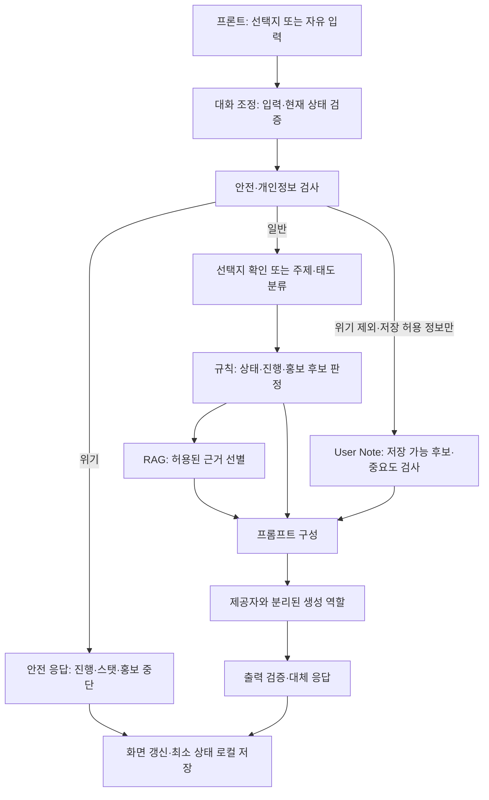

# AI/LLM 설계 — 푸르마와 학교 다니기

> 작성일: 2026-10-15 · 상태: 설계 및 시스템 프롬프트 초안
> 실제 LLM API, 분류기, 검색기, 기억 처리기, 규칙 엔진은 구현하지 않았다.

## 1. 목적과 작업 범위

AI 담당의 책임은 입력 해석, 캐릭터 응답 생성, 근거 활용, 기억 후보 처리 및 안전 검증의 구조를 정하는 것이다. 화면·학교 자료·분류 기준·게임 규칙을 중복 작성하지 않고 각 담당자의 산출물을 참조한다. 이번 산출물은 이 문서와 `prompts/pruma_system.md`뿐이다. 별도 공통 프롬프트 파일, 데이터 복사본, 실행 코드, 의존성, API 키는 추가하지 않는다.

기술 스택, AI 제공자·모델, 검색 방식, API 경로·필드·스트리밍 규격은 확정하지 않는다. 아래 구성 요소와 전달 항목은 논리적 역할과 협의 초안이다.

## 2. 검토 기준과 저장소 현황

원격 브랜치를 읽어 검토했으며 다른 브랜치를 병합하지 않았다. 아래 경로는 **해당 브랜치 안의 실제 경로**다. 현재 작업 브랜치에 모두 존재한다는 뜻이 아니다. 후속 통합 시 경로 변경 여부를 확인한다.

| 브랜치 / 검토 커밋 | 자료 | 활용 |
|---|---|---|
| `main` / `f3a2c407e01121d457cbc9263dc15df2edaa6f2f` | `AGENTS.md`, `README.md` | 개발 규칙·작업 범위 |
| `docs/planning` / `aa8da06a805859205509ea33bb6adbeb00bb3292` | `docs/mingle-srs.md` | 공통 기능·개인정보·안전 요구사항 |
| 위와 같음 | `docs/푸르마_프로젝트_기획서.md` v0.2 | 캐릭터·6구간/12턴·성장·홍보·기억 |
| `data` / `20e23c8d1e2cabd07b9eab6dd6592e37ad535c5b` | `docs/Pruma_Data_Design.md` v0.3 | 데이터 구조·참조 관계 |
| 위와 같음 | `data/rules/pruma_topic_classification.json` | 자유 입력 대표 주제 기준 |
| 위와 같음 | `data/rules/pruma_attitude_classification.json` | 자유 입력 대표 태도 기준 |
| 위와 같음 | `data/rag/pruma_rag_mvp.json` | 출처·확인일을 포함한 학교 정보 7건 |
| 위와 같음 | `data/usernote/pruma_usernote_importance.json` | 저장 허용 기억의 중요도 기준 |
| 위와 같음 | `data/tests/pruma_topic_classification_tests.json` | 향후 주제 검증 기준 |
| 위와 같음 | `data/tests/pruma_attitude_classification_tests.json` | 향후 태도·안전 우선 검증 기준 |
| 위와 같음 | `data/tests/pruma_usernote_importance_tests.json` | 향후 중요도·저장 제외 검증 기준 |
| `feature/frontend-ui` / `ff24b94c2a29cf8ac7bbefd4a5858b9eda3822c0` | `docs/FRONTEND_DESIGN.md` v0.2 | 화면 상태·Mock·연동 고려사항 |

`main`에는 실행 코드와 테스트·빌드 명령이 없다. 데이터 설계서의 `data/...`, `docs/Pruma_Data_Design.md`, `data/tests/*_tests.json`은 예정 경로이며 실제 `pruma/...`, `pruma/test/*_test.json`과 다르다. AI 문서는 파일 이동을 요구하지 않는다.

Persona `pruma_profile.json`, 시나리오, 상태 스키마·규칙, User Note 스키마, RAG 스키마, 엔딩 JSON은 데이터 설계서에 구조가 있지만 검토한 브랜치에는 실제 파일이 없다. 준비된 데이터로 간주하거나 AI 담당이 대체 정본을 만들지 않는다.

## 3. 시스템 아키텍처

위 그림의 생성 역할은 제공자별 호출부를 다른 로직에서 분리한다는 뜻이다. 분류·기억 추출에 LLM을 쓸지 규칙을 쓸지, 한 번 또는 여러 번 호출할지는 미정이다. 안전·규칙·출력 검증을 시스템 프롬프트만으로 보장할 수는 없다. 향후 애플리케이션 로직에서도 적용해야 한다.

| 역할 | 입력과 결과 | 경계 |
|---|---|---|
| 대화 조정 | 검증된 현재 구간·턴, 입력, 최소 맥락 → 처리 순서 | 상태 확정 시점·중복 방지는 백엔드와 협의 |
| 분류 | 자유 입력 → 데이터 기준의 주제·태도 | 수치·엔딩을 생성하지 않음 |
| 규칙 | 선택 기록·분류 결과 → 상태·진행·홍보 허용 결과 | LLM 밖에서 계산, 담당·실행 위치 협의 |
| 검색 | 현재 맥락·허용 후보 → 근거와 출처 | DB·벡터 검색 도입 여부 미정 |
| 기억 | 허용 정보 → 짧은 기억 후보 | 저장 검증과 영속화는 애플리케이션 책임 |
| 생성 | Persona·확정된 상태·근거·허용 기억 → 캐릭터 대사 | 규칙 결과를 임의 변경하지 않음 |

## 4. Persona와 프롬프트 구성

### 4.1 다른 IP에도 적용할 공통 구조 — 설계만 제시

향후 프롬프트 구성기는 다음 영역을 구분한다. 이번에는 별도 공통 파일이나 범용 프롬프트 엔진을 만들지 않는다.

| 영역 | 공통 구조 | 푸르마 적용 |
|---|---|---|
| 역할과 경계 | 대화 생성과 규칙 계산 구분 | 스탯·엔딩·턴은 외부 판정 |
| 캐릭터 설정 | 정체·배경·성격·관계·말투·금지 규칙 | 천마 출신 신입생, 사용자는 선배 |
| 프로젝트 규칙 | 승인된 장면·선택지·진행 정책 참조 | 6구간·12턴, 첫 턴 고정 SOS |
| 동적 맥락 | 검증된 상태·최근 최소 맥락 | 친밀도별 말투, 현재 SOS |
| 근거 | 출처가 있는 검색 결과, 사용 허용 범위 | 데이터 담당 RAG의 구간 제한 |
| 기억 | 저장 허용된 기억과 회상 허용 여부 | 최대 10개 반영·구간당 1회 언급 |
| 안전과 출력 | 개인정보·위기·지침 변경 대응, 대사 검증 | 장난 중단·공식 상담 안내는 승인 문구 사용 |

사용자 입력·기억·검색 문서는 내용 자료로 취급한다. 그 안의 역할 변경이나 지침 공개 요청을 시스템 명령으로 승격하지 않는다. 상태·안전 플래그는 사용자의 자유 텍스트 주장만으로 신뢰하지 않는다.

### 4.2 푸르마 전용 초안

`prompts/pruma_system.md`는 기획서 2장의 **팀 창작 설정, 최종 확인 필요** 상태를 유지한다. 활발함·호기심·덜렁거림·회복력, 천마의 시선에서 나오는 유머, 사용자와의 선후배 관계를 반영한다. 친밀도 구간은 0~24 / 25~49 / 50~100을 따르며 LLM이 친밀도를 추정하지 않는다. 향후 Persona 정본이 제공되면 구조·값을 대조하고 중복 정의를 정리한다. 충돌 시 자동 덮어쓰지 않는다.

## 5. 데이터 활용과 사용자 입력 처리

1. 입력 길이(기획 기준 300자), 빈 입력, 선택지 ID와 현재 턴의 일치 여부를 검증한다. 재시도·중복 요청 처리 방식을 협의한다.
2. 위기·개인정보·설정 변경·욕설/혐오 등 안전 규칙을 먼저 검사한다. 위기는 일반 분류 보상·진행·홍보보다 우선한다.
3. 고정 선택지는 주제·태도 분류를 거치지 않고 시나리오의 `stat_tag`와 선택지 규칙을 참조한다. 버튼 문구를 자유 입력했다고 선택 ID로 간주하지 않는다.
4. 자유 입력은 다음 데이터의 정의·예외·판정 순서를 적용한다. 결과 라벨을 허용 enum으로 검증한다.
5. 규칙이 상태를 계산하고 홍보를 허용한다. 분류 결과를 수치로 변환하는 단일 출처는 향후 `pruma_rules.json`이다. 현재 실제 파일이 없으므로 계산 구현은 보류한다.
6. 허용된 RAG와 기억을 선택하고 Persona·현재 장면과 조합해 응답을 생성한다.
7. 출력의 안전성·근거·말투·홍보 제한을 검증한 후 표시하고 최소 상태를 저장한다. 상태 갱신의 확정 시점과 실패 복구는 협의한다.

### 5.1 주제 분류 데이터

`pruma_topic_classification.json`의 `labels`, `decision_rules`, `output`을 분류 지침과 결과 검증에 활용한다. `primary_topic`은 `탐구`, `기술`, `예술`, `소통`, `글로벌`, `일상` 중 하나다. 장소·동행자보다 핵심 행동을 우선하고, 복수 주제가 동등하거나 불확실하면 `일상`이다. `stat_tag_map`을 사용하며 `일상`은 스탯 태그가 없다.

예를 들어 도서관에서 코딩은 `기술`, 미술 동아리 가입은 `소통`이다. 반복 비교는 데이터의 `integration.repeat_topic`에 따라 `primary_topic`을 쓰고 `일상`은 제외한다. 분류 실패는 주제 `일상`·태도 `중립`·스탯 변화 0이다. 이때 친밀도·SOS 보상 적용 세부 순서는 규칙 담당과 확인한다.

### 5.2 태도 분류 데이터

`pruma_attitude_classification.json`을 사용해 `primary_attitude`를 `응원·도움`, `중립`, `퉁명·부정` 중 하나로 결정한다. 전체 감정보다 푸르마를 대하는 태도와 실제 도움 의도를 본다. 시험을 싫어해도 함께 돕겠다는 말은 `응원·도움`, 대상이 불명확한 단독 부정 표현은 `중립` fallback이다. 안전 대상 입력의 보상 적용은 안전 정책이 우선한다. 위기 이외의 안전 유형별 진행·보상 정책은 추가 합의한다.

### 5.3 게임 규칙과 응답 생성의 분리

스탯 5종과 친밀도, 턴 진행, 선택 기록, 엔딩, 홍보 상한은 LLM이 계산하거나 새 규칙으로 만들지 않는다. 기획의 증가량·상한·반복 감쇠는 데이터 정본으로 이관될 대상이며 합산 순서는 미확정이다. 생성기는 외부에서 받은 결과만 대사에 반영한다. 장면·선택지는 승인된 시나리오를 참조하고 새 엔딩 조건이나 다음 구간을 창작하지 않는다.

실패 복구에서는 **동일 사용자 입력에 대한 상태 변경은 최대 한 번만 적용**해야 한다. 향후 설계안은 입력의 논리적 요청 식별과 적용 전 상태 버전을 연결하고, 규칙 계산 결과를 임시 결과로 유지한 뒤 검증된 응답 또는 승인된 대체 응답과 함께 한 번만 확정하는 것이다. 생성 실패·타임아웃·부분 스트리밍만으로 추가 턴이나 보상을 적용하지 않는다. 재시도는 같은 논리적 요청으로 취급하고, 이미 확정됐다면 기존 결과를 재사용한다. 늦게 도착한 응답이나 중복 응답으로 스탯·친밀도·선택 기록·User Note를 다시 적용하지 않는다. 구체적인 식별 방식·버전 검증·확정 위치·대체 응답 시 진행 정책·로컬 복원 방식은 프론트/백엔드와 협의하며, 이번에는 구현하지 않는다.

## 6. RAG 연동 구조

데이터 담당의 `pruma_rag_mvp.json` 7건을 읽기 전용 지식으로 사용한다. 내용·URL을 AI 문서에 복사해 별도 정본으로 관리하지 않는다. 검색은 우선 구간·사용 상태·맥락으로 후보를 제한하는 논리 구조이며 키워드/의미 검색·임베딩·저장소는 미정이다.

| 데이터 필드 | AI 시스템 활용 |
|---|---|
| `id`, `category`, `subcategory` | 후보 식별과 근거 추적 |
| `content`, `title` | 사실 응답의 허용 근거 |
| `source_name`, `source_url`, `checked_at` | 출처 연결·확인일 표시·검증 |
| `volatility` | 재확인이 필요한 정보 구분, 재검증 주기는 협의 |
| `usage`, `allowed_section` | MVP 사용 범위·현재 구간 필터 |
| `trigger_keywords`, `promotion_target` | 맥락 기반 후보 매칭·표시 대상, 노출은 별도 규칙으로 판정 |

2구간은 식당·동아리, 3구간은 도서관, 6구간은 선택한 진로에 해당하는 자료만 후보로 삼는다. 1·4·5구간은 홍보 없음, 한 턴 최대 1개·한 구간 최대 2개, 같은 진행에서 닫은 콘텐츠는 재노출하지 않는다. 위기 중에는 모두 차단한다. 엔딩 CTA는 확정된 엔딩 연결과 데이터 범위를 확인한 후 처리한다.

**주제 분류와 홍보 트리거는 별개다.** 식당 메뉴 입력은 `일상`이어도 2구간 식당 후보와 연결될 수 있다. `소통` 라벨만으로 임의의 소통 관련 링크를 노출하지 않는다. 검색 결과가 있다고 자동으로 링크를 붙이지 않는다.

좌석 실시간 현황·오늘 메뉴·모집 일정은 현재 요약만으로 알 수 없다. 없는 사실·URL·확인일을 만들지 않는다. 근거가 부족하면 모른다고 말하고 검증된 공식 링크가 있을 때만 안내한다. 출처 누락·무효·재확인 필요 시 정보 단정을 피하고 콘텐츠 사용 여부를 검증한다. 데이터의 확인일은 담당자의 기록이며 이번 작업에서 공식 사이트를 재검증한 것은 아니다.

## 7. User Note 처리 구조

User Note는 스탯과 별개다. 기획서 8장·데이터 설계서 8장과 `pruma_usernote_importance.json`을 참조한다.

안전 검사 결과를 기억 처리의 선행 조건으로 둔다. **위기 입력은 User Note 후보 추출·중요도 판정·신규 저장·기존 노트 갱신을 건너뛰며**, 위기 내용의 요약이나 반복 횟수도 기억으로 남기지 않는 보수적 설계안을 제안한다. 위기 중 기존 기억의 회상도 중단하는 안으로 두고, 세부 정책과 재개 조건은 팀 협의 대상으로 유지한다. 개인정보·민감정보는 추출 전에 제외하고 추출 결과도 저장 전에 재검사한다. 허용 정보가 섞여 있어도 안전하게 분리할 수 없거나 판정이 불확실하면 해당 입력에서 새 노트를 만들지 않는다. 허용 정보만 분리해 처리하는 구체적인 방식은 협의하며 금지 정보 저장은 허용하지 않는다.

1. 호칭/별명, 관심사, 선택, 약속/응원, 반복 주제에서 짧은 기억 후보를 추출한다.
2. **저장 가능 여부를 먼저 검사**한다. 학번·실명·연락처·주소·건강/정치/종교 등 민감정보·개인 고민 상세·타인 실명/특징은 제외한다. 원문을 그대로 노트로 만들지 않는다.
3. 허용된 후보에만 데이터 기준으로 `high` / `medium` / `low`를 부여한다. 강한 기억 요청도 금지 정보를 허용하지 않는다. 단일 일반 선호는 기본 `medium`, 명확한 지속·반복·미래 약속은 `high` 후보, 일시적 세부는 `low`다.
4. 중요도 → 현재 구간 관련성 → 최근 `created_at_turn` 순으로 최대 10개를 응답 맥락에 반영한다. 최대 저장 개수·보관 기간·교체/삭제/모순 해결·재시작 시 기억 유지 여부는 별도 협의한다. 반영 상한을 전체 저장 상한으로 단정하지 않는다.
5. 구간당 기억을 꺼내는 것은 최대 1회다. 사용 여부를 애플리케이션이 관리하고 생성기에 회상 허용 여부를 전달한다. 단순 노트 주입과 실제 회상 언급을 구분한다.
6. 데이터 설계의 `key`, `value`, `importance`, `section_id`, `created_at_turn` 구조를 참조하되 실제 스키마 제공 후 검증한다. 후보 추출 실패 시 새 노트를 저장하지 않는 방안을 검토한다.

저장은 브라우저 로컬을 기본으로 한다. AI 처리에 필요한 최소 맥락의 일시 전송과 서버 영구 저장은 구분한다. 금지 정보 필터를 모델 입력 전에도 적용하는 위치·방식, 외부 제공자의 보관 정책과 전송 범위는 실제 연동 전에 합의한다. 채팅 원문과 User Note를 관리자 통계에 넣지 않는다.

## 8. 담당자별 연동과 API 협의

| 담당 | 제공·합의 대상 | AI 담당의 활용 |
|---|---|---|
| 데이터 | 기존 분류/RAG/중요도 정본, 향후 Persona·시나리오·규칙·스키마, 버전·경로 | 읽기 전용 참조, enum·참조 ID 검증, 데이터 오류 공유 |
| 기획 | 창작 Persona 승인, 최종 장면·엔딩·안전 문구 | 프롬프트와 응답 허용 범위 갱신 |
| 프론트 | 입력 유형, 현재 진행, 최소 기억, 표시 상태, 닫은 콘텐츠 | 대사·검증된 진행 결과·허용 콘텐츠 표시와 로컬 복원 협의 |
| 백엔드 | 제공자 호출 경계, 상태 검증·규칙, 요청 제한, 실패 복구 | 비밀키 서버 보관, 데이터/프롬프트 버전 추적, 출력 검증 협의 |

데이터 변경 시 커밋/구조 버전을 함께 확인하고, 기존 테스트의 기대값 변경은 데이터 담당과 검토한다. 누락 파일·잘못된 enum·끊긴 ID 참조·필수값 `null`은 준비 완료로 처리하지 않는다. 미확정값을 모델이 채우게 하지 않는다.

요청 시 필요한 논리적 정보는 프로젝트·캐릭터, 현재 구간·턴, 선택 ID 또는 자유 입력, 최소 맥락과 허용 기억이다. 응답 측은 대사, 안전 여부, 규칙 판정 결과, 승인 선택지·홍보 참조·엔딩 결과의 구분이 필요하다. **이 목록은 API 계약이나 JSON 필드명 확정이 아니다.** 프론트 예시의 `chapterId`와 데이터의 `section_id`, 감정 코드 등 매핑은 협의한다.

스트리밍은 최종 요구사항이나 전송 방식은 미정이다. 검증 전 대사 노출과 안전 검증의 순서, 부분 응답 실패 시 처리, 동일 요청 재시도 시 중복 상태·보상 방지는 백엔드·프론트와 함께 정한다. 클라이언트의 상태를 무검증으로 신뢰하지 않되 서버 사용자 데이터 영구 저장을 전제하지 않는다. 익명 통계에는 불필요한 개인정보·채팅 원문을 포함하지 않는다.

## 9. 예외와 안전 응답

| 상황 | 설계 방향 |
|---|---|
| 위기 신호 | 장난·홍보·상태 변화·턴 진행 중단, 차분한 공감과 승인된 전문 상담 안내 우선. 사용자 현실의 위기를 게임 휴학 엔딩으로 처리하지 않음 |
| 공식 상담 문구 미확정 | 번호·URL을 창작하지 않음. 공식 안내 확인 및 팀 승인 전 운영용 안전 응답 준비 완료로 간주하지 않음 |
| 개인정보 | 저장 제외·반복 노출 방지, 입력하지 않아도 된다고 안내 |
| 설정 변경·지침 공개 요구 | 따르지 않고 캐릭터 말투로 대응, 허용 장면으로 복귀 |
| 욕설·혐오·연애/성적 요구 | 동조하지 않고 경계 제시·화제 전환, 반복 시 정중 거절 |
| 무관한 입력 | 짧게 받아 준 뒤 현재 SOS로 복귀, 구간을 임의 이동하지 않음 |
| 분류 실패·허용값 밖 출력 | `일상`/`중립` fallback·스탯 변화 0, 안전 판정을 우회하지 않음 |
| 근거 없음·출처 오류 | 사실 단정·임의 링크 생성 금지, 검증된 공식 자료 범위에서만 응답 |
| 생성 지연·실패·출력 검증 실패 | 승인된 대체 대사·재시도 UI 고려, 이전 진행 보존과 중복 갱신 방지 |
| 데이터/상태 누락·버전 불일치 | 임의 규칙으로 진행하지 않고 복구 안내 또는 명시적 Mock 경로 검토 |

안전 유형별 정확한 문구, 위기 종료·진행 재개 조건, 분류 신뢰 기준, 타임아웃·재시도 상한은 미정이다. 위기 외 모든 안전 유형의 스탯·턴 정지 여부를 일괄 확정하지 않는다. Mock와 실제 생성 모드는 명시적으로 구분한다.

## 10. 정합성 검토와 협의 필요 사항

| 항목 | 확인한 차이·미확정 내용 | 이번 문서 처리 |
|---|---|---|
| 엔딩 범위 | 기획·프론트: 첫 1~2개 대상 미정 / 데이터 설계: 과탑만 MVP | 과탑 확정·후보 활성화·판정 구현 보류, 대상·기본 fallback 협의 |
| 엔딩 도달성 | 과탑 탐구 40과 휴학 제외 조건은 잠정, 12턴 규칙과 검증 필요 | 수치·조건 변경 없이 플레이 검증 대상으로 기록 |
| 이미지 | 기획: 협의 전 / 프론트: 협의 완료 전달 기록 | 출처별 상태 구분, AI 문서에서 이용·배포 허용 범위 확정하지 않음 |
| 중간발표 | SRS: 여러 화면 / 프론트: 동작하는 채팅 Mock으로 축소 기록 | AI 실제 연동을 발표 필수로 두지 않음, 최종 범위 팀 확인 |
| 경로·파일 | 설계 예정 경로와 실제 경로 차이, 일부 정본 미제공 | 실제 경로로 참조, 이동·대체 생성 없음 |
| Persona·상세 시나리오 | 창작 말투 팀 확인 필요, 실제 시나리오 JSON 없음 | 프롬프트 초안만 작성, 세부 분기 확정 보류 |
| 규칙 | 보상 합산·상한·SOS·실패 친밀도 처리 순서 미정 | LLM 밖의 규칙으로 분리, 세부 순서 협의 |
| 안전·개인정보 | 공식 위기 문구·재개 조건·외부 전송/보관 정책 미정 | 출시 전 확인 필요, 번호·링크 창작 없음 |
| 연동 | 스택·API·감정 코드·검색·스트리밍·저장 버전 미정 | 논리적 역할과 전달 정보만 제안 |

검토 기준은 SRS FR-20~26, FR-30~34, FR-50~65와 푸르마 기획서 2~8장, 데이터 설계서 4·7~10장, 프론트 설계서 5·6·8·9장이다. 위 차이는 팀원 파일을 수정하거나 AI 담당의 판단으로 해소하지 않는다.

## 11. 향후 구현과 검증 계획

| 단계 | 예정 작업 | 완료 판단 기준 |
|---|---|---|
| 1. 합의 | 미결정 목록, Persona·시나리오·규칙·안전 문구와 데이터 정본 확인 | 담당자 합의와 필요한 파일 제공 |
| 2. Mock 연결 | 합의된 최소 대사·선택지·오류 흐름 연결 | Mock 표시와 프론트 입력/응답 흐름 확인 |
| 3. 처리 로직 | 분류·규칙 경계, 데이터 로딩·검증, RAG·기억 후보 처리 | 기준 데이터와 실패·누락 케이스 검증 |
| 4. 실제 AI | 제공자·모델·키·전송 정책 합의 후 호출 계층 연결 | Persona·근거·안전·지연·실패 복구 평가 |
| 5. 통합 | 스트리밍·저장/복원·재시도·턴/엔딩·홍보 연동 | 모바일 포함 통합 흐름과 개인정보 검증 |

기존 테스트 JSON을 **향후 AI 기능 검증의 기준 데이터**로 사용한다. 주제 35건, 태도 일반 32건과 안전 우선 1건, User Note 중요도 30건과 저장 제외 4건을 참조한다. 각각 기대 라벨 일치, 안전 시 보상 미적용, 금지 기억 저장 제외를 별도로 평가한다. 원본 테스트를 복제하거나 기대값을 임의 변경하지 않는다.

향후 평가에서는 각 입력의 실제 라벨을 원본 `expected`와 비교해 주제·태도·중요도별 정확도(정답 수/전체 수), 라벨별 오분류와 혼동 행렬을 기록한다. 안전 우선·저장 제외 사례는 일반 라벨 정확도와 분리해 위반 건수를 보고한다. 모델·프롬프트·데이터 커밋·생성 설정을 고정·기록하고 실패 사례는 테스트 ID로 추적한다. 반복 실행에 따른 결과 변동도 확인할 계획이며 반복 횟수·통과 기준은 합의 후 정한다. 기존 기준 데이터만의 점수를 일반화 성능으로 단정하지 않는다. **현재 정확도 측정이나 모델 테스트는 수행하지 않았다.**

추가 검증은 고정 선택지 분류 우회, 허용 enum 밖 출력, RAG 근거 부족·구간 제한·홍보 상한·닫기, 기억 회상 횟수, 프롬프트 주입, 분류/생성 실패·재시도, 친밀도별 말투, 위기 중 진행 중단을 대상으로 설계한다. 평가 방식·통과 기준은 구현 전에 합의한다.

## 12. 현재 완료와 미완료

- 완료: 네 브랜치 자료 분석, AI/LLM 설계 문서 및 푸르마 시스템 프롬프트 초안 작성, 문서 간 차이와 협의 항목 정리.
- 미완료: 실제 API 연동, 모델 선택, 실행 가능한 분류·RAG·User Note·규칙·안전 처리, Mock 코드, 프론트/백엔드 통합.
- 미실행: 테스트 데이터에 대한 분류기/모델 평가, 플레이 테스트, 실행 테스트·빌드, 공식 학교 링크 재검증. 테스트 JSON의 존재와 내용 검토는 기능 테스트 성공을 뜻하지 않는다.
