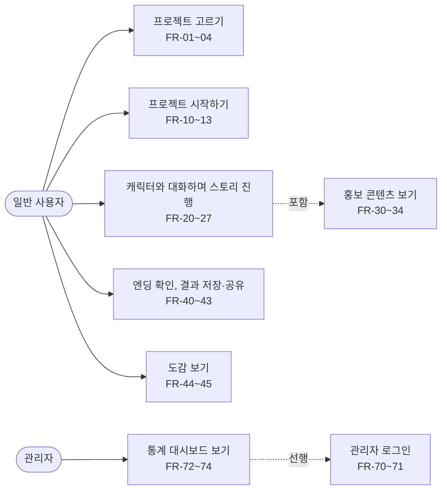
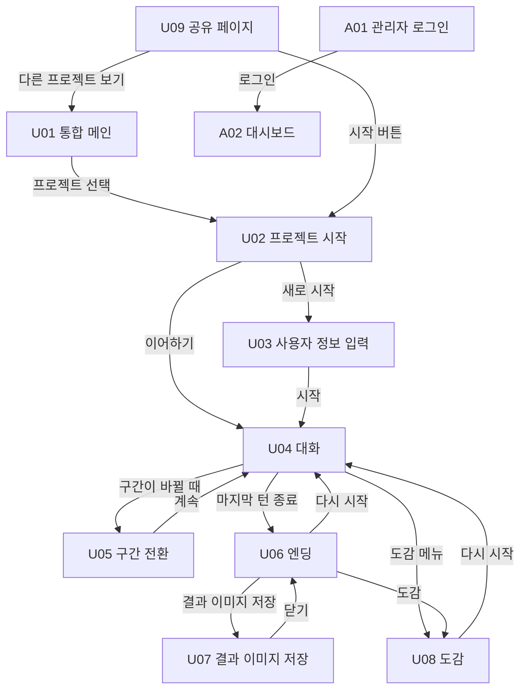
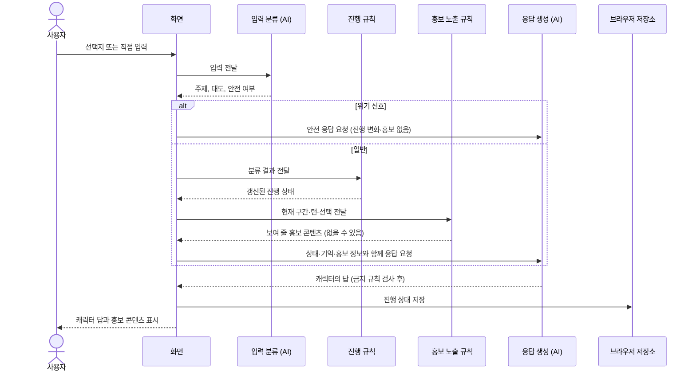
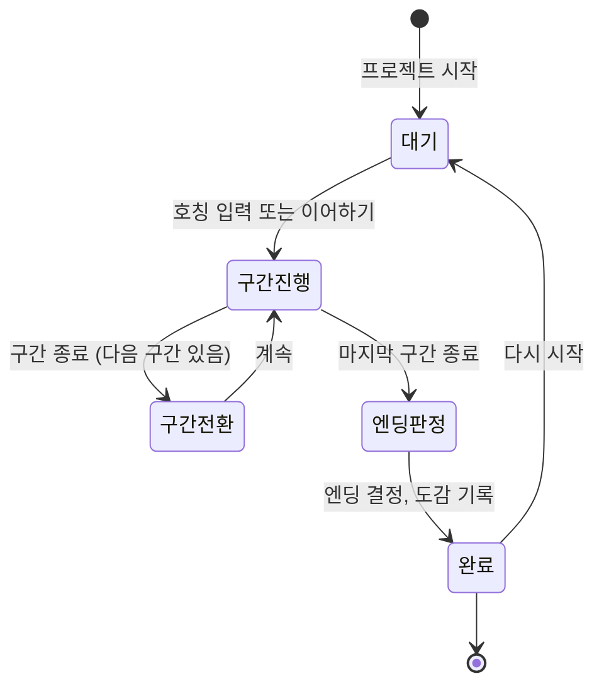

# 밍글 서비스 기획서 (Software Requirements Specification)

## 개정 이력 (Revision History)

| 버전 | 날짜 | 작성자 | 변경 내용 |
|---|---|---|---|
| 0.1 | 2026-10-14 | 진다혜 | 최초 작성 (요구사항, 유스케이스, 화면 목록, 지표, 데이터 요구사항) |

---

## 1. 서론 (Introduction)

### 1.1 목적 (Purpose)

이 문서는 밍글(Mingle)이 제공해야 하는 기능과 조건을 개발 전에 팀이 같은 기준으로 확인하도록 정리한다. 기획 담당이 작성하고, 개발·AI 담당이 구현 범위를 판단하는 기준으로 쓴다.

### 1.2 서비스 범위 (Scope)

밍글은 캐릭터 IP와 LLM 기반 페르소나 AI를 결합한 **웹 기반 인터랙티브 홍보 플랫폼**이다. 사용자가 캐릭터와 대화하며 스토리를 진행하는 동안 기업·기관·학교의 홍보 콘텐츠를 자연스럽게 경험하게 한다.

서비스는 세 부분으로 구성한다.

| 구성 | 설명 |
|---|---|
| 밍글 통합 메인 페이지 | 여러 홍보 프로젝트를 카드로 보여 주고 선택하면 해당 서비스로 이동 |
| 프로젝트별 사용자 서비스 | 캐릭터와 대화하며 스토리를 진행하는 서비스 |
| 프로젝트별 관리자 대시보드 | 프로젝트의 이용 현황과 홍보 반응을 확인하는 화면 |

첫 번째 프로젝트는 **푸르마와 학교 다니기**(영남대학교 홍보)이다. 푸르마는 플랫폼에 올라가는 프로젝트 중 하나이며, 프로젝트마다 캐릭터·시나리오·엔딩·홍보 링크만 교체할 수 있어야 한다. 푸르마 프로젝트의 세부 내용은 `puruma-gdd.md`에 둔다.

### 1.3 범위에서 제외 (Out of Scope)

- 캐릭터 외형 커스터마이징
- 일반 사용자 로그인과 회원가입
- 관리자 회원가입
- 실제 학교 부서와의 협약. 발표에서는 부서가 고객이라고 가정한 시연임을 밝힌다.

### 1.4 용어 (Definitions)

| 용어 | 뜻 |
|---|---|
| 프로젝트 | 밍글 위에서 운영하는 하나의 홍보 서비스. 예: 푸르마와 학교 다니기 |
| 페르소나 | 캐릭터의 성격, 말투, 설정, 금지 규칙 |
| 구간 | 스토리를 이루는 큰 단계. 푸르마 프로젝트는 6개 |
| 턴 | 캐릭터와 사용자가 한 번씩 주고받는 단위 |
| 선택지 | 상황에 맞게 제시하는 답변 버튼. 자유 입력과 함께 지원 |
| 홍보 콘텐츠 | 대화 속 키워드 링크와 이벤트 포스터. 홍보 대상의 공식 페이지나 이미지로 연결 |
| 엔딩 | 스토리가 끝났을 때 사용자의 진행에 따라 정해지는 결과 |
| 도감 | 사용자가 얻은 엔딩을 모아 보는 화면 |
| User Note | 대화에서 뽑은 짧은 기억 항목. 이후 대화에 반영 |
| Mock | 실제 AI·서버가 준비되기 전에 같은 형태로 만든 가짜 응답 |

### 1.5 참고 자료 (References)

- `AGENTS.md`: 밍글 공통 개발 지침
- 과제 수행계획서 (2026학년도 2학기 AI 서비스 프로젝트)

---

## 2. 전체 설명 (Overall Description)

### 2.1 서비스 관점: B2B2C

- **B2C**: 사용자(예: 재학생)는 캐릭터와 대화하는 게임 같은 경험을 하면서 홍보 정보를 자연스럽게 접한다.
- **B2B**: 홍보 주체(예: 학교 부서)는 자기 서비스를 대화 속에 넣고, 노출·클릭 반응을 대시보드에서 확인한다.

### 2.2 사용자 유형 (User Classes)

| 유형 | 설명 | 인증 |
|---|---|---|
| 일반 사용자 | 프로젝트 서비스를 이용하는 사람. 푸르마 프로젝트의 대상은 영남대학교 재학생 | 없음 (로그인·회원가입 요구 안 함) |
| 관리자 | 허용된 프로젝트의 통계를 보는 홍보 주체 담당자 | 아이디·비밀번호 로그인. 계정은 별도로 발급·관리 |

### 2.3 운영 환경과 제약 (Operating Environment and Constraints)

- 웹 서비스이며 **모바일 우선(Mobile First)**, 모바일과 데스크톱 모두 사용 가능해야 한다.
- 프론트엔드·서버·DB·AI 제공자의 최종 선택은 팀 협의 사항이다. 수행계획서는 React, FastAPI, PostgreSQL(pgvector), Gemini API를 제안하며, 결정 전에는 특정 기술에 묶인 설계를 하지 않는다. AI 연동 계층은 다른 로직과 분리한다.
- 인증 정보와 API 키는 환경변수로 관리하고 저장소에 올리지 않는다.
- AI가 준비되지 않은 기간에도 화면과 흐름을 검증할 수 있도록 Mock 응답을 지원한다.

### 2.4 가정과 의존 (Assumptions and Dependencies)

- 홍보 링크와 이미지는 홍보 주체가 승인하거나 공개한 자료만 사용한다. 존재하지 않는 프로그램이나 확인되지 않은 정보는 만들지 않는다.
- 푸르마 이미지는 학교 가이드라인에 따라 임의 변경이 불가능하고, 가이드라인 밖의 활용은 관리 부서와 협의가 필요하다. 협의 전에는 이미지 없이 텍스트와 색으로 만든 버전을 기본으로 설계한다.

---

## 3. 기능 요구사항 (Functional Requirements)

우선순위: **상** = 중간발표 프로토타입에 필요, **중** = 최종 구현 필수, **하** = 여유가 있을 때

### 3.1 통합 메인 (Main Page)

| ID | 요구사항 | 우선순위 |
|---|---|---|
| FR-01 | 프로젝트마다 대표 이미지와 간단한 설명을 담은 카드를 보여 준다. 카드는 세로 스크롤로 배치한다. | 상 |
| FR-02 | 카드를 선택하면 해당 프로젝트의 서비스로 이동한다. | 상 |
| FR-03 | 아직 공개하지 않은 프로젝트는 Coming Soon으로 표시하고 이용 가능한 프로젝트와 명확히 구분하며, 선택할 수 없다. | 상 |
| FR-04 | 이 기기에 진행 중인 기록이 있는 프로젝트는 카드에서 바로 이어할 수 있다. | 중 |

### 3.2 프로젝트 시작 (Project Start)

| ID | 요구사항 | 우선순위 |
|---|---|---|
| FR-10 | 프로젝트 소개(캐릭터, 한 줄 설명, 소요 시간)를 보여 준다. | 상 |
| FR-11 | 사용자 호칭 등 대화에 필요한 기본 정보를 입력받는다. 학번, 실명, 연락처는 요구하지 않는다. | 상 |
| FR-12 | "새로 시작"과 "이어하기"를 구분해 제공한다. 이어하기는 이 기기에 저장된 기록을 불러온다. | 중 |
| FR-13 | 공유 링크로 들어온 사용자도 해당 프로젝트의 시작 화면에 도착한다. | 중 |

### 3.3 대화와 스토리 진행 (Chat and Story)

| ID | 요구사항 | 우선순위 |
|---|---|---|
| FR-20 | 사용자는 자유 입력과 선택지 중 하나로 답할 수 있다. 입력은 300자로 제한한다. | 상 |
| FR-21 | 캐릭터의 메시지와 사용자의 메시지를 시각적으로 명확히 구분한다. | 상 |
| FR-22 | 캐릭터의 답은 생성되는 대로 이어서 보여 준다(스트리밍). | 중 |
| FR-23 | 스토리 진행 상태(현재 구간 이름, 구간 진행도, 턴 수)를 대화 화면에 항상 표시한다. | 상 |
| FR-24 | 구간이 바뀔 때 다음 구간을 알리는 전환 화면을 보여 준다. | 상 |
| FR-25 | 사용자의 선택과 입력에 따라 진행 상태(스탯, 친밀도 등)가 규칙에 따라 갱신된다. 수치 계산은 AI가 아니라 규칙이 한다. | 중 |
| FR-26 | 사용자의 입력이 스토리와 무관해도 캐릭터가 받아 준 뒤 스토리로 자연스럽게 돌아온다. | 중 |
| FR-27 | 상태창(수치 표시)의 포함 여부와 구성은 미정이다. | - |

### 3.4 홍보 콘텐츠 (Promotional Content)

| ID | 요구사항 | 우선순위 |
|---|---|---|
| FR-30 | 대화 속 키워드를 링크로 만들어 홍보 대상의 공식 페이지로 연결한다. 링크는 새 탭으로 열어 대화가 끊기지 않게 한다. | 상 |
| FR-31 | 이벤트 포스터나 이미지는 카드 형태로 대화나 엔딩 위에 보여 줄 수 있다. | 상 |
| FR-32 | 홍보 콘텐츠를 클릭하도록 강제하지 않으며, 사용자가 닫을 수 있다. 닫은 콘텐츠는 같은 진행 중에 다시 보이지 않는다. | 중 |
| FR-33 | 노출 시점은 규칙(구간, 턴, 선택, 키워드)으로 정하고, 한 구간·한 턴에 보이는 개수를 제한한다. 관련 없는 콘텐츠를 강제로 보이지 않는다. | 중 |
| FR-34 | 위기 신호가 있는 동안에는 홍보 콘텐츠 노출을 멈춘다. | 중 |

### 3.5 엔딩, 도감, 공유 (Endings, Collection, Sharing)

| ID | 요구사항 | 우선순위 |
|---|---|---|
| FR-40 | 스토리가 끝나면 진행 결과에 따라 엔딩을 정해 엔딩 카드로 보여 준다. | 상 |
| FR-41 | 엔딩 결과 이미지를 사용자 기기에 저장할 수 있다. | 중 |
| FR-42 | 모바일 기기의 공유 기능으로 링크를 공유할 수 있다(지원 가능한 범위에서). | 하 |
| FR-43 | 공유 링크로 들어온 사람에게는 엔딩 전체 내용이 아니라 **엔딩명 정도만** 보이고, 이어서 해당 프로젝트를 시작하는 버튼과 메인으로 가는 버튼을 제공한다. | 중 |
| FR-44 | 도감에서 얻은 엔딩과 얻지 못한 엔딩을 구분해 보여 준다. 얻지 못한 엔딩은 가려서 보여 준다(힌트 제공 여부는 미정). | 상 |
| FR-45 | 엔딩 후 다시 시작할 수 있으며, 도감은 다시 시작해도 유지된다. | 중 |

### 3.6 AI 페르소나와 기억 (AI Persona and Memory)

| ID | 요구사항 | 우선순위 |
|---|---|---|
| FR-50 | 프로젝트별로 캐릭터의 성격, 말투, 설정, 금지 규칙을 분리해 관리하며, 대화 중 정체성이 바뀌지 않게 한다. | 상 |
| FR-51 | 캐릭터 설정과 홍보 대상 정보를 검색해 응답에 반영한다(RAG). | 중 |
| FR-52 | 이전 대화의 핵심 정보(호칭, 관심사, 한 약속 등)를 기억해 이후 대화에 반영한다(User Note). 학번·실명·연락처·민감 정보는 저장하지 않는다. | 중 |
| FR-53 | 홍보 정보는 출처와 확인일을 관리하고, 근거가 없으면 모른다고 답하며 공식 링크를 안내한다. | 중 |
| FR-54 | 실제 AI 연동 전에는 Mock 응답으로 화면과 흐름이 동작한다. | 상 |

### 3.7 안전 (Safety)

| ID | 요구사항 | 우선순위 |
|---|---|---|
| FR-60 | 캐릭터 설정을 바꾸라는 요구, 지침 공개 요구에는 응하지 않고 캐릭터 말투로 넘긴다. | 중 |
| FR-61 | 위기 신호(힘들다는 표현 등)가 감지되면 장난을 멈추고 공감한 뒤 전문 상담 안내로 연결한다. 문구는 공식 안내 자료를 확인해 팀이 정한다. | 상 |
| FR-62 | 학번, 연락처 같은 개인정보 입력은 저장하지 않고 입력하지 않아도 된다고 안내한다. | 중 |
| FR-63 | 욕설·혐오 발언과 연애를 하자는 요구, 선을 넘는 성적인 대화 요구에는 응하지 않고 화제를 돌린다. | 중 |
| FR-64 | 실존 인물의 실명과 특징을 말하지 않는다. | 중 |
| FR-65 | AI 응답 지연이나 실패 시 대체 응답으로 이어가 서비스가 끊기지 않게 한다. | 중 |

### 3.8 관리자 (Admin)

| ID | 요구사항 | 우선순위 |
|---|---|---|
| FR-70 | 관리자는 아이디·비밀번호로 로그인한다. 회원가입 기능은 두지 않는다. | 상(화면) / 중(인증) |
| FR-71 | 관리자는 자신에게 허용된 프로젝트의 데이터만 볼 수 있다. 접근 권한은 서버에서 검증한다. | 중 |
| FR-72 | 대시보드에서 아래 지표를 카드와 그래프로 보여 준다(7장). | 상(화면) / 중(실데이터) |
| FR-73 | 실제로 수집하지 않은 데이터를 실제 통계처럼 보이지 않게 하고, Mock 데이터에는 "샘플 데이터" 표시를 한다. | 상 |
| FR-74 | 지표를 기간별로 조회하고 파일(CSV)로 내려받을 수 있다. | 하 |

---

## 4. 비기능 요구사항 (Non-functional Requirements)

| ID | 분류 | 요구사항 |
|---|---|---|
| NFR-01 | 사용성 | 모바일 우선, 360px 폭에서 가로 스크롤 없이 동작한다. |
| NFR-02 | 사용성 | 불필요한 팝업을 줄이고 입력·클릭이 편해야 한다. 접근성과 가독성을 고려한다. |
| NFR-03 | 사용성 | 한 번에 보이는 글자 수를 줄이고 캐릭터의 말은 두세 문장으로 끊는다. |
| NFR-04 | 성능 | 캐릭터의 첫 응답이 시작되기까지의 목표 시간을 정한다. 목표값은 AI 연동 후 측정해 정한다. |
| NFR-05 | 개인정보 | 사용자 이름, 설정, 진행 상태, 얻은 엔딩은 기본적으로 **브라우저 로컬 저장소**에 저장한다. 같은 기기·브라우저에서 다시 접속하면 복원한다. |
| NFR-06 | 개인정보 | 전체 대화 기록을 무조건 보관하지 않고 진행에 필요한 핵심 정보 중심으로 저장한다. |
| NFR-07 | 개인정보 | 통계에는 불필요한 개인정보를 넣지 않는다. 채팅 원문은 명시적 필요와 별도 합의 없이 서버에 저장하지 않는다. |
| NFR-08 | 보안 | 관리자 인증 정보와 API 키는 코드·저장소에 두지 않는다. |
| NFR-09 | 비용·남용 | 입력 길이 제한, 요청 빈도 제한, 일일 AI 호출 상한을 둔다. |
| NFR-10 | 확장성 | 공통 기능과 프로젝트별 설정(캐릭터, 시나리오, 엔딩, 홍보 링크, 디자인)을 분리해 새 프로젝트를 설정 교체 중심으로 추가할 수 있게 한다. 현재 필요를 넘는 추상화는 하지 않는다. |
| NFR-11 | 신뢰 | 확인되지 않은 정보를 사실처럼 안내하지 않는다. |

---

## 5. 사용자 흐름과 유스케이스 (User Flows and Use Cases)

다이어그램은 GitHub에서 그림으로 보이는 Mermaid 형식이다. 화면 번호(U01 등)는 6장과 같다.

### 5.1 유스케이스 다이어그램 (Use Case Diagram)

일반 사용자와 관리자가 시스템으로 할 수 있는 일이다. 괄호는 관련 요구사항이다.

### 5.2 유스케이스 명세 (Use Case Specifications)

#### UC-01 프로젝트 시작

| 항목 | 내용 |
|---|---|
| 행위자 | 일반 사용자 |
| 시작 조건 | 사용자가 통합 메인 또는 공유 링크로 들어왔다 |
| 정상 흐름 | 1. 통합 메인에서 공개 중인 프로젝트 카드를 고른다. 2. 프로젝트 소개를 본다. 3. "새로 시작"을 누른다. 4. 호칭을 입력한다. 5. 대화 화면이 열리고 캐릭터가 첫 말을 건다 |
| 대안 흐름 | 3a. 이 기기에 저장된 기록이 있으면 "이어하기"를 눌러 마지막 대화 화면으로 간다. 1a. 공유 링크로 들어왔으면 1번을 건너뛰고 해당 프로젝트의 소개 화면에서 시작한다 |
| 예외 흐름 | 1b. Coming Soon 카드는 눌러도 이동하지 않는다. 4a. 호칭을 비워 두면 기본 호칭을 쓴다 |
| 결과 | 새 진행 기록이 이 기기에 만들어진다 |
| 관련 요구사항 | FR-01~03, FR-10~13 |

#### UC-02 대화로 스토리 진행

| 항목 | 내용 |
|---|---|
| 행위자 | 일반 사용자 (보조: AI, 규칙) |
| 시작 조건 | 대화 화면이 열려 있다 |
| 정상 흐름 | 1. 캐릭터가 구간의 상황(SOS)을 말한다. 2. 사용자가 선택지를 누르거나 직접 입력한다. 3. 시스템이 입력을 분류하고 진행 상태를 규칙대로 갱신한다. 4. 홍보 콘텐츠 노출 조건을 검사한다. 5. 캐릭터가 답한다. 조건이 맞으면 키워드 링크나 포스터가 함께 나온다. 6. 정해진 턴이 차면 구간 전환 화면이 나오고 다음 구간으로 간다. 7. 마지막 턴이 끝나면 엔딩으로 간다 (UC-03) |
| 대안 흐름 | 2a. 스토리와 무관한 말을 하면 캐릭터가 받아 준 뒤 구간의 상황으로 돌아온다. 5a. 홍보 링크를 누르면 새 탭에서 열리고 대화는 유지된다 |
| 예외 흐름 | 3b. 위기 신호가 감지되면 장난을 멈추고 상담 안내 응답을 하며, 이 턴은 진행 상태 변화와 홍보 노출을 멈춘다. 5b. AI 응답이 늦거나 실패하면 대체 응답으로 이어간다. 2b. 300자를 넘기면 입력이 막힌다 |
| 결과 | 진행 상태가 이 기기에 저장된다 |
| 관련 요구사항 | FR-20~27, FR-30~34, FR-50~54, FR-60~65 |

#### UC-03 엔딩 확인과 결과 공유

| 항목 | 내용 |
|---|---|
| 행위자 | 일반 사용자 |
| 시작 조건 | 스토리의 마지막 턴이 끝났다 |
| 정상 흐름 | 1. 진행 결과로 엔딩이 정해진다. 2. 엔딩 화면에서 엔딩명과 설명을 본다. 3. 엔딩이 도감에 기록된다. 4. "결과 이미지 저장"으로 공유용 이미지를 기기에 저장하거나 "링크 공유"로 링크를 보낸다. 5. "다시 시작"으로 새 진행을 시작한다 |
| 대안 흐름 | 4a. 도감 버튼으로 도감 화면을 연다 (UC-04). 4b. 링크를 받은 사람은 공유 페이지에서 엔딩명만 보고, 시작 버튼으로 UC-01을 시작한다 |
| 예외 흐름 | 4c. 기기의 공유 기능을 쓸 수 없으면 링크 복사로 대체한다. 4d. 이미지 저장에 실패하면 다시 시도 안내를 보인다 |
| 결과 | 도감에 엔딩이 기록되고, 공유 지표가 집계된다 |
| 관련 요구사항 | FR-40~45 |

#### UC-04 도감 보기

| 항목 | 내용 |
|---|---|
| 행위자 | 일반 사용자 |
| 시작 조건 | 대화 또는 엔딩 화면에서 도감을 연다 |
| 정상 흐름 | 1. 얻은 엔딩과 얻지 못한 엔딩이 구분되어 보인다. 2. 얻지 못한 엔딩은 가려서 보인다. 3. 도감에서 다시 시작할 수 있다 |
| 예외 흐름 | 저장된 기록이 없으면 모두 가려진 상태로 보인다 |
| 관련 요구사항 | FR-44, FR-45 |

#### UC-05 관리자 통계 확인

| 항목 | 내용 |
|---|---|
| 행위자 | 관리자 |
| 시작 조건 | 별도로 발급받은 계정이 있다 |
| 정상 흐름 | 1. 관리자 로그인에서 아이디와 비밀번호를 입력한다. 2. 허용된 프로젝트의 대시보드가 열린다. 3. 기간을 고르고 지표 카드와 그래프를 본다 |
| 예외 흐름 | 1a. 계정 정보가 틀리면 오류 문구를 보이고 다시 입력하게 한다. 2a. 허용되지 않은 프로젝트의 데이터는 보이지 않으며 서버가 권한을 검증한다. 3a. 수집된 데이터가 없으면 빈 상태를 보이고, 샘플 데이터는 "샘플 데이터"로 표시한다 |
| 관련 요구사항 | FR-70~74 |

### 5.3 화면 흐름도 (Screen Flow)

공유 페이지(U09)는 엔딩 화면에서 만든 링크로만 들어온다. 관리자 화면(A01, A02)은 사용자 화면과 이어지지 않으며 주소로 직접 들어간다.

### 5.4 대화 한 턴의 순서 (Sequence Diagram)

기능을 서버와 브라우저 중 어디에 둘지는 기술 협의 사항이므로(10장), 아래는 역할만 나눈 논리 순서이다.

분류 단계가 실패하면 주제는 일상, 태도는 중립으로 처리하고 진행 상태는 바꾸지 않는다. 응답 생성이 실패하면 대체 응답을 쓴다.

### 5.5 스토리 진행 상태 (State Diagram)

---

## 6. 화면 목록과 화면별 요소 (Screen List and Elements)

목업은 두지 않는다. 시각 디자인은 별도로 정한다.

### 6.1 사용자 화면 (User Screens)

| ID | 화면 | 목적 | 들어가는 요소 | 이동 |
|---|---|---|---|---|
| U01 | 통합 메인 | 프로젝트를 고른다 | 서비스 이름과 한 줄 소개, 프로젝트 카드 목록(대표 이미지, 이름, 설명, 상태), Coming Soon 표시, 이어하기 진입 | 카드 → U02 |
| U02 | 프로젝트 시작 | 프로젝트를 소개하고 시작한다 | 캐릭터 소개, 한 줄 설명, 소요 시간, "새로 시작", "이어하기"(기록이 있을 때), 메인으로 가기 | → U03 또는 U04 |
| U03 | 사용자 정보 입력 | 대화에 쓸 호칭을 받는다 | 호칭 입력칸, 개인정보를 입력하지 않아도 된다는 안내, 시작 버튼 | → U04 |
| U04 | 대화 | 스토리를 진행한다 | 현재 구간 이름, 구간 진행도, 턴 수, 대화 목록(캐릭터와 사용자 구분), 선택지 버튼, 자유 입력칸(300자), 대화 속 키워드 링크, 이벤트 포스터 카드, 도감 메뉴, 메인으로 가기 | 구간 변경 → U05, 종료 → U06 |
| U05 | 구간 전환 | 다음 구간을 알린다 | 다음 구간 이름, 캐릭터의 한마디, 계속 버튼 | → U04 |
| U06 | 엔딩 | 결과를 보여 준다 | 엔딩명, 엔딩 설명, 엔딩 이미지, 결과 이미지 저장, 링크 공유, 도감, 다시 시작 | → U07, U08, U04 |
| U07 | 결과 이미지 저장 | 공유용 이미지를 저장한다 | 이미지 미리보기(엔딩명과 시작 유도 문구만), 기기에 저장, 링크 복사 | → U06 |
| U08 | 도감 | 엔딩 수집 현황을 본다 | 엔딩 카드 목록(획득/미획득), 미획득은 가려서 표시, 다시 시작 | → U04 |
| U09 | 공유 페이지 | 공유 링크로 들어온 사람을 안내한다 | 엔딩명, 해당 프로젝트 시작 버튼(주), 다른 프로젝트 보기(보조) | → U02, U01 |

### 6.2 관리자 화면 (Admin Screens)

| ID | 화면 | 목적 | 들어가는 요소 | 이동 |
|---|---|---|---|---|
| A01 | 관리자 로그인 | 관리자를 확인한다 | 아이디, 비밀번호, 로그인 버튼, 오류 문구, 서비스 첫 화면으로 가기 | → A02 |
| A02 | 대시보드 | 프로젝트 반응을 본다 | 프로젝트 선택, 기간 선택, 핵심 지표 카드, 구간 도달률 그래프, 공유 지표, 홍보 콘텐츠 클릭률, 엔딩 분포, 관심 분야 분포, 샘플 데이터 표시, 로그아웃 | - |

### 6.3 공통 상태 (Common States)

| 상황 | 처리 |
|---|---|
| 응답 대기 | 캐릭터가 입력 중임을 보여 주고 입력을 잠시 막는다 |
| AI 응답 실패 | 안내 문구를 보이고 대체 응답이나 다시 시도로 이어간다 |
| 네트워크 오류 | 다시 시도 버튼을 보여 주고 진행 상태를 잃지 않는다 |
| 저장된 기록 없음 | 이어하기를 숨기거나 비활성화한다 |
| 존재하지 않는 공유 링크 | 만료 안내와 메인으로 가는 버튼을 보여 준다 |
| 데이터 없음(대시보드) | 빈 상태 문구를 보여 준다 |

---

## 7. 관리자 통계 지표 (Admin Metrics)

모든 지표는 프로젝트별로 구분하고, 집계 기준을 아래처럼 정의한다.

| 지표 | 정의 |
|---|---|
| 총 접속 수 | 프로젝트 시작 화면에 들어온 세션 수 |
| 사용자 체류 시간 | 시작부터 마지막 활동까지의 시간 |
| 구간 도달률 | 구간에 들어온 세션 / 시작한 세션 |
| 스토리 완료율 | 엔딩에 도달한 세션 / 시작한 세션 |
| 홍보 링크 클릭 수 | 키워드 링크와 포스터 카드 클릭 횟수 |
| 홍보 콘텐츠별 관심도 | 콘텐츠별 노출 수 대비 클릭 수 (노출·클릭 모두 집계) |
| 엔딩 분포 | 엔딩별 도달 비율 |
| 재방문율 | 두 번째 이상 시작한 세션 / 완료한 세션 |
| 공유 기능 사용 횟수 | 링크 공유와 이미지 저장 버튼 사용 횟수. 외부에 실제로 올렸는지는 알 수 없으므로 버튼 사용을 센다 |
| 공유 링크 방문 수 | 공유 링크가 열린 횟수와, 그 페이지에서 시작 버튼을 눌러 들어온 세션 수 |

- 수집하는 이벤트에는 익명 세션 ID, 프로젝트, 구간, 턴, 이벤트 종류, 콘텐츠 ID, 시각만 남긴다.
- 이름, 학번, 연락처, 채팅 원문은 통계에 넣지 않는다.

---

## 8. 데이터 요구사항 (Data Requirements)

| 구분 | 저장 위치 | 내용 |
|---|---|---|
| 사용자 데이터 | 브라우저 로컬 저장소 | 호칭, 진행 상태, 핵심 대화 정보, User Note, 얻은 엔딩 |
| 통계 데이터 | 서버 | 7장의 이벤트 로그와 집계. 사용자 데이터와 구분 |
| 프로젝트 설정 | 설정 파일 또는 저장소 | 캐릭터 설정, 시나리오, 엔딩 조건, 홍보 링크 목록 |
| 홍보 자료 | 설정 파일 또는 저장소 | 출처 URL, 요약, 확인일 |
| 관리자 계정 | 서버 | 계정 정보와 허용된 프로젝트 |

공유 링크가 보여 줄 정보(엔딩명과 프로젝트)를 서버가 알아야 하는 방식인지, 링크 자체에 담는 방식인지는 기술 검토 후 정한다. (미결정)

---

## 9. 개발 단계 (Development Stages)

### 9.1 중간발표 프로토타입 (10/20)

화면 구조와 사용자 흐름을 설명할 수 있는 수준을 목표로 한다. 실제 AI 연동과 완전한 스토리는 필수가 아니다.

- 대상 화면: U01~U06, U08, A01, A02
- 대화·통계는 Mock으로 동작하고 화면에 구분 표시를 한다.
- 관리자 로그인 화면만으로 인증이 구현됐다고 보고하지 않는다.

### 9.2 중간발표 이후

수행계획서 일정에 맞춰 실제 AI 연동, 페르소나 유지, 진행 상태 저장·복원, 관리자 인증, 통계 수집·시각화, 엔딩·공유, 프론트·백엔드 통합을 단계적으로 구현한다. 순서와 범위는 팀이 조정한다.

---

## 10. 미결정 사항 (Open Issues)

| 번호 | 항목 | 현재 안 |
|---|---|---|
| 1 | 진행 기록 보관 기간과 만료 시 처리 | 미정. 브라우저 저장소 기준으로 정해야 함 |
| 2 | 상태창(수치 표시) 포함 여부와 구성 | 미정 |
| 3 | 도감에서 미획득 엔딩의 힌트 제공 | 미정 |
| 4 | 사용자 정보 입력 항목 | 호칭 하나로 시작 |
| 5 | 공유 링크가 담을 정보와 방식 | 엔딩명과 프로젝트만, 방식은 기술 검토 |
| 6 | 푸르마 이미지 사용 조건 | 가이드라인상 관리 부서 협의 필요. 이미지 없는 버전을 기본 설계 |
| 7 | 프론트·서버·DB·AI 제공자와 모델 | 수행계획서 제안은 있으나 팀 결정 전 |
| 8 | 배포 환경 | 미정 |
| 9 | 관리자 계정 발급 방식과 프로젝트별 권한 기준 | 미정 |
| 10 | 통계 이벤트 규격과 수집·보관 범위 | 7장의 안을 기준으로 협의 |
| 11 | 위기 신호 안내 문구 | 공식 안내 자료를 확인해 정함 |
| 12 | 프로젝트 이름 | `AGENTS.md`는 "푸르마와 학교 다니기"로 표기. 기획 중 이름은 "푸르마 키우기". 하나로 통일 필요 |
