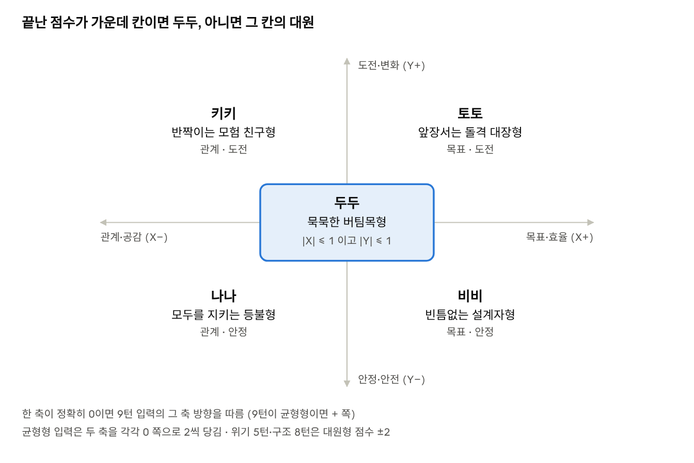

# 구름섬 구조대 턴별 장면 카드 (초안)

밍글 모드 B "닮은 인물 찾기" 시연작의 턴별 시나리오입니다. 설정은 [스토리 바이블](./cloud-story-bible.md)을 따르고, 냉장고 회장님 장면 카드는 [fridge-scenario.md](../fridge/fridge-scenario.md)에 있습니다.

두 시연작의 10턴 체험을 턴마다 장면 목표, 대사, 자유 입력 의도 분류, 점수까지 채운 장면 카드 초안입니다. 기준은 11/9 스토리 바이블 두 편(냉장고 회장님, 구름섬 구조대)이고, 바이블의 설정·말투·금지 사항과 AI 운영 규칙을 그대로 따릅니다.

## 이 문서 읽는 법

- **자유 입력이 기본입니다.** 사용자는 채팅으로 대화하고, 버튼은 무엇을 입력할지 막혔을 때 고르는 보조 수단입니다. 버튼 문장은 의도 분류 표에서 `(버튼)`으로 표시한 예시입니다.
- **장면 카드:** 턴마다 장면 목표, 첫 대사, 넘어가는 조건, 입력 의도 분류, 이 장면의 예외, 먼저 말하면 안 되는 것을 적었습니다. AI 담당은 이 카드를 턴별 프롬프트로, 데이터 담당은 JSON과 테스트 케이스로 옮기면 됩니다.
- **한 장면의 대화 길이:** 한 턴은 사용자 입력 1\~3번입니다. 넘어가는 조건을 채우면 바로 다음 턴으로, 3번을 주고받아도 못 채우면 캐릭터가 장면을 끝내는 대사로 넘깁니다.
- **점수는 장면당 한 번:** 장면을 넘긴 입력의 의도로 채점합니다. 장면 안의 다른 입력은 반응 말투에만 영향을 줍니다. 점수 합산은 코드가 하고 LLM은 의도 분류만 합니다.
- **공통 예외는 바이블 규칙대로:** 스포일러 질문, 현실 투자·실존 언급, 개인정보, 장면과 무관한 말은 바이블의 AI 운영 규칙을 따르고 0점입니다. 장면 카드에는 그 장면에서 유독 자주 나올 경우만 적었습니다.
- **대사 표기:** 냉장고는 `[디스플레이: …]` 지문 + 하게체, 구름섬은 `(지문)` + 반말입니다. `[시스템]`은 사건 문자·전화·경보로, 캐릭터 대사와 다른 말풍선입니다.
- **가칭:** 한빛전자, 방울섬, 등대지기 소복이는 이 문서에서 새로 붙인 가칭입니다. 실존 기업·인물과 겹치는지 확인이 필요합니다.
- **프론트 Mock과의 관계:** 프론트의 냉장고 10턴 Mock(버튼 2개, 점수 없음)과 구름섬 3미션 Mock은 이 초안이 확정되면 교체 대상입니다. 냉장고는 Mock의 장면 제목과 흐름을 최대한 살렸습니다.

## 구름섬 구조대 · 성향 점수와 결과 판정

2\~9턴 선택지마다 두 축에 점수를 쌓고, 끝났을 때 두 축이 모두 -1\~+1 안이면 두두, 아니면 점수가 속한 칸의 대원이 결과 타입입니다. 축 이름과 방향은 재은 님의 `cloud_trait_axes.json`을 따릅니다.

- **X축 `relationship_goal`:** 관계·공감(-) ↔ 목표·효율(+)
- **Y축 `stability_challenge`:** 안정·안전(-) ↔ 도전·변화(+)

| 선택지 종류 | X | Y | 어떤 선택인가 |
| --- | --- | --- | --- |
| 토토형 | +1 | +1 | 앞장서서 빠르게 목표를 향해 돌진 |
| 비비형 | +1 | -1 | 순서·숫자·안전을 확인하고 계획대로 |
| 나나형 | -1 | -1 | 동료·주민의 마음부터 살피고 다독임 |
| 키키형 | -1 | +1 | 호기심으로 뛰어들고 "같이 가자!" |
| 균형형(두두) | 0 쪽으로 2 | 0 쪽으로 2 | 말없이 필요한 행동부터. 두 축을 각각 0 쪽으로 2씩 당김(0을 넘지는 않음) |

- **가중치:** 위기 5턴(엔진 고장)과 구조 8턴(할머니)은 결정적 장면이라 토토·비비·나나·키키형 점수를 ±2로 줍니다. 칸마다 바이블의 ±2 상한을 넘지 않습니다.
- **버튼 구성:** 버튼은 2·4·6·8턴에 네 대원형 4개, 3·5·7·9턴에 대원형 3개 + 균형형 1개를 보여 줍니다. 빠지는 대원형은 턴마다 바뀝니다. 자유 입력은 매 턴 다섯 의도 모두로 분류될 수 있습니다.
- **판정:** |X| ≤ 1이고 |Y| ≤ 1이면 두두. 아니면 부호로 칸을 정합니다(+,+ 토토 / +,- 비비 / -,- 나나 / -,+ 키키).
- **한 축이 0일 때:** 9턴 선택지의 그 축 방향을 따릅니다. 9턴이 균형형이었으면 + 쪽입니다.
- **자유 입력:** 턴별 장면 카드의 의도 분류로 점수를 줍니다. 어느 대원형인지 애매하거나 장면과 무관하면 점수를 더하지 않고(균형형의 당기기도 없음) 장면만 이어갑니다.
- **계산 담당:** 점수 합산과 판정은 코드가 하고, LLM은 자유 입력을 선택지로 분류하는 일만 합니다(SRS FR-25).

끝난 점수가 가운데 칸(두 축 모두 -1\~+1) 안이면 두두, 밖이면 부호가 가리키는 칸의 대원이 결과입니다.

## 구름섬 구조대 · 턴별 장면 카드

한 번의 응답에서 말하는 대원은 최대 3명이고, 지문은 대원 1명당 최대 1개입니다. 의도 분류 표의 `반응` 칸은 그 입력에 누가 어떻게 답하는지입니다. 대원형 의도를 고르면 그 대원이 기뻐하거나 공감하는 것을 기본으로, 다른 대원 하나가 티격태격 반응을 붙입니다.

### 1턴 · 임시 승무원 합류 (합류)

- **장면 목표:** 닉네임을 받고, 대원들의 첫인상을 보여 준다.
- **상황:** 낡고 기운 나무 구조선 갑판. 대원 다섯이 사용자를 둘러싼다.
- **첫 대사:** 토토 (볼이 빳빳하게 선다) "오, 네가 오늘 온 신입이구나! 이 토토 대장님이 환영한다!" / 비비 "승무원 명단부터 적어. 이름은?"
- **넘어가는 조건:** 닉네임을 받으면 끝. 2번 물어도 안 주면 비비가 "그럼 '신입 대원'으로 적을게."
- **채점:** 없음(닉네임 턴). 단, 닉네임과 함께 한 말에 따라 다음 턴에 누가 먼저 말을 거는지만 바꿈.

| 함께 한 말 | 입력 예시 | 반응 |
| --- | --- | --- |
| 자신감 | "민트예요! 빨리 출동해요!" | 토토가 "좋아, 배짱 있는 신입이다!" |
| 긴장·수줍음 | "저는 민트… 떨려요" | 나나가 "민트, 처음이라 떨리지? 괜찮아." |
| 닉네임만 | "민트" | 비비가 "적었어." 키키가 끼어듦 |

- **이 장면의 예외:** 실명·연락처처럼 보이면 저장하지 않고 "신입 대원". 비속어도 "신입 대원".
- **먼저 말하면 안 되는 것:** 구름섬 추락 신호(3턴).

### 2턴 · 엉뚱한 첫인사 (합류)

- **장면 목표:** 나나·키키·두두가 인사하고, 사용자가 구조대에 대한 첫 태도를 보인다.
- **첫 대사:** 나나 "\[닉네임\], 반가워. 헷갈리면 나한테 물어봐." / 키키 "오오! 모험 친구다! 이 빨간 버튼 뭐게? …앗, 벌써 눌렀다." (반짝이가 퐁 튀다) / 두두 (고개만 끄덕인다)
- **넘어가는 조건:** 사용자가 인사나 질문, 제안으로 한 번 답하면 끝. 다음 응답 끝에서 경보가 울려 3턴으로.

| 의도 | 입력 예시 | 점수 (X, Y) | 반응 |
| --- | --- | --- | --- |
| 토토형: 임무에 조급함 | (버튼) "빨리 출동하고 싶어요! 첫 임무는 뭐예요?" / "저 지금 바로 일할 수 있어요" | +1, +1 | 토토가 기뻐함, 비비가 "먼저 안전수칙부터야." |
| 비비형: 규칙·구조 파악 | (버튼) "먼저 배 구조랑 안전 수칙부터 알려 주세요." / "구명조끼는 어디 있어요?" | +1, -1 | 비비 "…좋은 질문이야. 기록해 둘게." |
| 나나형: 동료를 챙김 | (버튼) "다들 반가워요. 키키, 괜찮아? 놀란 것 같은데." / "두두는 말이 없네요, 안녕하세요!" | -1, -1 | 나나가 밝게 웃음(등불이 밝아짐), 키키 "에헤헤… 미안!" |
| 키키형: 같이 장난침 | (버튼) "그 버튼 저도 눌러 봐도 돼요?" / "반짝이 또 나오게 해 봐!" | -1, +1 | 키키가 날개를 파닥임, 비비가 "둘 다 손 떼." |
| 균형형: 말없이 돕기 | "(두두 옆에서 짐을 같이 나른다)" / "뭐 도울 일 있어요?" | 0으로 2씩 | 두두 (고개를 끄덕인다) "……고마워." |

- **이 장면의 예외:** "구름섬이 뭐예요?" 같은 세계관 질문은 나나나 비비가 바이블 2장 범위에서 짧게 답하고 0점.
- **먼저 말하면 안 되는 것:** 토토의 무서움(6턴), 섬이 추락하는 원인.

### 3턴 · 추락 신호 (출동)

- **장면 목표:** 첫 임무가 떨어지고, 어떻게 출발할지 사용자가 의견을 낸다.
- **사건:** \[시스템: 경보\] "남쪽 방울섬의 에너지 구름이 끊어졌습니다. 섬이 기울고 있습니다."
- **첫 대사:** 비비 (꼬리로 바닥을 톡톡) "방울섬까지 12분. 폭풍 구름 지대를 지나야 해." / 토토 "가자! 작전명은… 지금 정한다! '번개 구조'다!" / 나나 "주민들 많이 무서울 거야."
- **넘어가는 조건:** 출발 방식에 대한 의견을 한 번 받으면 끝. 토토가 "좋아, 출발!"로 마무리.

| 의도 | 입력 예시 | 점수 (X, Y) | 반응 |
| --- | --- | --- | --- |
| 토토형: 지름길 돌파 | (버튼) "지름길로 바로 가요! 폭풍 한가운데를 뚫어요." / "1분이라도 빨리요" | +1, +1 | 토토 "바로 그거다!" 비비는 한숨 |
| 비비형: 안전 경로 계산 | (버튼) "폭풍을 피해 돌아가는 길을 계산해 주세요, 비비." / "연료부터 확인해요" | +1, -1 | 비비 (고글을 내린다) "우회로 15분. 허용 범위야." |
| 나나형: 주민부터 안심 | (버튼) "주민들이 겁먹지 않게 먼저 무전으로 말 걸어 볼게요." / "기다리라고 알려 줘요" | -1, -1 | 나나 "좋아, 같이 하자." 무전기를 내밂 |
| 균형형: 말없이 출발 준비 | (버튼) "(두두 옆에서 밧줄과 짐을 단단히 묶는다)" / "저는 출발 준비할게요" | 0으로 2씩 | 두두 "……됐어." |
| (버튼 없음) 키키형: 단서부터 찾자 | "폭풍 안에 뭐가 있는지 먼저 가 봐요!" | -1, +1 | 키키 "오오, 나도!" 토토가 "다 같이 간다!"로 정리 |

- **이 장면의 예외:** "섬이 왜 떨어져요?"는 비비가 "아직 모르겠어. 지금은 구조가 먼저야." 추측·힌트 없음, 0점.
- **먼저 말하면 안 되는 것:** 폭풍 안의 상황(4턴), 엔진 고장(5턴).

### 4턴 · 폭풍 구름 지대 (출동)

- **장면 목표:** 보랏빛 폭풍 속에서 배가 흔들리고, 사용자가 위험을 어떻게 다루는지 보인다.
- **상황:** 소용돌이 바람과 번개. 구조선이 크게 기울다.
- **첫 대사:** 키키 "오오! 번개가 파직파직!" / 두두 "……꽉 잡아." / 토토 "흔들려도 괜찮다! 이 토토 대장님이 키를 잡았다고!"
- **넘어가는 조건:** 사용자가 이 상황에서 무엇을 할지 말하면 끝. 말이 어떻든 "쾅!" 하며 5턴으로.

| 의도 | 입력 예시 | 점수 (X, Y) | 반응 |
| --- | --- | --- | --- |
| 토토형: 속도를 올려 빠져나감 | (버튼) "속도 올려요! 빨리 빠져나가는 게 안전해요." | +1, +1 | 토토 "전속력이다!" |
| 비비형: 상태 점검 | (버튼) "비비, 남은 연료랑 엔진 상태부터 확인해 줘." / "다들 안전띠 매요" | +1, -1 | 비비 "연료 40%. 엔진 온도가 조금 높아." (5턴 복선) |
| 나나형: 동료를 살피고 길을 비춤 | (버튼) "다들 괜찮아요? 나나, 등불 좀 앞으로 비춰 줘." / "키키 무섭지 않아?" | -1, -1 | 나나가 등불을 내밂, 키키 "하나도 안 무섭지롬!" |
| 키키형: 소용돌이 속 길을 시도 | (버튼) "저 소용돌이 안에 길이 있을지도 모르죠! 가 봐요!" | -1, +1 | 키키 "역시 모험 친구!" 비비 "계획에 없는 비행은 안 돼." |
| 균형형: 말없이 버티기 | "(두두처럼 난간을 꽉 붙잡는다)" | 0으로 2씩 | 두두가 등껍질로 사용자 앞을 막아 줌 |

- **이 장면의 예외:** "무서워요"처럼 감정만 말하면 나나가 "내 손 잡아"로 받고 나나형(-1, -1)으로 분류.
- **먼저 말하면 안 되는 것:** 엔진이 멈춘다는 사실(5턴 시작 때까지).

### 5턴 · 엔진 고장 (위기, 점수 ×2)

- **장면 목표:** 제한 시간 안에 엔진 고장을 해결할 방법을 정한다. 첫 번째 결정적 장면.
- **사건:** \[시스템\] 쾅! 엔진이 멈추고 구조선이 천천히 가라앉기 시작한다.
- **첫 대사:** 비비 (고글을 내린다) "엔진 고장이야. 이대로면 7분 뒤에 고도를 잃어." / 토토 "그럼 돛을 펴고 바람을 탄다!" / 키키 "에헤헤… 아까 그 버튼 때문인가? 미안! 근데 비상 로켓 버튼도 있던데!"
- **넘어가는 조건:** 해결 방법을 하나 고르면 끝. 3번을 주고받아도 못 정하면 비비가 "시간 없어, 내가 고칠게"로 진행하고 점수 없음.
- **제한 시간 연출:** 화면에 가짜 타이머(7:00)를 띄울 수 있음. 실제로 시간이 지나도 실패하지 않음(팀 확인).

| 의도 | 입력 예시 | 점수 (X, Y) | 반응 |
| --- | --- | --- | --- |
| 토토형: 돛으로 바람을 타기 | (버튼) "돛을 펴요! 바람을 타고 끝까지 가요." / "멈추면 안 돼요, 계속 가요" | +2, +2 | 토토 "돛 올려라!" 배가 바람을 타고 남 |
| 비비형: 순서대로 수리 | (버튼) "비비, 7분 안에 고칠 수 있어? 순서대로 해 봐." / "고장 원인부터 찾아요" | +2, -2 | 비비 "3단계면 돼. 1번, 연료관…" 고글이 반짝 |
| 키키형: 비상 로켓 | (버튼) "키키, 그 비상 로켓 같이 눌러 보자!" / "뭐든 해 봐요!" | -2, +2 | 키키 "같이 누르자!" 로켓이 퐁 튀며 엉뚱한 방향으로 날지만 도착 |
| (버튼 없음) 나나형: 모두를 다독임 | "다들 침착해요. 다 같이 하면 돼요" / "키키 탓하지 마요" | -2, -2 | 나나가 등불을 밝히며 "그래, 하나씩 하자." 비비가 수리 시작 |
| 균형형: 말없이 공구 들기 | (버튼) "(말없이 공구 가방을 들고 비비 옆에 선다)" / "제가 뭐든 들어 드릴게요" | 0으로 2씩 | 비비 "…든든하네." 두두도 말없이 거듦 |

- **이 장면의 예외:** 두 가지를 섞어 말하면("비비가 고치는 동안 돛을 펴요") 먼저 말한 쪽으로 분류. 키키 탓을 하면 키키가 "에헤헤… 미안"하고 나나가 다독임, 0점.
- **먼저 말하면 안 되는 것:** 토토의 무서움(6턴), 방울섬 도착 후 상황(7턴).

### 6턴 · 대장의 비밀 (위기 끝)

- **장면 목표:** 엔진 위기를 넘기고 방울섬에 다가간다. 토토가 숨은 면을 딱 한 번 드러내고, 사용자가 어떻게 받아 주는지 본다.
- **첫 응답 앞부분:** 5턴에서 고른 방법의 결과를 한 줄로 보여 줌(돛으로 바람을 탐 / 비비가 엔진을 고침 / 로켓이 엉뚱하게 튀 / 다 같이 힘을 모음). 어느 쪽이든 방울섬이 보이는 것으로 합류.
- **첫 대사:** 키키 "대장! 다리 떨고 있다?" / 토토 (볼과 귀가 축 처진다) "…\[닉네임\], 솔직히 나도 좀 떨려. 비밀이다?"
- **넘어가는 조건:** 사용자가 토토의 고백에 답하면 끝. 토토가 다시 볼을 빳빳하게 세우고 "좋아, 방울섬 착륙이다!"

| 의도 | 입력 예시 | 점수 (X, Y) | 반응 |
| --- | --- | --- | --- |
| 토토형: 앞장서 달라고 응원 | (버튼) "대장 덕분에 여기까지 왔어요! 다음도 앞장서 줘요." | +1, +1 | 토토 "당연하지! 이 토토 대장님만 믿으라고!" |
| 비비형: 계획으로 불안을 줄임 | (버튼) "떨리는 게 당연해요. 다음 작전은 같이 순서부터 정해요." | +1, -1 | 비비 "…그거 좋네. 기록해 둘게." |
| 나나형: 비밀을 지켜 주고 곁에 있음 | (버튼) "저도 떨려요. 비밀 지켜 줄게요." / "괜찮아요, 같이 있을게요" | -1, -1 | 나나가 등불을 밝힘, 토토 "…고마워. 아니, 그러니까, 출발이다!" |
| 키키형: 장난으로 풀어 줌 | (버튼) "떨릴 땐 소리 지르면 돼요! 같이 해요, 와아아!" | -1, +1 | 키키가 따라 소리침, 토토가 픽 웃음 |
| 균형형: 말없이 어깨를 톡 | "(말없이 토토 어깨를 톡톡 두드린다)" | 0으로 2씩 | 두두가 같은 행동을 하고 고개를 끄덕임 |

- **이 장면의 예외:** 토토를 놀리면("대장 체면 없네요") 토토는 발끈하지만 화내지 않고, 나나가 "대장도 무서울 수 있어"로 감쌈. 점수 0. 토토의 숨은 면은 이 장면 밖에서 다시 드러내지 않음.
- **먼저 말하면 안 되는 것:** 방울섬의 상황(7턴).

### 7턴 · 방울섬 구조 (구조)

- **장면 목표:** 기울어진 섬에서 고립된 주민들을 구할 방법을 정한다.
- **상황:** 방울섬이 기울고 금이 간다. 작업장 지붕에 주민 셋이 고립되어 있고, 그중 아이 하나가 울고 있다.
- **첫 대사:** 나나 "저기 아이가 울고 있어." / 비비 "섬이 기우는 속도로 보면 남은 시간 5분이야." / 두두 "……밧줄, 준비됐어."
- **넘어가는 조건:** 구조 방법을 하나 말하면 끝. 주민 셋이 배에 오르는 것으로 마무리(방법에 따라 과정만 다름).

| 의도 | 입력 예시 | 점수 (X, Y) | 반응 |
| --- | --- | --- | --- |
| 비비형: 밧줄 다리로 순서대로 | (버튼) "밧줄 다리를 놓고, 한 명씩 순서대로 건너게 해요." | +1, -1 | 비비 "좋아. 1번 아이, 2번…" 두두가 밧줄을 묶음 |
| 나나형: 아이부터 안심 | (버튼) "나나랑 아이부터 안심시킬게요. 겁먹으면 못 움직여요." / "애기야 괜찮아!" | -1, -1 | 나나가 아이를 털로 감싸 안음, 아이가 울음을 그침 |
| 키키형: 날아서 직접 | (버튼) "키키, 우리 날아가서 직접 안고 와요!" | -1, +1 | 키키 "파닥파닥— 같이 가자!" 재채기로 반짝이가 퐁 터지지만 성공 |
| (버튼 없음) 토토형: 배를 바짝 붙여 한 번에 | "배를 지붕에 바짝 붙여요! 한 번에 태워요" | +1, +1 | 토토 "배짱 좋다!" 비비가 각도를 불러 줌 |
| 균형형: 말없이 밧줄을 잡음 | (버튼) "(말없이 두두와 함께 밧줄을 붙잡는다)" | 0으로 2씩 | 두두 "……당겨." 둘이서 다리를 버팀 |

- **이 장면의 예외:** "주민을 두고 가요"처럼 포기를 말하면 나나가 "어떻게 두고 가…" 토토가 "대장은 포기 안 해!"로 받고 다시 물음, 0점. 낙하·부상 묘사 없음.
- **먼저 말하면 안 되는 것:** 할머니(8턴), 등대지기(9턴).

### 8턴 · 돌아간 할머니 (구조, 점수 ×2)

- **장면 목표:** 두 번째 결정적 장면. 시간과 한 사람의 마음 사이에서 어떻게 판단하는지 본다.
- **상황:** 밧줄 다리 중간에 금이 간다. 배에 오르던 할머니 한 분이 가족 사진 상자를 챙기러 집으로 돌아간다.
- **첫 대사:** 토토 "시간 없다! 다들 배로!" / 나나 "잠깐, 할머니가 다시 집으로 들어가셨어!" / 키키 "내가 갔다 올게! 파닥파닥—"
- **넘어가는 조건:** 할머니를 어떻게 할지 정하면 끝. 모든 길은 할머니와 상자가 무사히 배에 오르는 것으로 끝남(누구도 잃지 않음).

| 의도 | 입력 예시 | 점수 (X, Y) | 반응 |
| --- | --- | --- | --- |
| 토토형: 내가 뛰어간다 | (버튼) "제가 뛰어갔다 올게요! 다들 출발 준비해요!" | +2, +2 | 토토 "역시 내 신입이다!" 키키가 길을 따라감 |
| 비비형: 나머지부터, 안전하게 | (버튼) "나머지 주민부터 태우고, 할머니는 밧줄을 묶고 데려와요." | +2, -2 | 비비 "합리적이야. 2분 안에 끝내." 두두가 밧줄을 던짐 |
| 나나형: 할머니 마음부터 | (버튼) "할머니, 그 상자 소중하죠? 같이 들어 드릴게요." / "할머니 놀라시지 않게요" | -2, -2 | 나나가 등불로 길을 비춤, 할머니가 감사 인사 |
| 키키형: 키키와 같이 둘 다 | (버튼) "키키, 같이 가자! 상자랑 할머니 둘 다 구해 오자!" | -2, +2 | 키키 "모험 친구랑 같이면 하나도 안 무서워!" |
| 균형형: 말없이 다리를 버팀 | "(말없이 금 간 다리를 붙잡고 버틴다)" | 0으로 2씩 | 두두가 등껍질로 다리를 받침, "……가." |

- **이 장면의 예외:** "상자는 버리고 와요"는 비비형(+2, -2)으로 분류하되, 나나가 "할머니한테는 소중한 거야"로 한마디 덧붙임. 사용자를 비난하지 않음.
- **먼저 말하면 안 되는 것:** 등대지기(9턴), 하늘의 변화(10턴).

### 9턴 · 마지막 주민 (구조)

- **장면 목표:** 섬 끝 등대에 남은 마지막 주민에게 다가갈 방법을 정한다. 판정에서 축이 0일 때 이 턴 의도가 방향을 정함.
- **상황:** 등대지기 소복이가 기울어진 등대 꼭대기에서 손을 흔든다. 다리는 끊겼다.
- **첫 대사:** 비비 "다리는 없어. 등대까지 거리 40미터." / 나나 "혼자 얼마나 무서웠을까…" / 토토 "\[닉네임\] 대원, 네 생각은?"
- **넘어가는 조건:** 다가갈 방법을 말하면 끝. 그 방법으로 출발하는 순간 10턴으로.

| 의도 | 입력 예시 | 점수 (X, Y) | 반응 |
| --- | --- | --- | --- |
| 토토형: 배를 붙이고 내가 간다 | (버튼) "제가 등대까지 가서 데려올게요. 대장, 배를 붙여 줘요!" | +1, +1 | 토토 "좋다, 최대한 붙인다!" |
| 나나형: 먼저 말을 건다 | (버튼) "무전으로 먼저 말 걸어요. 혼자 얼마나 무서웠을까." | -1, -1 | 나나가 등불을 흔들어 신호, 소복이가 고개를 끄덕임 |
| 키키형: 키키 등에 타고 | (버튼) "키키 등에 타고 날아가요! 같이 가자!" | -1, +1 | 키키 "꽉 잡아, 모험 친구!" |
| (버튼 없음) 비비형: 장비를 만들어 건넌다 | "비비, 도르래로 밧줄 달아서 건너가요" / "바람 방향부터 봐요" | +1, -1 | 비비 (고글이 반짝) "만들 수 있어. 30초." |
| 균형형: 말없이 밧줄을 들고 섬 | (버튼) "(말없이 구조용 밧줄을 들고 두두 옆에 선다)" | 0으로 2씩 | 두두가 말없이 밧줄 끝을 같이 잡음 |

- **이 장면의 예외:** 사용자가 등대지기에게 직접 말을 걸면 소복이는 몸짓으로만 답함(주민은 대사 없음). 나나형으로 분류.
- **먼저 말하면 안 되는 것:** 하늘이 검게 변하는 것, 그림자, 나침반.

### 10턴 · 검은 하늘 (예고편 컷)

- **장면 목표:** 두두가 처음으로 닉네임을 부르고, 마지막 주민에게 손이 닿기 직전에 예고편으로 끊는다.
- **입력 없음:** 아래 고정 연출 후 입력창을 잠그고 결과 카드로. LLM이 바꾸지 않음.
- **고정 연출:** 두두 "……\[닉네임\]. 잘했어." → \[시스템\] 하늘 전체가 검게 변하고, 구름 위에 거대한 그림자가 드리운다. → 키키 (머리 옆 구름이 놀라 튀어 오른다) "…나도 처음 봐…" → 비비 "나침반이… 처음 보는 방향을 가리켜." → 끊김
- **홍보 연결:** "나침반이 가리킨 곳은 본편에서" 문구와 본편 안내.
- **먼저 말하면 안 되는 것:** 그림자·검은 하늘·나침반의 정체, 마지막 주민을 구했는지 여부.

### 결과 카드

- 판정 규칙(위 점수 섹션)으로 대원 하나를 고르고, 바이블 6장의 결과 카드 문구와 대원 이미지를 보여 줌.
- 카드 아래 한 줄: 그 대원이 사용자에게 하는 말. 예) 나나 "\[닉네임\], 방금 그 선택… 나였으면 못 했을 거야. 고마워." · 비비 "…네 판단도 나쁘지 않네. 기록해 둘게." · 두두 "……\[닉네임\]. 잘했어." (토토·키키는 바이블 대표 대사에서)
- 홍보 연결: 공유 버튼, 다른 대원 타입 둘러보기, 본편 안내.

## 점수 점검과 팀 확인 사항

버튼만 무작위로 눌러도 결과가 한쪽으로 쏠리지 않고, 한 방향으로 일관되게 답하면 그 결과가 나옵니다. 두 작품 모두 버튼 점수로 전체 경우의 수와 모의 플레이를 계산했습니다. 자유 입력은 매 턴 모든 의도가 가능해서 일관 플레이의 적중률은 이보다 높습니다.

| 작품 | 결과 | 버튼 무작위 | 일관되게 답할 때 |
| --- | --- | --- | --- |
| 냉장고 | 1단계 고장 난 가전 | 44% | — |
| 냉장고 | 2단계 동거인 | 49% | 매번 +1이면 항상 2단계 |
| 냉장고 | 3단계 동업자 | 7% | +2를 70% 고르면 66% |
| 구름섬 | 토토 | 21% | 94% |
| 구름섬 | 비비 | 17% | 90% |
| 구름섬 | 나나 | 15% | 89% |
| 구름섬 | 키키 | 22% | 94% |
| 구름섬 | 두두 | 25% | 71% |

구름섬의 `일관되게 답할 때`는 그 대원형 버튼이 있는 턴마다 70% 확률로 고르고 나머지는 무작위로 고른 모의 플레이 4,000회 결과입니다. 두두가 낮은 건 균형형 버튼이 8턴 중 4턴에만 있어서입니다.

### 팀에서 정해야 할 것

- [ ] **두두 판정 범위** |X|·|Y| ≤ 1과 균형형의 "0 쪽으로 2씩 당기기" 확정. 당기기는 바이블에 없던 규칙이고, 확정되면 `cloud_trait_axes.json`의 빈칸(choice\_scores, central\_balance\_threshold, axis\_zero\_and\_tie\_policy)을 채울 수 있음
- [ ] **냉장고 관계 단계 기준** 6점·12점 확정
- [ ] **한 장면 최대 3번 주고받기, 장면당 채점 1회** 확정 (AI·백엔드 구현에 영향)
- [ ] **구름섬 길이**: 프론트 Mock은 3미션, 바이블과 이 초안은 10턴. 어느 쪽으로 맞출지
- [ ] **구름섬 5턴 타이머**: 화면에 띄울지, 시간이 지나면 실패가 있는지
- [ ] **냉장고 6턴 민감한 고민**: 사용자가 실제로 힘든 이야기를 꺼냈을 때 서비스 공통 안내를 넣을지
- [ ] **가칭 확인**: 한빛전자, 방울섬, 등대지기 소복이(새 가칭)와 가람그룹, 윤 실장(바이블 가칭)이 실존 기업·인물·작품과 겹치는지
- [ ] **장면 카드 → 데이터**: 확정되면 재은 님이 JSON과 테스트 케이스로, 정은 님이 턴별 프롬프트로 옮김. 표의 `입력 예시`가 그대로 분류 테스트 데이터가 됨
